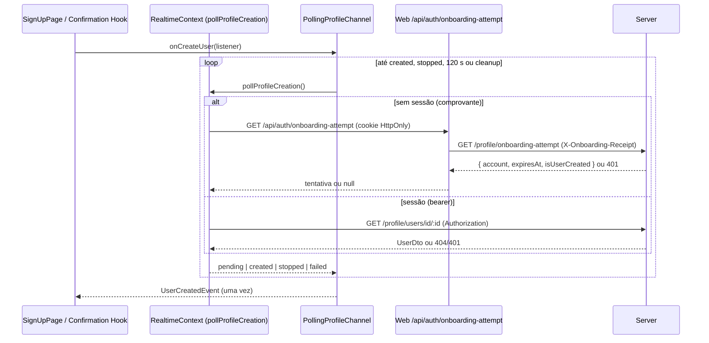

# Context and scope

A Issue #643 (label `refactor`, sem milestone nem PRD associado) pede substituir o client
Supabase Realtime do Web por polling nos fluxos de cadastro, confirmação de conta por email e
confirmação de conta social, preservando o contrato `ProfileChannel` do Core. A espera pela
criação do perfil é curta e única; o stream SSE do Server já consulta o banco a cada segundo por
conexão, então polling no cliente entrega latência equivalente sem conexão longa, buffering de
proxy ou ciclo de vida de stream.

**Estado atual verificado:**

- `apps/web/src/ui/global/contexts/RealtimeContext/useRealtimeContextProvider.ts` compõe
  `SupabaseProfileChannel(SupabaseClient())`, que escuta todo `INSERT` em `public.users` e filtra
  por email nas páginas.
- O PR #609 (Issue #602, Spec `documentation/features/global/supabase-replacement-with-drizzle/`,
  `superseded`) entregou `SseProfileChannel`, a rota BFF `/api/auth/profile-events` e o
  `GET /profile/events` do Server, mas nada compõe o adapter SSE: é código morto.
- `SignUpPage` assina `useProfileSocket` na montagem, antes do envio do formulário; o comprovante
  `@stardust:onboarding-attempt` (cookie HttpOnly, path `/api/auth`) só existe depois de
  `POST /api/auth/sign-up` bem-sucedido.
- `GET /profile/onboarding-attempt` autoriza pelo `X-Onboarding-Receipt` e retorna
  `{ account, expiresAt, isUserCreated }`; o BFF `/api/auth/onboarding-attempt` encaminha o cookie
  e responde `null` para tentativa ausente ou expirada.
- `GET /profile/users/id/:id` (bearer) já é usado por `AuthContext` e responde 404 enquanto o
  perfil não existe.
- `OnboardingService` existe no Core e no Web, mas nenhum composition root o instancia.
- `ServerProviders/index.tsx` renderiza `<ClientProviders>` (que monta `RestContextProvider` e
  `RealtimeContextProvider`) **em volta** de `<AuthContextProvider>`. Como `AuthContext` tem default
  `{}`, `useAuthContext()` dentro de Rest/Realtime devolve `account`/`accessToken` indefinidos: o
  `restClient` do `RestContext` nunca recebe o bearer e as chamadas do browser dependem de
  401 → refresh-session → retry; um composition root de Realtime não enxergaria a sessão.

**Resultado:** os três fluxos recebem `UserCreatedEvent` por `PollingProfileChannel`, composto em
`RealtimeContext`; o Web não possui client, variáveis de ambiente nem dependências Supabase; o SSE
morto sai do Server e do Web; o comportamento visível das páginas permanece o atual.

**Modo:** completo. A entrega alcança fluxos de autenticação/onboarding em quatro workspaces
(`@stardust/core`, `@stardust/web`, `@stardust/backoffice`, `@stardust/server`), remove uma
superfície de autorização do Server e altera um port do Core. Não há migration nem mudança
visual.

**Rastreabilidade:** a Issue não associa PRD. Por ser refactor, a fronteira de comportamento
preservado é a própria Issue e o comportamento atual das páginas; não há `RP-*`/`JN-*`.

**Fora de escopo:**

- Contrato HTTP de `GET /profile/onboarding-attempt` e da rota BFF `/api/auth/onboarding-attempt`.
- Retomada de tentativa na UI de cadastro e feedback de expiração na página de cadastro.
- Alteração do contrato `ProfileChannel`, de `ProfileChannelMock` ou do `ServerMock`.
- Penpot e qualquer mudança visual.
- Variáveis `NEXT_PUBLIC_SUPABASE_*` configuradas fora do repositório (Coolify/Vercel).
- Infraestrutura local `docker/`: serviço `supabase-realtime`, publicação `supabase_realtime` e
  `SELECT` em `public.users` para `anon`/`authenticated`.
- Encaminhamento do IP do cliente pelo BFF ao rate limiter do Server.

**Follow-ups registrados (não bloqueiam esta entrega):**

1. Remover `NEXT_PUBLIC_SUPABASE_URL`/`NEXT_PUBLIC_SUPABASE_PUBLISHABLE_KEY` dos ambientes de
   implantação do Web.
2. Remover a dependência do Realtime local: publicação `supabase_realtime` de `public.users` e
   `SELECT` para `anon`/`authenticated`, com validação própria de infraestrutura.
3. Fazer o BFF encaminhar o IP do cliente (`X-Forwarded-For` + `TRUSTED_PROXY_CIDRS`) para que o
   limite `general` por IP deixe de ser compartilhado entre cadastros simultâneos.

# Implementation Contract

## Requisitos funcionais

| RF | Requisito |
| --- | --- |
| RF-01 | `PollingProfileChannel` implementa `ProfileChannel` por polling: consulta imediata, intervalo de 2000 ms após `pending`, no máximo uma consulta em voo, backoff exponencial até 8000 ms em falha transitória, entrega única de `UserCreatedEvent`, parada em `stopped`, timeout de 120 s e cleanup idempotente. |
| RF-02 | `RealtimeContext` compõe `PollingProfileChannel` com a função de consulta derivada da sessão: bearer via `ProfileService.fetchUserById(account.id)` quando há conta autenticada com `accessToken`; comprovante via `ProfileService.fetchOnboardingAttempt()` quando não há sessão; canal injetado (testes) tem precedência. A composição raiz monta `AuthContextProvider` acima de `RestContextProvider` e `RealtimeContextProvider`, de modo que ambos leem a sessão real. |
| RF-03 | `useProfileSocket` aceita `enabled` e mantém a assinatura estável entre re-renders; `SignUpPage` só assina depois de `requestSignUp` bem-sucedido. As páginas de confirmação por email e social preservam o comportamento atual. |
| RF-04 | O port `ProfileService` do Core expõe `fetchOnboardingAttempt()`; o Web o implementa contra a API same-origin `/api`; o Backoffice lança `MethodNotImplementedError`; `OnboardingService` é removido do Core e do Web. |
| RF-05 | O SSE é removido: `GET /profile/events`, `createProfileCreationStream`, `authorizeProfileStream`, a rota BFF `/api/auth/profile-events`, sua entrada no allowlist do middleware e `SseProfileChannel`. `ProfileEventsRouter` vira `OnboardingAttemptsRouter`, mantendo `GET /profile/onboarding-attempt` inalterado e documentado em `.rest`. |
| RF-06 | O Web não possui client, tipos, variáveis de ambiente, dependências nem variáveis de CI Supabase. |
| RF-07 | Architecture, Rules, Tooling e Infrastructure descrevem o adapter de polling e deixam de descrever o Supabase Realtime/SSE como transporte do Web. |
| RF-08 | (rev. 4) O login não remonta a página de sign-in quando a conta passa a existir no layout raiz: `FeedbackLayout` permanece montado e apenas alterna `isEnabled`. |

## Critérios de aceitação

| CA | RF | Dado | Quando | Então | Evidência esperada |
| --- | --- | --- | --- | --- | --- |
| CA-01 | RF-01 | Uma assinatura `onCreateUser` cuja consulta retorna `pending` | A assinatura começa e o tempo avança | A primeira consulta ocorre imediatamente e as seguintes a cada 2000 ms após a conclusão da anterior; enquanto uma consulta não resolve, nenhuma outra é iniciada | AV-02 |
| CA-02 | RF-01 | Consultas que retornam `failed` (inclui 429, 5xx, rede) ou rejeitam | O polling continua | Os atrasos seguintes são 4000, 8000 e 8000 ms; após um `pending`, o atraso volta a 2000 ms; nenhum evento é entregue por falha | AV-02 |
| CA-03 | RF-01 | Uma consulta retorna `created` com payload | O resultado chega | O listener recebe exatamente um `UserCreatedEvent` com `userId`, `userName`, `userEmail` e `userSlug` do payload e nenhuma consulta posterior ocorre | AV-02 |
| CA-04 | RF-01 | Uma consulta retorna `stopped` | O resultado chega | Nenhum evento é entregue e nenhuma consulta posterior ocorre | AV-02 |
| CA-05 | RF-01 | Uma assinatura ativa | 120 s se passam sem `created`, ou o cleanup é chamado (inclusive duas vezes, ou com consulta em voo) | Nenhuma consulta é iniciada depois disso, uma resposta tardia é ignorada, o listener nunca é chamado e o cleanup repetido não lança erro | AV-02 |
| CA-06 | RF-02 | Conta autenticada com `accessToken` | O canal composto consulta | Chama `fetchUserById(account.id)`; 2xx → `created` com payload de `User.create(body)`; 404 → `pending`; 401/403 → `stopped`; demais falhas → `failed`; nenhum id vem de payload do cliente | AV-01 |
| CA-07 | RF-02 | Conta autenticada ainda sem `accessToken` | O canal composto consulta e, depois, o token chega | Sem token, nenhuma requisição é feita e o resultado é `stopped`; com token, o contexto expõe um novo `profileChannel` que consulta por bearer | AV-01 |
| CA-08 | RF-02 | Nenhuma conta autenticada | O canal composto consulta | Chama `fetchOnboardingAttempt()`; corpo `null` → `stopped`; `isUserCreated: true` → `created` com `userId`/`userEmail`/`userName` da tentativa e `userSlug` de `Name.create(name).slug`; `isUserCreated: false` → `pending`; 401/403 → `stopped`; demais falhas → `failed` | AV-01 |
| CA-09 | RF-02 | `RealtimeContextProvider` recebe `profileChannel` (ambiente `testing`) | O contexto é criado | O canal injetado é exposto e nenhuma consulta de polling é feita, porque o canal de polling composto só consulta em `onCreateUser` | AV-03 |
| CA-10 | RF-03 | Página `/auth/sign-up` sem cadastro enviado | O formulário é exibido, depois enviado com sucesso, e a página re-renderiza enquanto aguarda | Antes do envio não há assinatura no `ProfileChannel`; depois do envio há exatamente uma, que não é refeita por re-render; o sucesso inline e o toast só aparecem após `UserCreatedEvent` do mesmo email | AV-03 |
| CA-11 | RF-03 | Páginas `/auth/account-confirmation` e `/auth/social-account-confirmation` | Ocorrem eventos de criação | Os cenários existentes de confirmação, filtro por conta/email, retry e login social continuam passando; os Hooks das páginas só assinam o canal enquanto o perfil não existe (D-13), sem ciclo de reassinatura | AV-03 |
| CA-12 | RF-04 | Core, Web e Backoffice compilam contra o port | Os typechecks rodam | `ProfileService.fetchOnboardingAttempt()` existe no port; o Web chama `GET /auth/onboarding-attempt` no client same-origin `/api`; o Backoffice lança `MethodNotImplementedError('fetchOnboardingAttempt')`; não há referência a `OnboardingService` | AV-05, AV-06 |
| CA-13 | RF-05 | Server com `OnboardingAttemptsRouter` | Um cadastro gera comprovante e consulta a tentativa | `GET /profile/onboarding-attempt` mantém status e corpo atuais; o comprovante continua sem autorizar rotas protegidas; não há rota, middleware nem helper SSE | AV-04, AV-05 |
| CA-14 | RF-05 | Web sem SSE | Requisição anônima a `/api/auth/profile-events` | A resposta não é `200` nem `text/event-stream`; `middleware.ts` libera somente `/api/auth/sign-up` e `/api/auth/onboarding-attempt` entre as rotas BFF de onboarding; `SseProfileChannel` não existe | AV-03, AV-05 |
| CA-15 | RF-06 | Workspace `@stardust/web` | Os checks e o CI do Web rodam | Não há import `@supabase/`, dependências `@supabase/*`, script `db:types`, variável `NEXT_PUBLIC_SUPABASE_*` em código, config, `.env.example` ou `web-app-ci.yaml` | AV-05, AV-06 |
| CA-16 | RF-01, RF-02, RF-03, RF-06 | Stack local real (Server, Web, Auth, Inngest, Mailpit) | Um usuário real se cadastra em `/auth/sign-up` | O sucesso inline e o toast aparecem; `POST /api/auth/sign-up` retorna 201; `GET /api/auth/onboarding-attempt` retorna 2xx a cada ~2 s e para após `isUserCreated`; não há WebSocket/Supabase nem `/api/auth/profile-events` | MV-01 |
| CA-17 | RF-02, RF-03 | Conta do CA-16 com email de confirmação no Mailpit | O link de confirmação é aberto no navegador | `/auth/account-confirmation` exibe o estado de sucesso e `GET /profile/users/id/:id` retorna 200 com `Authorization`, sem 401 nem `refresh-session` antes dele, e sem repetição de consultas depois que o perfil existe | MV-02 |
| CA-18 | RF-07 | Documentação normativa | A entrega é revisada | Os documentos listados no alinhamento documental descrevem `PollingProfileChannel`, não descrevem client Supabase nem SSE como transporte atual do Web e `widget-tests-rules.md` declara que hooks globais não recebem testes dedicados | AV-05 |
| CA-19 | RF-02 | Layout raiz com `AuthContextProvider` acima de Rest e Realtime | Qualquer jornada Web é renderizada | `useAuthContext()` em `RestContext`/`RealtimeContext` recebe o valor real; com sessão, o `restClient` do `RestContext` envia o bearer; todas as jornadas da suíte de integração Web continuam passando | AV-03, MV-02 |
| CA-20 | RF-08 | `SignInPage` com a animação do foguete | O login é bem-sucedido e o layout raiz recebe `accountDto` | A árvore da página não é desmontada nem remontada até a navegação para `/space`; `FeedbackLayout` segue montado e só muda `isEnabled`; páginas anônimas mantêm o layout atual (wrappers `display: contents`); `FeedbackDialog` só renderiza com conta, fora de rotas públicas e após `isDialogReady`; `useSignInPage` não usa `sessionStorage` | AV-07, AV-03, MV-03 |

**Limitação aceita (Q4):** quando o polling expira ou para sem `created`, a página de cadastro
permanece no estado de envio, como hoje ocorre quando o evento Supabase é perdido. As páginas de
confirmação mantêm o retry exibido após 7 s. Não há sinal de expiração em `ProfileChannel`.

**Segurança:** o `accountId` consultado vem sempre da sessão verificada (`account.id` com bearer) ou
do comprovante assinado lido pelo BFF a partir do cookie HttpOnly; o cliente nunca escolhe id ou
email. Tokens, comprovantes e cookies não são registrados em logs, testes ou Evaluation.

## Design Contract

Não aplicável: a entrega não altera composição visual, estados visuais nem viewports. O arquivo
Penpot `stardust` não entra no escopo e não há `VV-*`. As mudanças em widgets são a ligação de
`useProfileSocket` no Entry Point `SignUp/index.tsx` e a ordem dos providers não visuais do layout
raiz (`ClientProviders`/`ServerProviders`).

**Matriz de auditoria estrutural de UI:**

| Widget / unidade | Entry Point | View | Hook | Regra aplicável |
| --- | --- | --- | --- | --- |
| `SignUpPage` | `apps/web/src/ui/auth/widgets/pages/SignUp/index.tsx` (Modify: passa `{ enabled: userEmail !== null }`) | `SignUpPageView.tsx` (inalterada) | `useSignUpPage.ts` (inalterado; já retorna `userEmail`) | UI Rules: dependências resolvidas no Entry Point; Hook sem context |
| `RealtimeContextProvider` | `apps/web/src/ui/global/contexts/RealtimeContext/index.tsx` (Modify: resolve `useRestContext`/`useAuthContext`) | Não há View (context) | `useRealtimeContextProvider.ts` (Modify: recebe dependências por parâmetro) e `useProfileCreationPolling.ts` (Create: compõe o canal de polling) | UI Rules (integração na borda) e Realtime Rules (composition root) |
| `ClientProviders` | `apps/web/src/ui/global/widgets/layouts/Root/ClientProviders/index.tsx` (Modify: recebe e repassa `accessToken`) | `ClientProvidersView.tsx` (Modify: renderiza `AuthContextProvider` acima de `RestContextProvider` e do provider realtime) | Não há Hook | UI Rules (View só renderiza providers recebidos por props). Desvio pré-existente aceito: o `useEffect` de inicialização do PostHog no Entry Point (`index.tsx`) viola a "Regra do Entry Point", não é alterado nesta entrega e deve ser citado assim na auditoria de UI do Evaluation |
| `ServerProviders` | `apps/web/src/ui/global/widgets/layouts/Root/ServerProviders/index.tsx` (Modify: passa `accessToken` a `ClientProviders`, não renderiza `AuthContextProvider` e sempre monta `FeedbackLayout` com `isEnabled`, D-14) | Não há View | Não há Hook | UI Rules (integração na borda). Desvio pré-existente aceito: o Server Component assíncrono de composição não tem `*View.tsx` ("Regra estrutural"); esta entrega não cria View e a auditoria de UI cita o desvio como pré-existente |
| `FeedbackLayout` (rev. 4) | `apps/web/src/ui/reporting/widgets/layouts/FeedbackLayout/index.tsx` e `FeedbackLayoutClient.tsx` (Modify: repassam `isEnabled`, default `true`) | `FeedbackLayoutView.tsx` (Modify: wrappers sempre renderizados; só renderiza por props) | `useFeedbackLayout.ts` (Modify: `function`, retorna `classNames` e `isDialogVisible`) | UI Rules (View só renderiza; Hook concentra a lógica); Widget Tests Rules (hook de widget com teste) |
| `SignInPage` (rev. 4) | `SignIn/index.tsx` (inalterado) | `SignInPageView.tsx` (inalterada) | `useSignInPage.ts` (Modify: remove o workaround de `sessionStorage`) | UI Rules; testes do hook existentes |
| `useProfileSocket` | Não se aplica (hook global) | Não se aplica | `apps/web/src/ui/global/hooks/useProfileSocket.ts` (Modify) | Realtime Rules (consumer hook fino); hooks globais não recebem teste dedicado (Widget Tests Rules, alterada nesta entrega) |

# Technical Contract

## Decisões técnicas

| Decisão | Escolha | Alternativas descartadas | Motivo e impacto |
| --- | --- | --- | --- |
| D-01 (Q1) | Fluxos bearer consultam `GET /profile/users/id/:id`; 404 = pendente | Novo endpoint bearer de prontidão | Endpoint existente, autorizado por bearer e já usado por `AuthContext`; nenhuma mudança no Server. |
| D-02 (Q2) | `useProfileSocket(listener, { enabled })`; `SignUpPage` habilita após envio | Polling desde a montagem; assinatura dentro de `useSignUpPage` | Sem comprovante a consulta retorna `null`; habilitar após envio evita requisições inúteis e preserva o hook documentado. |
| D-03 (Q3, Q13) | 2000 ms, backoff ×2 até 8000 ms, timeout 120 s, cadeia de `setTimeout` | 1000 ms; `setInterval` | `GET /profile/onboarding-attempt` cai na política `general` (100 req/min por IP) e o BFF não encaminha o IP do cliente: todos os cadastros simultâneos compartilham o balde do IP do Web. 2000 ms reduz pela metade a carga; 429 segue o backoff. |
| D-04 (Q4) | Timeout silencioso | Callback de expiração no `ProfileChannel` | Refactor preserva o contrato do Core e o comportamento visível atual. |
| D-05 (Q5) | Remover SSE do Server e do Web | Manter documentado como não usado | Código morto com superfície própria de autorização (decodificação de `exp` do bearer) e ciclo de vida de stream. |
| D-06 (Q6, Q8, Q14) | Composição do canal extraída para o hook do context `RealtimeContext/useProfileCreationPolling.ts`, testado em `RealtimeContext/tests/useProfileCreationPolling.test.ts` com o adapter real | Teste em `realtime/**` (fora dos locais permitidos); `RealtimeContext/tests/useRealtimeContextProvider.test.ts` (nome `*Provider.test.ts` rejeitado por `FORBIDDEN_TEST_SUBJECT_PATTERNS`); teste em `ui/global/hooks/tests` (hooks globais não recebem testes) | Único alvo permitido que executa o adapter real; a regra de hooks globais passa a constar de `widget-tests-rules.md`. |
| D-07 (Q7) | Remover client, env, deps e CI Supabase do Web no repositório | Manter variáveis sem uso | Nenhum outro import `@supabase/` em `apps/web/src`. |
| D-08 (Q9, Q9a) | `ProfileEventsRouter` → `OnboardingAttemptsRouter`; path inalterado | Manter nome; pluralizar path | O router deixa de servir eventos; o path é consumido pelo BFF e por testes. |
| D-09 (Q10, Q12) | `fetchOnboardingAttempt` no port `ProfileService`; Web com segundo client same-origin; Backoffice com `MethodNotImplementedError` | `OnboardingService` no `RestContext`; método só no Web | Mantém `RealtimeContext` dependente apenas de ports do Core; segue o precedente `AuthService(restClient, signUpRestClient)` e `MethodNotImplementedError` do Backoffice. |
| D-10 (Q14) | `AuthContextProvider` passa a ser renderizado em `ClientProvidersView`, acima de `RestContextProvider` e do provider realtime; `ClientProviders` recebe `accessToken` | Manter a ordem e montar só o provider realtime dentro de `AuthContextProvider` (exigiria expor o `profileService` do Auth ou um terceiro client, e manteria o `RestContext` sem bearer) | É a ordem que o código já presume (`useRestContextProvider` lê `useAuthContext().accessToken`); remove o 401 + refresh por requisição do `RestContext`; mudança de composição raiz exige a suíte completa de integração Web. |
| D-12 (MV-02, rev. 3) | O header `Authorization` do `restClient` do `RestContext` é aplicado durante o render em `useRestContextProvider`, não em `useEffect` | Manter o `useEffect` | Efeitos de descendentes (o polling) rodam antes do efeito do provider: a primeira consulta saía sem bearer, recebia 401 e acionava `refresh-session` (viola CA-17). O padrão já é o de `AuthContextProvider`. |
| D-13 (MV-02, rev. 3) | `useAccountConfirmationPage` e `useSocialAccountConfirmationPage` assinam `onCreateUser` somente enquanto `user` é nulo (`if (!account \|\| user) return`, `user` nas deps) | Manter a assinatura incondicional | Com polling, uma assinatura nova entrega `created` imediatamente quando o perfil já existe; `onRefetchUser` re-renderiza, o effect reassina e o ciclo se repete (49 consultas em 8 s observadas em MV-02). Com Supabase o evento só ocorria no INSERT. |
| D-14 (ACH-07, rev. 4) | `ServerProviders` sempre renderiza `<FeedbackLayout isEnabled={Boolean(accountDto)}>`; `FeedbackLayout` (default `isEnabled = true`, pois o layout de `challenge` também o usa) mantém os dois wrappers e, desabilitado, aplica `display: contents`; `FeedbackDialog` só aparece habilitado, pronto e fora de rota pública; `useSignInPage` perde o workaround de `sessionStorage` | Envolver `children` condicionalmente por conta (estado anterior); manter o workaround de `sessionStorage` | O wrapper condicional mudava a posição da página na árvore no instante do login: `SignInPage` era desmontada ~560 ms depois do envio e a animação do foguete reiniciava (observado no navegador); o workaround só restaurava o estado. Mantendo a mesma estrutura DOM o remount some. Pedido diretamente pelo usuário; revisão 4. |
| D-11 (revisão rev. 1) | `useProfileSocket` guarda o listener em ref e assina só quando `profileChannel` ou `enabled` mudam | Memoizar `handleUserCreated` em `useSignUpPage` | `handleUserCreated` não é memoizado; sem a ref, cada re-render reiniciaria o polling (consulta imediata e novo deadline). A correção fica no hook consumidor e protege qualquer consumidor futuro. |

## Conceitos novos

**`PollingProfileChannel` (camada Realtime do Web).** Adapter que implementa `ProfileChannel`
consultando periodicamente uma função injetada, em vez de manter uma conexão aberta. Cada chamada a
`onCreateUser(listener)` cria uma assinatura independente com estado próprio (flag de parada,
atraso atual, deadline e timers); nada é compartilhado entre assinaturas. Ele não conhece REST,
sessão nem Supabase: recebe `pollProfileCreation` do composition root e só interpreta o resultado
tipado. Fonte de verdade: o banco do Server, lido via REST a cada consulta. Exemplo: com
`pending, pending, created`, as consultas ocorrem em t=0, t≈2 s e t≈4 s, o listener é chamado uma
vez e a assinatura termina.

**`ProfileCreationPoll` (tipo da camada Realtime).** Resultado de uma consulta, discriminado por
`status`: `pending` (continuar no intervalo base), `created` (entregar e parar), `stopped` (parar sem
evento: credencial ausente, inválida ou expirada) e `failed` (erro transitório: aplicar backoff). É o
contrato entre o composition root, que traduz `RestResponse` em status, e o adapter, que decide o
agendamento.

**`useProfileCreationPolling` e `pollProfileCreation` (composition root).** Hook do context
`RealtimeContext` que recebe `ProfileService`, `account` e `accessToken`, cria a função
`pollProfileCreation` e devolve um `PollingProfileChannel` memoizado. A função decide o transporte
da credencial (bearer ou comprovante) e traduz respostas HTTP em `ProfileCreationPoll`.
`useRealtimeContextProvider` chama esse hook sempre (regra dos hooks) e expõe o canal injetado,
quando houver, ou o canal de polling. A direção de dependência é UI context → port
`ProfileService` → adapter REST; o adapter Realtime só recebe a função. Criar o canal não abre
requisição: o polling só começa em `onCreateUser`.

**Ordem dos providers raiz.** `ServerProviders` (Server Component) resolve `accountDto` e
`accessToken` e renderiza `ClientProviders`, que renderiza
`TooltipProvider > AuthContextProvider > RestContextProvider > RealtimeContextProvider (ou
TestingRealtimeContextProvider) > EditorProvider > children`. `FeedbackLayout` é sempre
filho (D-14), habilitado apenas quando há conta. `AuthContextProvider` depende apenas de Toast, Audio e Nuqs, que permanecem
acima de `ClientProviders`.

## Expected file tree

```text
packages/core/
└── src/
    ├── auth/interfaces/
    │   ├── OnboardingService.ts                                         [D]
    │   └── index.ts                                                     [M]
    └── profile/interfaces/ProfileService.ts                             [M]
```

```text
apps/backoffice/
└── src/rest/services/ProfileService.ts                                  [M]
```

```text
apps/server/
├── rest-client/profile/onboarding-attempts.rest                         [N]
└── src/
    ├── app/hono/
    │   ├── middlewares/OnboardingMiddleware.ts                          [M]
    │   ├── routers/profile/
    │   │   ├── OnboardingAttemptsRouter.ts                              [N]
    │   │   ├── ProfileEventsRouter.ts                                   [D]
    │   │   └── ProfileRouter.ts                                         [M]
    │   └── streaming/createProfileCreationStream.ts                     [D]
    └── tests/routes/
        ├── auth/SignUpRoute.test.ts                                     [M]
        └── profile/StreamProfileCreationRoute.test.ts                   [D]
```

```text
apps/web/
├── .env.example                                                         [M]
├── global.d.ts                                                          [M]
├── next.config.js                                                       [M]
├── package.json                                                         [M]
└── src/
    ├── app/
    │   ├── api/auth/profile-events/
    │   │   ├── route.ts                                                 [D]
    │   │   └── tests/route.test.ts                                      [D]
    │   └── tests/auth/sign-up.test.ts                                   [M]
    ├── constants/
    │   ├── client-env.ts                                                [M]
    │   ├── index.ts                                                     [M]
    │   └── profile-creation-polling.ts                                  [N]
    ├── middleware.ts                                                    [M]
    ├── realtime/
    │   ├── polling/
    │   │   ├── channels/
    │   │   │   ├── PollingProfileChannel.ts                             [N]
    │   │   │   └── index.ts                                             [N]
    │   │   └── types/
    │   │       ├── ProfileCreationPoll.ts                               [N]
    │   │       └── index.ts                                             [N]
    │   ├── sse/channels/
    │   │   ├── SseProfileChannel.ts                                     [D]
    │   │   └── index.ts                                                 [D]
    │   └── supabase/
    │       ├── client.ts                                                [D]
    │       ├── channels/
    │       │   ├── SupabaseProfileChannel.ts                            [D]
    │       │   └── index.ts                                             [D]
    │       └── types/
    │           ├── SupabaseUser.ts                                      [D]
    │           └── index.ts                                             [D]
    ├── rest/services/
    │   ├── OnboardingService.ts                                         [D]
    │   ├── ProfileService.ts                                            [M]
    │   └── index.ts                                                     [M]
    └── ui/
        ├── auth/widgets/pages/SignUp/
        │   ├── index.tsx                                                [M]
        │   ├── SignUpPageView.tsx                                       (unchanged)
        │   └── useSignUpPage.ts                                         (unchanged)
        ├── auth/widgets/pages/AccountConfirmation/
        │   └── useAccountConfirmationPage.ts                            [M]
        ├── auth/widgets/pages/SocialAccountConfirmation/
        │   ├── useSocialAccountConfirmationPage.ts                      [M]
        │   └── tests/useSocialAccountConfirmationPage.test.ts           [M]
        ├── auth/widgets/pages/SignIn/useSignInPage.ts                   [M]
        ├── reporting/widgets/layouts/FeedbackLayout/
        │   ├── index.tsx                                                [M]
        │   ├── FeedbackLayoutClient.tsx                                 [M]
        │   ├── FeedbackLayoutView.tsx                                   [M]
        │   ├── useFeedbackLayout.ts                                     [M]
        │   └── tests/useFeedbackLayout.test.ts                          [N]
        └── global/
            ├── contexts/
            │   ├── RealtimeContext/
            │   │   ├── index.tsx                                        [M]
            │   │   ├── useRealtimeContextProvider.ts                    [M]
            │   │   ├── useProfileCreationPolling.ts                     [N]
            │   │   ├── types/RealtimeContextValue.ts                    (unchanged)
            │   │   └── tests/useProfileCreationPolling.test.ts          [N]
            │   └── RestContext/useRestContextProvider.ts                [M]
            ├── hooks/useProfileSocket.ts                                [M]
            └── widgets/layouts/Root/
                ├── ClientProviders/
                │   ├── index.tsx                                        [M]
                │   └── ClientProvidersView.tsx                          [M]
                └── ServerProviders/index.tsx                            [M]
```

```text
repository root/
├── .github/workflows/web-app-ci.yaml                                    [M]
├── pnpm-lock.yaml                                                       [G]
└── documentation/
    ├── architecture.md                                                  [M]
    ├── infrastructure.md                                                [M]
    ├── tooling.md                                                       [M]
    └── rules/
        ├── realtime-rules.md                                            [M]
        ├── server-application-rules.md                                  [M]
        ├── server-routes-testing-rules.md                               [M]
        ├── web-application-rules.md                                     [M]
        └── widget-tests-rules.md                                        [M]
```

**Ownership:** depois de D-10, `RealtimeContextProvider` (ou `TestingRealtimeContextProvider`) é
renderizado em `ClientProvidersView` dentro de `AuthContextProvider` e de `RestContextProvider`,
por isso seu Entry Point resolve `profileService`, `account` e `accessToken` com valores reais.
`TestingRealtimeContextProvider` continua injetando `ProfileChannelMock` pelo prop `profileChannel`. As páginas de confirmação continuam recebendo
`profileChannel` de `useRealtimeContext()` no Entry Point e assinando no próprio Hook; `SignUpPage`
continua usando `useProfileSocket`.

## Mapa canônico de paths afetados

### packages/core — Interfaces

| Path | Change | Declaration | Contract | Dependencies | Tests |
| --- | --- | --- | --- | --- | --- |
| `packages/core/src/profile/interfaces/ProfileService.ts` | Modify | `fetchOnboardingAttempt(): Promise<RestResponse<OnboardingAttempt \| null>>`, com o tipo local não exportado `type OnboardingAttempt = { account: { id: string; email: string; name: string }; expiresAt: string; isUserCreated: boolean }`, como o precedente `RewardingResponse` do mesmo arquivo | Port de leitura da tentativa de cadastro autorizada pelo comprovante; corpo `null` quando a tentativa está ausente ou expirada | `RestResponse` | AV-01 (mock do port), AV-06 (types Core/Web/Backoffice) |
| `packages/core/src/auth/interfaces/OnboardingService.ts` | Remove | `OnboardingService` | Port substituído por `ProfileService.fetchOnboardingAttempt` | — | AV-05 |
| `packages/core/src/auth/interfaces/index.ts` | Modify | barrel sem `OnboardingService` | Exports restantes inalterados | — | AV-06 |

### apps/backoffice — REST

| Path | Change | Declaration | Contract | Dependencies | Tests |
| --- | --- | --- | --- | --- | --- |
| `apps/backoffice/src/rest/services/ProfileService.ts` | Modify | `async fetchOnboardingAttempt()` | Lança `new MethodNotImplementedError('fetchOnboardingAttempt')`, como `AuthService.signUp` do Backoffice | `MethodNotImplementedError` | AV-06 (`check:types -w @stardust/backoffice`) |

### apps/server — App Hono

| Path | Change | Declaration | Contract | Dependencies | Tests |
| --- | --- | --- | --- | --- | --- |
| `apps/server/src/app/hono/routers/profile/OnboardingAttemptsRouter.ts` | Create | `class OnboardingAttemptsRouter extends HonoRouter { registerRoutes(): Hono }` | Registra somente `GET /onboarding-attempt` com `OnboardingMiddleware.authorizeAttempt`, `DrizzleUsersRepository(http.getDatabase(), http.getDatabaseAccess())` e `FetchOnboardingAttemptController`, com o mesmo corpo e status atuais | `HonoRouter`, `HonoHttp`, `OnboardingMiddleware`, `DrizzleUsersRepository`, `FetchOnboardingAttemptController` | AV-04 |
| `apps/server/src/app/hono/routers/profile/ProfileEventsRouter.ts` | Remove | `ProfileEventsRouter` | Substituído por `OnboardingAttemptsRouter`; `GET /events` deixa de existir | — | AV-04, AV-05 |
| `apps/server/src/app/hono/routers/profile/ProfileRouter.ts` | Modify | `registerRoutes(): Hono` | Monta `new OnboardingAttemptsRouter(this.app).registerRoutes()` em `/` no lugar de `ProfileEventsRouter`; demais routers inalterados | `OnboardingAttemptsRouter` | AV-04 |
| `apps/server/src/app/hono/middlewares/OnboardingMiddleware.ts` | Modify | mantém `authorizeAttempt(context: Context, next: Next): Promise<void>`; remove `authorizeProfileStream`, `authorizeBearerProfileStream`, `authorizeReceiptProfileStream`, `verifyBearerAccount`, `getBearerExpiry`, `decodeBearerExpiryClaim`, o tipo exportado `ProfileStreamAuthorization` e a variável de contexto `profileStreamAuthorization` | `authorizeAttempt` preserva verificação do comprovante, `onboardingAttempt` e `databaseAccess` atuais | `NodeOnboardingReceiptProvider`, `ENV` | AV-04, AV-05 |
| `apps/server/src/app/hono/streaming/createProfileCreationStream.ts` | Remove | `createProfileCreationStream` | Stream SSE sem consumidor | — | AV-05 |

### apps/server — Testes de rota e REST client

| Path | Change | Declaration | Contract | Dependencies | Tests |
| --- | --- | --- | --- | --- | --- |
| `apps/server/src/tests/routes/profile/StreamProfileCreationRoute.test.ts` | Remove | suíte de `GET /profile/events` | Rota removida | — | AV-06 (`check:test-integrity`) |
| `apps/server/src/tests/routes/auth/SignUpRoute.test.ts` | Modify | caso `persists an unconfirmed Auth account and authorizes onboarding without creating a session` | Remove o bloco que abre `/profile/events`; mantém fora dele as asserções já existentes de `GET /auth/account` com `X-Onboarding-Receipt` → 401 e de ausência de linha em `users`; substitui as três asserções do stream por pelo menos três asserções sobre a própria resposta de `POST /auth/sign-up` e o comprovante emitido, sem requisitar outra rota (por exemplo: `attempt.expiresAt` no futuro; `attempt.expiresAt` no máximo 15 min à frente; o corpo serializado não contém o comprovante). A contagem de casos e asserções do arquivo não diminui | `HonoFixture`, `NodeOnboardingReceiptProvider` | AV-04 |
| `apps/server/rest-client/profile/onboarding-attempts.rest` | Create | `### Fetch onboarding attempt` | `GET {{BASE_URL}}/profile/onboarding-attempt` com `X-Onboarding-Receipt: {{ONBOARDING_RECEIPT}}`, sem valor real | — | Revisão manual do arquivo |

### apps/web — Realtime

| Path | Change | Declaration | Contract | Dependencies | Tests |
| --- | --- | --- | --- | --- | --- |
| `apps/web/src/realtime/polling/types/ProfileCreationPoll.ts` | Create | `type ProfileCreationPoll = { status: 'pending' } \| { status: 'created'; payload: UserCreatedEvent['payload'] } \| { status: 'stopped' } \| { status: 'failed' }` | Resultado discriminado de uma consulta | `UserCreatedEvent` (tipo do Core) | AV-01, AV-02 |
| `apps/web/src/realtime/polling/types/index.ts` | Create | `export type { ProfileCreationPoll }` | Barrel de tipos | — | — |
| `apps/web/src/realtime/polling/channels/PollingProfileChannel.ts` | Create | `PollingProfileChannel = (params: { pollProfileCreation: () => Promise<ProfileCreationPoll>; intervalInMs: number; maxBackoffInMs: number; timeoutInMs: number }): ProfileChannel` | `onCreateUser(listener)` cria assinatura própria e retorna cleanup idempotente; garantias de RF-01/CA-01..05; rejeição de `pollProfileCreation` conta como `failed`; não importa REST, UI nem SDK | `ProfileChannel`, `UserCreatedEvent`, `ProfileCreationPoll` | AV-02 |
| `apps/web/src/realtime/polling/channels/index.ts` | Create | `export { PollingProfileChannel }` | Barrel de canais | — | — |
| `apps/web/src/realtime/sse/channels/SseProfileChannel.ts` | Remove | `SseProfileChannel` | Adapter SSE sem consumidor | — | AV-05 |
| `apps/web/src/realtime/sse/channels/index.ts` | Remove | barrel SSE | — | — | AV-05 |
| `apps/web/src/realtime/supabase/client.ts` | Remove | `SupabaseClient` | Client browser Supabase | — | AV-05 |
| `apps/web/src/realtime/supabase/channels/SupabaseProfileChannel.ts` | Remove | `SupabaseProfileChannel` | Adapter Supabase substituído | — | AV-05 |
| `apps/web/src/realtime/supabase/channels/index.ts` | Remove | barrel Supabase | — | — | AV-05 |
| `apps/web/src/realtime/supabase/types/SupabaseUser.ts` | Remove | `SupabaseUser` | Tipo de payload externo | — | AV-05 |
| `apps/web/src/realtime/supabase/types/index.ts` | Remove | barrel de tipos Supabase | — | — | AV-05 |

### apps/web — Constants e configuração

| Path | Change | Declaration | Contract | Dependencies | Tests |
| --- | --- | --- | --- | --- | --- |
| `apps/web/src/constants/profile-creation-polling.ts` | Create | `PROFILE_CREATION_POLLING = { intervalInMs: 2000, maxBackoffInMs: 8000, timeoutInMs: 120_000 } as const` | Parâmetros de polling (D-03); sem teste dedicado | — | AV-02 (valores usados pelo canal composto) |
| `apps/web/src/constants/index.ts` | Modify | `export { PROFILE_CREATION_POLLING }` | Barrel de constantes | — | — |
| `apps/web/src/constants/client-env.ts` | Modify | `CLIENT_ENV` sem `supabaseUrl`/`supabaseKey`; `LocalClientEndpoints = Pick<..., 'mode' \| 'cdnUrl'>`; `validateLocalClientEndpoints` valida só `NEXT_PUBLIC_CDN_URL` | O schema deixa de exigir variáveis Supabase | — | AV-05, AV-06 |
| `apps/web/next.config.js` | Modify | validação de endpoints locais sem `NEXT_PUBLIC_SUPABASE_URL` | Startup de desenvolvimento não exige Supabase | — | AV-05, MV-01 |
| `apps/web/global.d.ts` | Modify | `ProcessEnv` sem `NEXT_PUBLIC_SUPABASE_URL` | — | — | AV-06 |
| `apps/web/.env.example` | Modify | sem `NEXT_PUBLIC_SUPABASE_URL`/`NEXT_PUBLIC_SUPABASE_PUBLISHABLE_KEY` | — | — | AV-05 |
| `apps/web/package.json` | Modify | remove `@supabase/auth-helpers-nextjs`, `@supabase/ssr`, `@supabase/supabase-js` e o script `db:types` | — | — | AV-05, AV-06 |
| `pnpm-lock.yaml` | Generate | lockfile | Fonte: `apps/web/package.json`; comando: `pnpm install` na raiz; saída: entradas `@supabase/*` do importer `apps/web` removidas, sem edição manual | — | AV-06 (`pnpm install --frozen-lockfile` no CI) |
| `.github/workflows/web-app-ci.yaml` | Modify | remove `NEXT_PUBLIC_SUPABASE_URL` e `NEXT_PUBLIC_SUPABASE_PUBLISHABLE_KEY` dos três jobs que geram `.env.testing` | Demais variáveis e jobs inalterados | — | AV-05; CI do PR |

### apps/web — REST

| Path | Change | Declaration | Contract | Dependencies | Tests |
| --- | --- | --- | --- | --- | --- |
| `apps/web/src/rest/services/ProfileService.ts` | Modify | `ProfileService = (restClient: RestClient, webApiRestClient: RestClient = restClient): IProfileService`; `async fetchOnboardingAttempt()` → `webApiRestClient.get('/auth/onboarding-attempt')` | Demais métodos continuam em `restClient`; rota relativa, `baseUrl` no client | `RestClient` | AV-01 (consumidor), MV-01 |
| `apps/web/src/rest/services/OnboardingService.ts` | Remove | `OnboardingService` | Substituído por `ProfileService.fetchOnboardingAttempt` | — | AV-05 |
| `apps/web/src/rest/services/index.ts` | Modify | barrel sem `OnboardingService` | — | — | AV-06 |

### apps/web — UI

| Path | Change | Declaration | Contract | Dependencies | Tests |
| --- | --- | --- | --- | --- | --- |
| `apps/web/src/ui/global/contexts/RestContext/useRestContextProvider.ts` | Modify | `profileService: ProfileService(restClient, signUpRestClient)`; D-12: o header `Authorization` do `restClient` é definido durante o render (sem `useEffect`) | `signUpRestClient` já tem base `${stardustWebUrl}/api`; `RestContextValue` inalterado | `ProfileService`, `NextRestClient` | AV-03, MV-01 |
| `apps/web/src/ui/global/contexts/RealtimeContext/index.tsx` | Modify | `RealtimeContextProvider({ children, profileChannel }: PropsWithChildren<{ profileChannel?: ProfileChannel }>)` | Resolve `useRestContext().profileService` e `useAuthContext().{ account, accessToken }` e chama `useRealtimeContextProvider({ profileChannel, profileService, account, accessToken })` | `useRestContext`, `useAuthContext` | AV-03 |
| `apps/web/src/ui/global/contexts/RealtimeContext/useRealtimeContextProvider.ts` | Modify | `useRealtimeContextProvider(params: { profileChannel?: ProfileChannel; profileService: ProfileService; account: Account \| null; accessToken: string \| null }): RealtimeContextValue` | Chama `useProfileCreationPolling({ profileService, account, accessToken })` incondicionalmente e expõe `profileChannel ?? pollingProfileChannel`, memoizado; CA-09 | `useProfileCreationPolling` | AV-01, AV-03 |
| `apps/web/src/ui/global/contexts/RealtimeContext/useProfileCreationPolling.ts` | Create | `useProfileCreationPolling(params: { profileService: ProfileService; account: Account \| null; accessToken: string \| null }): ProfileChannel` | Cria `pollProfileCreation` conforme a tabela de mapeamento e devolve `PollingProfileChannel({ pollProfileCreation, ...PROFILE_CREATION_POLLING })` memoizado por `[profileService, account?.id.value, account?.isAuthenticated.isTrue, accessToken]`; declarado com `function`; CA-06..08 | `PollingProfileChannel`, `ProfileCreationPoll`, `PROFILE_CREATION_POLLING`, `User`, `Name`, `HTTP_STATUS_CODE` | AV-01, AV-02 |
| `apps/web/src/ui/global/contexts/RealtimeContext/tests/useProfileCreationPolling.test.ts` | Create | suíte `useProfileCreationPolling` | Cenários de AV-01 e AV-02 com `renderHook`, `ts-jest-mocker` para `ProfileService`, `PollingProfileChannel` real e `jest.useFakeTimers()`; local permitido (`ui/**/contexts/**/tests`) e nome fora de `*Provider.test.*` | `@testing-library/react`, `ts-jest-mocker` | — |
| `apps/web/src/ui/global/hooks/useProfileSocket.ts` | Modify | `useProfileSocket(onCreateUser: (event: UserCreatedEvent) => void, options?: { enabled?: boolean }): void` | Guarda o listener mais recente em `useRef` e assina somente quando `options?.enabled !== false`; refaz a assinatura apenas quando `enabled` ou `profileChannel` mudam; o listener efetivo é sempre o da ref; retorna o cleanup do canal | `useRealtimeContext` | AV-03 (sem teste dedicado: hook global) |
| `apps/web/src/ui/global/widgets/layouts/Root/ClientProviders/index.tsx` | Modify | `ClientProviders({ accountDto, accessToken, children }: { accountDto?: AccountDto \| null; accessToken: string \| null; children: ReactNode })` | Repassa `accountDto` e `accessToken` a `ClientProvidersView`; efeito do PostHog e cálculo de `isTestingMode` inalterados | `ClientProvidersView` | AV-03 |
| `apps/web/src/ui/global/widgets/layouts/Root/ClientProviders/ClientProvidersView.tsx` | Modify | `ClientProvidersView({ children, isTestingMode, accountDto, accessToken })` | Renderiza `TooltipProvider > AuthContextProvider(accountDto ?? null, accessToken) > RestContextProvider > (TestingRealtimeContextProvider \| RealtimeContextProvider) > EditorProvider > children`; sem estado nem efeitos | `AuthContextProvider`, `RestContextProvider`, `RealtimeContextProvider` | AV-03 |
| `apps/web/src/ui/global/widgets/layouts/Root/ServerProviders/index.tsx` | Modify | `ServerProviders({ children })` | Passa `accountDto` e `accessToken?.data ?? null` a `ClientProviders` e não renderiza mais `AuthContextProvider`; D-14: renderiza sempre `<FeedbackLayout isEnabled={Boolean(accountDto)}>{children}</FeedbackLayout>` | `ClientProviders`, `FeedbackLayout` | AV-03, MV-02, MV-03 |
| `apps/web/src/ui/reporting/widgets/layouts/FeedbackLayout/index.tsx` | Modify | `FeedbackLayout({ children, isEnabled = true }: { children: ReactNode; isEnabled?: boolean })` | Repassa `isEnabled` a `FeedbackLayoutClient`; o default `true` preserva o layout de `challenge` | `FeedbackLayoutClient` | AV-07 |
| `apps/web/src/ui/reporting/widgets/layouts/FeedbackLayout/FeedbackLayoutClient.tsx` | Modify | `FeedbackLayoutClient({ children, isEnabled }: { children: ReactNode; isEnabled: boolean })` | Chama `useFeedbackLayout({ isEnabled })` e delega à View | `useFeedbackLayout`, `FeedbackLayoutView` | AV-07 |
| `apps/web/src/ui/reporting/widgets/layouts/FeedbackLayout/FeedbackLayoutView.tsx` | Modify | `FeedbackLayoutView({ children, classNames, isDialogVisible }: { children: ReactNode; classNames: { container: string; content: string }; isDialogVisible: boolean })` | Renderiza sempre dois `div` (`classNames.container` > `classNames.content`) e o `FeedbackDialog` quando `isDialogVisible`; sem estado nem efeitos | `FeedbackDialog` | AV-03, MV-03 |
| `apps/web/src/ui/reporting/widgets/layouts/FeedbackLayout/useFeedbackLayout.ts` | Modify | `useFeedbackLayout(params: { isEnabled: boolean }): { classNames: { container: string; content: string }; isDialogVisible: boolean }` | Habilitado: `relative flex h-screen w-screen overflow-hidden` / `flex-1 overflow-auto`; desabilitado: `contents` nos dois; `isDialogVisible = isEnabled && isDialogReady && !isPublicRoute` (`/auth`, `/auth/*` e `PUBLIC_ROUTES`); `function` | `usePathname`, `PUBLIC_ROUTES` | AV-07 |
| `apps/web/src/ui/reporting/widgets/layouts/FeedbackLayout/tests/useFeedbackLayout.test.ts` | Create | suíte `useFeedbackLayout` | Cinco casos: diálogo em rota privada habilitado, oculto em rota pública, oculto desabilitado, `contents` desabilitado, layout de tela habilitado; `renderHook` com `usePathname` mockado | `@testing-library/react` | — |
| `apps/web/src/ui/auth/widgets/pages/SignIn/useSignInPage.ts` | Modify | `useSignInPage(params)` | Remove o `useEffect` e as chaves de `sessionStorage` do workaround do remount (D-14); fluxo de envio, animação e navegação inalterado | `useNavigationProvider`, `useSleep` | AV-07, AV-03 |
| `apps/web/src/ui/auth/widgets/pages/AccountConfirmation/useAccountConfirmationPage.ts` | Modify | `useAccountConfirmationPage(params)` | D-13: o effect de assinatura retorna cedo quando `user` existe e inclui `user` nas deps; filtro por email e `onRefetchUser` inalterados | `ProfileChannel` | AV-03, MV-02 |
| `apps/web/src/ui/auth/widgets/pages/SocialAccountConfirmation/useSocialAccountConfirmationPage.ts` | Modify | `useSocialAccountConfirmationPage(params)` | D-13: mesmo guard e deps; demais efeitos inalterados | `ProfileChannel` | AV-03, teste do Hook |
| `apps/web/src/ui/auth/widgets/pages/SocialAccountConfirmation/tests/useSocialAccountConfirmationPage.test.ts` | Modify | suíte `useSocialAccountConfirmationPage` | Acrescenta o caso "não assina quando o perfil já está disponível"; casos e asserções existentes inalterados | `@testing-library/react` | — |
| `apps/web/src/ui/auth/widgets/pages/SignUp/index.tsx` | Modify | `SignUpPage` | Lê `userEmail` de `useSignUpPage` e chama `useProfileSocket(handleUserCreated, { enabled: userEmail !== null })` | `useProfileSocket`, `useSignUpPage` | AV-03, MV-01 |

### apps/web — App Router, middleware e testes de jornada

| Path | Change | Declaration | Contract | Dependencies | Tests |
| --- | --- | --- | --- | --- | --- |
| `apps/web/src/app/api/auth/profile-events/route.ts` | Remove | `GET` | Proxy SSE sem consumidor | — | AV-03, AV-05 |
| `apps/web/src/app/api/auth/profile-events/tests/route.test.ts` | Remove | suíte do proxy SSE | Rota removida | — | AV-06 (`check:test-integrity`) |
| `apps/web/src/middleware.ts` | Modify | `middleware(request: NextRequest)` | O bypass exato contém `/api/auth/sign-up` e `/api/auth/onboarding-attempt` (além do prefixo `/api/tests/server`); `/api/auth/profile-events` sai da lista | — | AV-03 |
| `apps/web/src/app/tests/auth/sign-up.test.ts` | Modify | suíte `sign-up` | Acrescenta `getSubscriptionsCount() === 0` antes do envio e `=== 1` depois em `waits for realtime user creation before showing success`; nos testes BFF, remove a requisição/asserções de `/api/auth/profile-events` e o registro `GET /profile/events`, renomeia os títulos sem "SSE" e acrescenta, para `/api/auth/profile-events` anônimo, que a resposta não é `200` e não tem `content-type` `text/event-stream`. A contagem de casos e asserções do arquivo não diminui | `ServerMock`, `window.__STARDUST_PROFILE_CHANNEL_MOCK__` | AV-03 |

### documentation

| Path | Change | Declaration | Contract | Dependencies | Tests |
| --- | --- | --- | --- | --- | --- |
| `documentation/rules/realtime-rules.md` | Modify | tabela de diretórios, "Deve conter", "Payload Translation", padrões e integração | Descreve `apps/web/src/realtime/polling/` e `PollingProfileChannel` como adapter atual; reescreve a tradução de payload: o composition root (`useProfileCreationPolling`) traduz respostas REST em `ProfileCreationPoll` e o adapter traduz `ProfileCreationPoll` em `UserCreatedEvent`; documenta `useProfileSocket` com `enabled` e listener em ref, testes via `RealtimeContext/tests` e a proibição de testes em `realtime/**`; remove exemplos Supabase e a seção de transição SSE | — | AV-05 |
| `documentation/rules/web-application-rules.md` | Modify | seções Desenvolvimento e Tooling | Remove a frase do client Supabase do browser e o script `db:types` | — | AV-05 |
| `documentation/rules/widget-tests-rules.md` | Modify | nova regra na seção de Hooks | Hooks globais de `apps/web/src/ui/global/hooks/` não recebem arquivos de teste dedicados; seu comportamento é coberto pelos consumidores (hooks de widget, hooks de context ou jornadas Playwright). `usePaginatedCache.test.ts` é legado e não serve de precedente | — | AV-05 |
| `documentation/rules/server-application-rules.md` | Modify | seção `Transição aprovada: Drizzle e SSE (Issue #602)` | Retitula para `Transição aprovada: Drizzle (Issue #602)`; o conteúdo sobre Drizzle permanece | — | AV-05 |
| `documentation/rules/server-routes-testing-rules.md` | Modify | seção `Transição aprovada: Drizzle e SSE (Issue #602)` | Retitula para `Transição aprovada: Drizzle (Issue #602)`; o conteúdo sobre fixtures permanece | — | AV-05 |
| `documentation/architecture.md` | Modify | fluxos `Web integration tests`, `Infraestrutura local` e seção `Transição aprovada: Drizzle e SSE (Issue #602)` | Substitui "Supabase realtime"/SSE por polling do perfil (`/api/auth/onboarding-attempt` com comprovante e `/profile/users/id/:id` com bearer); remove o uso de `NEXT_PUBLIC_SUPABASE_PUBLISHABLE_KEY` pela Web | — | AV-05 |
| `documentation/infrastructure.md` | Modify | variáveis do Web | Remove `NEXT_PUBLIC_SUPABASE_URL` e `NEXT_PUBLIC_SUPABASE_PUBLISHABLE_KEY` da lista do Web | — | AV-05 |
| `documentation/tooling.md` | Modify | parágrafo do Realtime local | Declara que o Web não consome mais `postgres_changes`; a publicação e os grants permanecem só até o follow-up de infraestrutura | — | AV-05 |

## Detalhamento técnico por camada afetada

**Core.** Somente o port muda. `OnboardingAttempt` é um tipo local não exportado com o mesmo shape
do tipo anônimo que `OnboardingService.fetchAttempt` usava; não há DTO, entidade, use-case nem
evento novo. O Core continua sem importar apps.

**Server.** Não há mudança de comportamento HTTP. `OnboardingAttemptsRouter` é uma renomeação
mecânica que preserva middleware, repository e controller. A remoção de `authorizeProfileStream`
elimina a única leitura local do claim `exp` do bearer e a ligação de rate limit por conta dentro
desse middleware; `authorizeAttempt` não muda. `FetchOnboardingAttemptRoute.test.ts` permanece como
teste de rota de `GET /profile/onboarding-attempt`.

**REST Web.** `ProfileService` recebe o segundo client por injeção, sem instanciar `RestClient` no
service (REST Rules). O client same-origin é o mesmo `signUpRestClient` já usado por
`AuthService.requestSignUp`, de modo que o cookie HttpOnly do comprovante segue para
`/api/auth/onboarding-attempt` e nunca é lido por JavaScript.

**Realtime Web.** `PollingProfileChannel` segue a factory function PascalCase com dependências por
parâmetro, implementa o port do Core e retorna cleanup explícito. Ele não chama services: a função
de consulta é injetada pelo composition root, que é quem conhece REST e sessão.

**UI Web.** `RealtimeContextProvider` é o Entry Point do context e resolve as dependências;
`useRealtimeContextProvider` e `useProfileCreationPolling` as recebem por parâmetro. A ordem dos
providers raiz segue D-10. Mapeamento de respostas em `useProfileCreationPolling`:

| Origem | Resposta | `ProfileCreationPoll` |
| --- | --- | --- |
| `fetchUserById(account.id)` | `isSuccessful` | `created`, payload de `User.create(body)`: `id`, `name`, `email`, `slug` |
| `fetchUserById(account.id)` | 404 | `pending` |
| `fetchUserById(account.id)` | 401 ou 403 | `stopped` |
| `fetchUserById(account.id)` | outra falha (inclui 429, 5xx, rede) | `failed` |
| conta autenticada sem `accessToken` | sem requisição | `stopped` |
| `fetchOnboardingAttempt()` | sucesso com corpo `null` | `stopped` |
| `fetchOnboardingAttempt()` | sucesso com `isUserCreated: true` | `created`, payload `{ userId: account.id, userName: account.name, userEmail: account.email, userSlug: Name.create(account.name).slug.value }` |
| `fetchOnboardingAttempt()` | sucesso com `isUserCreated: false` | `pending` |
| `fetchOnboardingAttempt()` | 401 ou 403 | `stopped` |
| `fetchOnboardingAttempt()` | outra falha (inclui 502 do BFF) | `failed` |

"Conta autenticada" significa `account?.isAuthenticated.isTrue`. Uma exceção lançada pelo service
é tratada pelo canal como `failed`.

## Runtime Flow

**Assinatura (`PollingProfileChannel.onCreateUser`).**

1. Registra `deadline = Date.now() + timeoutInMs`, arma um timer até o deadline e consulta
   imediatamente.
2. Ao concluir uma consulta, se a assinatura já parou, o resultado é descartado. Caso contrário:
   `created` → para e chama `listener(new UserCreatedEvent(payload))` uma única vez; `stopped` → para
   sem evento; `pending` → atraso volta a `intervalInMs`; `failed` ou rejeição → atraso passa a
   `min(atraso × 2, maxBackoffInMs)`.
3. A próxima consulta é agendada com `setTimeout` somente depois da conclusão da anterior; se o
   instante agendado ultrapassar o deadline, nada é agendado e a assinatura termina no timer do
   deadline.
4. Deadline ou cleanup: marca a parada e limpa os timers. Uma consulta em voo continua até o service
   resolver, mas seu resultado é ignorado. Cleanup repetido é no-op. No StrictMode, o cleanup da
   primeira montagem encerra aquela assinatura antes da segunda.

**Cadastro.** `SignUpPage` monta sem assinatura. `requestSignUp` → `POST /api/auth/sign-up` → Server
cria a conta, emite o comprovante e o BFF grava o cookie HttpOnly. `useSignUpPage` define
`userEmail`, `enabled` vira `true` e `useProfileSocket` assina uma vez; re-renders posteriores
(toast, estado do formulário) só atualizam a ref do listener e não reiniciam o polling. Cada consulta faz
`GET /api/auth/onboarding-attempt` → BFF → `GET /profile/onboarding-attempt` com
`X-Onboarding-Receipt` → `FetchOnboardingAttemptController` lê `users` pelo `accountId` do
comprovante. Quando o job cria o perfil, `isUserCreated` vira `true`, o canal entrega o evento,
`handleUserCreated` compara o email e exibe o sucesso. Comprovante ausente ou expirado → BFF
responde `null` e limpa o cookie → `stopped`.

**Confirmação por email.** A rota de confirmação cria a sessão; `AuthContext` recebe `account` e
`accessToken` do SSR e, por estar acima de Rest e Realtime (D-10), o `restClient` do `RestContext`
envia o bearer desde a primeira consulta. `useAccountConfirmationPage` assina com o `profileChannel` do contexto
quando `account` existe; cada consulta faz `GET /profile/users/id/:id` com bearer (404 enquanto o
job não terminou). No `created`, a página chama `onRefetchUser()` como hoje. O retry de 7 s e
`handleRetryUserCreation` não mudam.

**Confirmação social.** `handleSignUpWithSocialAccount` define `account`; até o `accessToken` chegar ao
`AuthContext`, a consulta retorna `stopped` sem requisição. Quando o token chega, a dependência de
memo muda, o contexto expõe um novo `profileChannel`, o effect do Hook desmonta a assinatura antiga e
assina de novo, agora por bearer.

**Bearer no RestContext.** `useRestContextProvider` já aplica `Authorization: Bearer <accessToken>`
no `restClient` quando `useAuthContext().accessToken` existe; com D-10 esse valor passa a ser real
para todas as chamadas do browser feitas pelos services do `RestContext`, que deixam de depender
do ciclo 401 → `refresh-session` → retry. O fallback de refresh em `handleRestError` permanece
para tokens expirados.

**Rate limit.** Requisições por bearer saem do navegador com o IP e a conta do usuário. Requisições
por comprovante chegam ao Server a partir do Web (BFF), que não encaminha o IP do cliente: elas
compartilham o limite `general` (100 req/min por IP). Com 2000 ms, cada cadastro ativo consome até
30 req/min; um 429 vira `failed` e aplica backoff. Isso é aceito até o follow-up 3.

**Recursos.** Nenhuma conexão longa, WebSocket ou stream. Cada assinatura tem no máximo uma
requisição em voo e termina em no máximo 120 s. Jobs de criação de perfil não dependem da página
aberta.



# Verification Contract

## Shared setup

- **Testes unitários Web (AV-01, AV-02):** Jest do workspace `@stardust/web`, sem serviços externos;
  `ProfileService` via `ts-jest-mocker`, `account` via fakers/entidades do Core, timers falsos do
  Jest. Nenhum dado persistido.
- **Integração Web (AV-03):** Playwright via `apps/web/playwright.config.ts`, que sobe o Web em
  `http://127.0.0.1:3100` com `MODE=testing`, `apps/web/.env.testing`, `ServerMock(page)` e
  `ProfileChannelMock` exposto em `window.__STARDUST_PROFILE_CHANNEL_MOCK__`. Não iniciar
  `next dev` manualmente. Sem credenciais reais.
- **Integração Server (AV-04):** Supabase local do `docker-compose.yml` raiz preparado com
  `pnpm --filter @stardust/server run db:test` (reset local sem seed); contas efêmeras criadas pelas
  fixtures e confirmadas pelo Mailpit local; limpeza por `fixture.clearDatabase()` de cada suíte.
  Serializar com qualquer outro comando que use os containers.
- **Manual (MV-01, MV-02):** stack local com `.env.local` raiz (Compose: PostgreSQL/Auth Supabase,
  Mailpit, Inngest, Redis); `pnpm --filter @stardust/server run dev` em `http://localhost:3334` e
  `pnpm --filter @stardust/web run dev` em `http://localhost:3000`, em terminais separados. O ator é
  uma conta nova e descartável criada no próprio MV-01 com email único capturado pelo Mailpit; não
  há credencial de seed nem valor escrito em arquivo. A conta permanece apenas no banco local; não
  há reset compartilhado.

## Automated

### AV-01 — Composição da consulta no RealtimeContext

**Critérios:** CA-06, CA-07, CA-08
**Alvo / fronteira:** `apps/web/src/ui/global/contexts/RealtimeContext/tests/useProfileCreationPolling.test.ts` (planejado), hook do context com `PollingProfileChannel` real
**Comando:** na raiz, `pnpm run test:unit -w @stardust/web -- src/ui/global/contexts/RealtimeContext/tests/useProfileCreationPolling.test.ts`
**Condição de aprovação:** cenários para bearer (2xx com payload de `User`, 404 contínuo, 401, 403, 500 e rejeição), conta autenticada sem token (nenhuma chamada a `fetchUserById`; novo `ProfileChannel` retornado quando o token chega no rerender) e comprovante (`null`, `isUserCreated` com `userSlug` derivado do nome, pendente, 401, 403, 502); a seleção executa casos > 0 sem `skip`/`todo`. A precedência do canal injetado (CA-09) é provada em AV-03, cuja suíte inteira usa `ProfileChannelMock`.

### AV-02 — Ciclo de vida do polling

**Critérios:** CA-01, CA-02, CA-03, CA-04, CA-05
**Alvo / fronteira:** mesmo arquivo de AV-01, com `jest.useFakeTimers()` e os valores de `PROFILE_CREATION_POLLING`
**Comando:** o mesmo de AV-01
**Condição de aprovação:** consulta imediata e próximas a cada 2000 ms; promessa pendente mantém exatamente uma chamada mesmo após avançar o tempo; sequência 4000/8000/8000 ms em falhas e retorno a 2000 ms após `pending`; uma única entrega em `created` sem chamadas posteriores; `stopped` sem evento; nenhuma chamada após 120 s; cleanup com consulta em voo ignora a resposta e não chama o listener; cleanup duplo não lança.

### AV-03 — Suíte de integração Web

**Critérios:** CA-09, CA-10, CA-11, CA-14, CA-19
**Alvo / fronteira:** suíte Playwright completa da Web (execução completa registrada no Evaluation, EV-13, sobre o candidato da revisão 3; a partir da revisão 4, por instrução do usuário de executar só os testes do código alterado, a verificação local roda os arquivos afetados — auth, reporting, space e shop — e a suíte completa fica para o CI). Ampliação justificada: D-10 altera a ordem dos providers do layout raiz (Auth, Rest e Realtime), que envolve todas as jornadas. Arquivos que concentram as asserções da entrega: `apps/web/src/app/tests/auth/sign-up.test.ts`, `apps/web/src/app/tests/auth/account-confirmation.test.ts` e `apps/web/src/app/tests/auth/sign-in.test.ts`.
**Comando:** na raiz, `pnpm --filter @stardust/web run test:integration`
**Condição de aprovação:** todos os arquivos da suíte executam e passam, com contagem registrada; `sign-up.test.ts` comprova zero assinaturas antes do envio, exatamente uma depois (inclusive após o toast re-renderizar a página), sucesso só após o evento do mesmo email e `/api/auth/profile-events` sem `200`/`text/event-stream`; os cenários de confirmação e login social existentes passam sem alteração; `check:test-integrity` não acusa queda de casos/asserções.

### AV-04 — Rotas do Server preservadas

**Critérios:** CA-13
**Alvo / fronteira:** `apps/server/src/tests/routes/auth/SignUpRoute.test.ts` e `apps/server/src/tests/routes/profile/FetchOnboardingAttemptRoute.test.ts`
**Comando:** na raiz, `pnpm --filter @stardust/server run db:test` e depois `pnpm --filter @stardust/server run test:integration src/tests/routes/auth/SignUpRoute.test.ts src/tests/routes/profile/FetchOnboardingAttemptRoute.test.ts`
**Condição de aprovação:** ambos executam e passam; `GET /profile/onboarding-attempt` mantém status/corpo pelo `OnboardingAttemptsRouter`; o comprovante continua sem autorizar `GET /auth/account`; contagem de casos e asserções de `SignUpRoute.test.ts` não diminui.

### AV-05 — Remoções e alinhamento estático

**Critérios:** CA-12, CA-13, CA-14, CA-15, CA-18
**Alvo / fronteira:** código, configuração, CI e documentação alterados
**Comando:** na raiz, `git grep -nE "@supabase/|NEXT_PUBLIC_SUPABASE|SseProfileChannel|SupabaseProfileChannel|profile-events|createProfileCreationStream|authorizeProfileStream|ProfileStreamAuthorization|ProfileEventsRouter|OnboardingService" -- apps/web apps/server/src packages/core/src apps/backoffice/src .github/workflows/web-app-ci.yaml documentation/architecture.md documentation/infrastructure.md documentation/rules/realtime-rules.md documentation/rules/web-application-rules.md`
**Condição de aprovação:** nenhuma ocorrência, exceto o teste de jornada que verifica a ausência de `/api/auth/profile-events` em `apps/web/src/app/tests/auth/sign-up.test.ts` e referências históricas explicitamente marcadas como tal na documentação; `documentation/tooling.md` não descreve o Web como consumidor de `postgres_changes`.

### AV-07 — Layout de feedback e sign-in (rev. 4)

**Critérios:** CA-20
**Alvo / fronteira:** `FeedbackLayout/tests/useFeedbackLayout.test.ts`, os testes do `SignIn` (`useSignInPage.test.ts`, `SignInPageView.test.tsx`) e `FeedbackDialog/tests`
**Comando:** na raiz, `pnpm --filter @stardust/web run test:unit src/ui/reporting/widgets/layouts/FeedbackLayout src/ui/auth/widgets/pages/SignIn`
**Condição de aprovação:** os casos executam (> 0, sem `skip`/`todo`) e passam; sem referência a `sessionStorage` em `apps/web/src`.

### AV-06 — Verificações de baseline aplicáveis

**Escopo:** `@stardust/core`, `@stardust/web`, `@stardust/backoffice`, `@stardust/server` (consumidores do port alterado e workspaces editados)
**Verificações:**
- `pnpm run format`;
- `pnpm run check:code -w @stardust/core`, `-w @stardust/web`, `-w @stardust/backoffice`, `-w @stardust/server` (lint/código);
- `pnpm run check:types -w @stardust/core`, `-w @stardust/web`, `-w @stardust/backoffice`, `-w @stardust/server` (projeto inteiro de cada workspace);
- `pnpm run check:architecture` (dependency-cruiser: limites entre apps e Core → apps). A fronteira "realtime não importa REST/UI" não tem regra no cruiser e é verificada na revisão e na auditoria de UI do Evaluation;
- `pnpm run check:complexity -w apps/web` e `pnpm run check:complexity -w apps/server`, com os limites de `.code-multivitals.json` e o baseline `.code-multivitals-baseline.json` (função nova acima do nível de aviso falha);
- `pnpm run check:test-integrity` (sem `forbiddenTestPaths`, sem queda de casos/asserções em testes modificados);
- `pnpm run check:spec-implementation documentation/features/profile/profile-creation-polling/spec.md --base <commit-base>`.

`test:coverage`/`check:coverage` e as suítes completas rodam no CI do PR; o ratchet de
`coverage-baseline.json` não é medido localmente salvo pedido explícito.
**Condição de aprovação:** todos os gates passam no candidato integrado e as seleções de teste de AV-01..AV-04 executam casos reais.

## Manual

### MV-01 — Cadastro real com polling

**Critérios:** CA-16
**Ferramenta / setup:** Playwright CLI em navegador real; setup compartilhado "Manual"
**Procedimento:** abrir `http://localhost:3000/auth/sign-up`; preencher nome, email único e senha válida; enviar; observar a rede até o sucesso; aguardar 6 s adicionais.
**Condição de aprovação:** sucesso inline e toast de confirmação visíveis; `POST /api/auth/sign-up` 201; `GET /api/auth/onboarding-attempt` 2xx em intervalos de ~2 s, sem requisições sobrepostas, cessando após `isUserCreated: true`; nenhuma conexão WebSocket, requisição ao Supabase Realtime ou a `/api/auth/profile-events`; sem `pageerror`. Registrar apenas rota, resultado e status; nenhum email, senha, cookie ou comprovante.

### MV-02 — Confirmação por email com sessão real

**Critérios:** CA-17, CA-19
**Ferramenta / setup:** Playwright CLI no mesmo contexto de MV-01; email capturado no Mailpit local
**Procedimento:** abrir o link de confirmação da conta de MV-01 a partir do Mailpit; aguardar a navegação para `/auth/account-confirmation`.
**Condição de aprovação:** estado de sucesso da confirmação visível; `GET /profile/users/id/:id` 200 com cabeçalho `Authorization` presente (registrar só a presença, nunca o valor) e sem 401 nem `refresh-session` antes dele; sem `pageerror`.

### MV-03 — Sign-in sem remount (rev. 4)

**Critérios:** CA-20
**Ferramenta / setup:** Playwright em navegador real; Web em `localhost:3000` e Server em `3334`; conta seed local carregada pelo exportador `--seed` (valores nunca escritos em arquivo)
**Procedimento:** abrir `/auth/sign-in`, registrar com `MutationObserver` as remoções/adições do formulário e da animação, enviar o login e aguardar `/space`.
**Condição de aprovação:** nenhuma remoção/adição da árvore da página entre o envio e a navegação para `/space` (a única remoção é a da própria navegação); `/space` alcançado; sem `pageerror`. Registrar apenas rota e resultado.

A confirmação social não tem MV: exige OAuth real de Google/GitHub, indisponível para o agente no
ambiente local. O caminho bearer que ela usa é coberto por AV-01 e a jornada da página por
`sign-in.test.ts` em AV-03.

## Visual

Não aplicável: não há mudança visual nem board Penpot de referência (Design Contract). Screenshots
não são exigidos; capture-os somente para diagnosticar uma falha inesperada em MV-01/MV-02.

# Documentation alignment and revision history

**Alinhamento documental:** `realtime-rules.md`, `web-application-rules.md`,
`widget-tests-rules.md`, `server-application-rules.md`, `server-routes-testing-rules.md`,
`architecture.md`, `infrastructure.md` e `tooling.md` são atualizados nesta entrega conforme o mapa
de paths. As
seções de transição da Issue #602 em Architecture e Realtime Rules deixam de declarar SSE como
destino do browser; o histórico permanece na Spec `superseded` de
`documentation/features/global/supabase-replacement-with-drizzle/`. Os follow-ups listados no
contexto não alteram autoridades nesta entrega. `documentation/overview.md`, citado em `AGENTS.md`,
não existe no repositório e permanece como lacuna documental.

**Rule Pack:** `documentation/sdd.md`; `documentation/rules/rules.md`;
`code-conventions-rules.md`; `core-package-rules.md`; `realtime-rules.md`; `rest-layer-rules.md`;
`ui-layer-rules.md`; `web-application-rules.md`; `web-app-routes-testing-rules.md`;
`widget-tests-rules.md`; `server-application-rules.md`; `server-routes-testing-rules.md`;
`backoffice-application-rules.md` (paths relativos a `documentation/rules/` quando não indicado).
Exceção registrada: `SignUpRoute.test.ts` já exercita `GET /profile/onboarding-attempt` e
`GET /auth/account` além de `POST /auth/sign-up` (legado da Issue #602); a entrega remove
`GET /profile/events` do arquivo e as asserções de substituição tratam somente da resposta de
`POST /auth/sign-up`, sem introduzir outra rota. Regra alterada por decisão do usuário (Q6):
hooks globais não recebem testes dedicados (`widget-tests-rules.md`).

| Revisão | Data | Mudança | Revisão independente |
| --- | --- | --- | --- |
| 1 | 2026-11-10 | Criação a partir da Issue #643 após grilling (Q1–Q13) e aprovação das quatro seções de design. | Spec Reviewer: `blocking_findings`. (1) `RealtimeContextProvider`/`RestContextProvider` ficam acima de `AuthContextProvider`, então a sessão não chega ao composition root; (2) `RealtimeContext/tests/useRealtimeContextProvider.test.ts` é rejeitado por `*Provider.test.*`. Não bloqueantes: asserção cross-route proposta em `SignUpRoute.test.ts`, nome `*Dto` em `interfaces/`, garantia inexistente atribuída a `check:architecture`, regra de hooks globais ausente das Rules, tradução de payload conflitando com `realtime-rules.md`, títulos SSE em Rules do Server; observação: re-render de `SignUpPage` reiniciaria o polling. Todos verificados diretamente. |
| 2 | 2026-11-10 | Q14 (a): `AuthContextProvider` acima de Rest e Realtime (D-10, CA-19, três paths do layout raiz). Hook `useProfileCreationPolling` com teste permitido (D-06). Listener em ref em `useProfileSocket` (D-11). Regra de hooks globais em `widget-tests-rules.md`; tradução de payload explícita em `realtime-rules.md`; retitulação SSE nas Rules do Server. Asserções de substituição restritas a `POST /auth/sign-up`; tipo local `OnboardingAttempt`; AV-03 ampliado à suíte completa. | Mesmo Spec Reviewer: `clear`; todos os findings da revisão 1 resolvidos. Duas notas não bloqueantes de registro de auditoria (PostHog `useEffect` no Entry Point de `ClientProviders`; `ServerProviders` sem View) foram verificadas e registradas como desvios pré-existentes aceitos na matriz de auditoria, sem mudança de Contract. Contract escrito aprovado pelo usuário em 2026-11-10; status `open` (sem incremento de revisão). |
| 3 | 2026-11-11 | Descobertas em MV-02 (real): D-12 (bearer aplicado no render, evita 401 + `refresh-session` na primeira consulta) e D-13 (Hooks das páginas de confirmação não reassinam quando o perfil já existe; ciclo de 49 consultas). Três paths adicionados ao mapa (57→60 contratados), CA-11 e CA-17 ajustados. Correção de implementação que altera o Contract; aprovada pelo usuário em 2026-11-11. | Spec Reviewer não reexecutado (compatibilidade com Rules inalterada); Implementation Reviewer cobrirá o diff final. |
| 4 | 2026-11-11 | ACH-07: `SignInPage` remontava ~560 ms após o login porque `ServerProviders` só envolvia `children` em `FeedbackLayout` com conta. D-14, RF-08, CA-20, AV-07, MV-03; `FeedbackLayout` sempre montado com `isEnabled`; workaround de `sessionStorage` removido; seis paths adicionados ao mapa (60→66 contratados); linha de `ServerProviders` e matriz de UI atualizadas; AV-03 passa a rodar só os arquivos afetados localmente. Delta aprovado como emenda pelo usuário em 2026-11-11 ("Amend Spec (rev 4)"). | Implementation Reviewer: PASS no código do delta; finding F-6 (Contract desatualizado) resolvido por esta revisão. Spec Reviewer não reexecutado (compatibilidade com Rules inalterada). |
