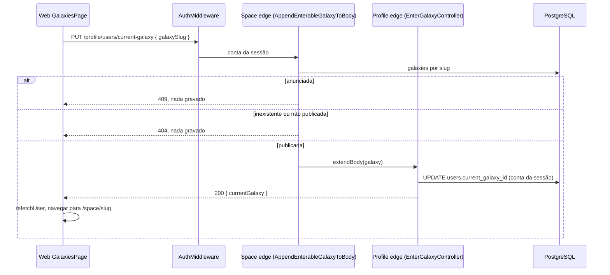

# Context and scope

A Issue #657 (milestone #45 "Página de Galáxias") pede que alunos autenticados vejam os cursos do
StarDust como galáxias em um mapa, reconheçam a galáxia atual, entrem em uma galáxia publicada sem
perder progresso e conheçam as galáxias anunciadas como "Em breve". O PRD principal é
`documentation/prds/space/galaxies-page-prd.md` (RP-01 a RP-05, JN-01 a JN-07); o PRD complementar
`documentation/prds/space/galaxy-page-prd.md` contribui RP-13 (galáxias como cursos) e JN-11.

## Resultado delimitado

- O catálogo de space passa a ter galáxias persistidas. Em produção existem Lógica de Programação
  (publicada, com os dez planetas atuais) e Orientação a Objetos (anunciada, sem planetas).
- O progresso da trilha é derivado por galáxia a partir das estrelas desbloqueadas; nenhum dado de
  usuário é movido. A galáxia atual fica na conta (`users.current_galaxy_id`).
- A página Galáxia passa a ser `/space/[galaxySlug]`; `/space` redireciona para a galáxia atual.
- A Página de Galáxias (`/space/galaxies`) apresenta o mapa, o carregamento, a falha com nova
  tentativa, a entrada em outra galáxia e o toast de falha ao entrar.
- O controle de galáxia aparece no topo da página Galáxia quando há duas ou mais galáxias visíveis.
- As ilustrações são animações Lottie provisórias, versionadas como cenas do `packages/studio` e
  servidas pelo storage (`lotties/galaxies`).
- O tooling de migrations Drizzle passa a aplicar migrations posteriores à transição da Issue #602.

## Fora do escopo

- Backoffice e qualquer UI de autoria de galáxias (cadastro, ordenação, anúncio, publicação). O
  Backoffice só implementa os métodos novos de `SpaceService` e `ProfileService` do Core (DT-04),
  sem uso em tela.
- Planetas, estrelas e narrativa de Orientação a Objetos ou de qualquer galáxia além da primeira.
- Arte final das galáxias; as animações são provisórias e não são validadas como arte.
- Conclusão total, vídeo de encerramento e agradecimentos por galáxia: `has_completed_space`
  continua significando a conclusão de Lógica de Programação (decisão Q2).
- A reformulação da trilha desenhada nos boards `Espaço / Galáxia / …`; só a camada
  `Controle de galáxia` desses boards entra no Contract.
- Eventos de analytics, limite de frequência para trocar de galáxia, escolha de curso no cadastro.

## Classificação

Spec em modo **full**: migration de produção com dados, dois módulos do Core compostos na borda,
mudança do tooling de migrations usado pelo CD de produção, novas rotas Server e Web e escrita de
reparo durante uma leitura.

## Decisões de grilling registradas

| ID      | Decisão                                                                                                                                                                                                                                                                                  |
| ------- | ---------------------------------------------------------------------------------------------------------------------------------------------------------------------------------------------------------------------------------------------------------------------------------------- |
| Q1      | Tabela `galaxies` (slug, nome, descrição, animação, posição, status `published\|announced\|unpublished`), `planets.galaxy_id` obrigatório, `users.current_galaxy_id` opcional, progresso derivado das estrelas desbloqueadas; a migration cria LP e OO e atribui todos os planetas a LP. |
| Q2      | Trilha por galáxia delimitada: posição de planeta por galáxia, próxima estrela dentro da galáxia, primeira estrela de cada galáxia disponível na leitura (sem escrita), `has_completed_space` e encerramento continuam significando LP; conclusão por galáxia adiada.                    |
| Q3      | Produção recebe LP (publicada) e OO (anunciada); o seed local acrescenta uma terceira galáxia publicada de teste com um planeta e duas estrelas.                                                                                                                                         |
| Q4      | Composição na borda: o módulo space decide se uma galáxia pode ser aberta; o módulo profile grava a galáxia atual (`User.currentGalaxy`, `EnterGalaxyUseCase`).                                                                                                                          |
| Q5, Q5a | Página de Galáxias em `/space/galaxies` com carregamento no cliente; página Galáxia em `/space/[galaxySlug]`, com `/space` e qualquer slug que não seja o da galáxia atual redirecionando para a galáxia atual.                                                                          |
| Q6a     | Endpoints de planetas usados pelo Backoffice mantêm o contrato e atuam sobre a primeira galáxia do catálogo; o Backoffice não muda. Na revisão 2, o Backoffice só ganha os métodos novos de service, sem uso em tela (DT-04).                                                            |
| Q7      | Resolver a galáxia atual repara e grava uma galáxia que deixou de estar publicada, trocando-a pela primeira publicada.                                                                                                                                                                   |
| Q8, Q8a | A página Galáxia renderiza o controle: no desktop, no topo do conteúdo (desvio aprovado do board, que o desenha na linha do cabeçalho); no mobile, faixa logo abaixo do cabeçalho. `HomeHeader` não muda.                                                                                |
| Q9a–Q9c | Ilustrações em Lottie; cenas no projeto `galaxies` do `packages/studio`; arquivos servidos de `lotties/galaxies` no storage (MinIO local pelo seed; R2 em staging e produção por passo de release).                                                                                      |
| Q10     | Adoção do padrão de hooks de query e de action (Rules atualizadas nesta task, antes desta Spec).                                                                                                                                                                                         |
| Q11     | O tooling de migrations Drizzle é estendido nesta Spec para aplicar migrations posteriores à transição.                                                                                                                                                                                  |
| Q12     | Só recursos de migration do Drizzle: migrations geradas não são editadas; dados, backfill e grants ficam numa migration customizada (`--custom`); `database-rules.md` não muda.                                                                                                          |

# Implementation Contract

## Requisitos funcionais

| RF    | Requisito                                                                                                                                                                                                                                                                                                                                                 | Origem                                          |
| ----- | --------------------------------------------------------------------------------------------------------------------------------------------------------------------------------------------------------------------------------------------------------------------------------------------------------------------------------------------------------- | ----------------------------------------------- |
| RF-01 | O catálogo persiste galáxias com slug único, nome, descrição curta, arquivo de animação, posição e status (`published`, `announced`, `unpublished`). A migration cria Lógica de Programação (publicada, posição 1) e Orientação a Objetos (anunciada, posição 2), atribui todo planeta existente a Lógica de Programação e não altera linhas de usuários. | RP-01, RP-13, Q1, Q3                            |
| RF-02 | O progresso de cada galáxia publicada é o número de planetas concluídos pelo aluno que pertencem a ela sobre o total de planetas da galáxia, derivado das estrelas desbloqueadas; o progresso existente passa a contar para Lógica de Programação sem perda.                                                                                              | RP-01, RP-02, RP-13, Q1                         |
| RF-03 | `GET /space/galaxies` lista as galáxias visíveis (publicadas e anunciadas) na ordem do catálogo, com estado, progresso das publicadas, ausência de progresso das anunciadas e a indicação da galáxia atual. Galáxias não publicadas não são retornadas.                                                                                                   | RP-01, RP-02, RP-03                             |
| RF-04 | A galáxia atual pertence à conta. Resolvê-la (`GET /space/galaxies/current`) devolve a galáxia gravada quando publicada; caso contrário, a primeira publicada do catálogo, que é gravada. Conta nova resolve para a primeira publicada.                                                                                                                   | RP-03, JN-06, Q7                                |
| RF-05 | `PUT /profile/users/current-galaxy` torna atual uma galáxia publicada e recusa galáxia anunciada, não publicada ou inexistente sem alterar nada. Entrar não altera progresso nem concede recompensas.                                                                                                                                                     | RP-03, JN-02, JN-05, JN-07, Q4                  |
| RF-06 | A página Galáxia é `/space/[galaxySlug]` e carrega os planetas da galáxia pelo slug; `/space` e um slug diferente do da galáxia atual redirecionam para `/space/<slug da galáxia atual>`.                                                                                                                                                                 | RP-03, RP-13, JN-02, JN-06, Q5a                 |
| RF-07 | A trilha pertence à galáxia: posição de planeta é por galáxia; a próxima estrela não atravessa galáxias; a primeira estrela do primeiro planeta de cada galáxia é apresentada como disponível sem escrita; `has_completed_space` só é marcado ao concluir a primeira galáxia; o desbloqueio da primeira estrela no cadastro usa a primeira galáxia.       | RP-13, JN-11, Q2                                |
| RF-08 | `GET /space/planets`, `POST /space/planets` e `PATCH /space/planets/order` mantêm request e response e atuam sobre a primeira galáxia do catálogo.                                                                                                                                                                                                        | Q6a                                             |
| RF-09 | A Página de Galáxias apresenta o mapa sobre o fundo espacial, o carregamento, a falha com "Tentar novamente", a ação de retorno com o nome da galáxia atual e redireciona para a Galáxia quando há menos de duas galáxias visíveis.                                                                                                                       | RP-01, RP-02, RP-04, JN-01, JN-03, JN-04, JN-07 |
| RF-10 | Escolher uma galáxia publicada diferente da atual a torna atual e abre sua trilha; a falha mostra toast com o nome da galáxia e mantém o aluno na página; escolher a atual volta à Galáxia sem requisição.                                                                                                                                                | RP-03, JN-02, JN-05                             |
| RF-11 | A página Galáxia apresenta o controle de galáxia com o nome da galáxia atual e "Ver galáxias" somente quando há duas ou mais galáxias visíveis; o controle leva à Página de Galáxias.                                                                                                                                                                     | RP-04, JN-01, JN-04, JN-07                      |
| RF-12 | Página e controle funcionam em desktop e mobile sem scroll horizontal, com teclado, foco visível, nome acessível e sem movimento sob preferência por movimento reduzido.                                                                                                                                                                                  | RP-05                                           |
| RF-13 | Cada galáxia nomeia sua animação Lottie no catálogo; as cenas provisórias vivem no projeto `galaxies` do `packages/studio`, o seed local as envia ao MinIO e a Web as carrega de `lotties/galaxies` no storage.                                                                                                                                           | RP-02, Q9a–Q9c                                  |
| RF-14 | O tooling de migrations aplica migrations posteriores às três migrations da transição, preservando as verificações exatas do estado de transição.                                                                                                                                                                                                         | Q11                                             |

## Critérios de aceitação

| CA    | RF                  | Given                                                                                                        | When                                                                                                        | Then                                                                                                                                                                                                                                                                                           | Expected evidence                        |
| ----- | ------------------- | ------------------------------------------------------------------------------------------------------------ | ----------------------------------------------------------------------------------------------------------- | ---------------------------------------------------------------------------------------------------------------------------------------------------------------------------------------------------------------------------------------------------------------------------------------------- | ---------------------------------------- |
| CA-01 | RF-01               | Banco com o schema posterior a `0002_server_owned_access`, planetas e usuários legados                       | `0003_galaxies`, `0004_galaxies_catalog` e `0005_planets_galaxy_required` são aplicadas em ordem            | `galaxies` contém LP (`logica-de-programacao`, `published`, 1) e OO (`orientacao-a-objetos`, `announced`, 2); todo planeta tem `galaxy_id` = LP com a mesma `position`; `(galaxy_id, position)` é único; linhas de `users`, `users_unlocked_stars` e `users_recently_unlocked_stars` não mudam | AV-05                                    |
| CA-02 | RF-01               | Migration aplicada                                                                                           | Os privilégios da tabela `galaxies` são inspecionados                                                       | `anon`, `authenticated` e `PUBLIC` não têm privilégio em `galaxies`; `auditExternalExposure` não acusa novo caminho                                                                                                                                                                            | AV-05, AV-08                             |
| CA-03 | RF-02, RF-03        | Aluno que desbloqueou todas as estrelas de 4 dos 10 planetas de LP                                           | `GET /space/galaxies`                                                                                       | LP tem `planetsCount: 10` e `completedPlanetsCount: 4`                                                                                                                                                                                                                                         | AV-01, AV-04                             |
| CA-04 | RF-03               | Catálogo com galáxias publicada, anunciada e não publicada em posições fora de ordem                         | `GET /space/galaxies`                                                                                       | Somente publicadas e anunciadas, ordenadas por `position`; anunciada com `status: 'announced'`, `planetsCount: null` e `completedPlanetsCount: null`; não publicada ausente                                                                                                                    | AV-01, AV-02, AV-04                      |
| CA-05 | RF-03, RF-04        | Conta com galáxia atual publicada                                                                            | `GET /space/galaxies`                                                                                       | Somente essa galáxia tem `isCurrent: true`                                                                                                                                                                                                                                                     | AV-02, AV-04                             |
| CA-06 | RF-04               | Conta sem galáxia atual                                                                                      | `GET /space/galaxies/current`                                                                               | `200` com a primeira galáxia publicada e `hasGalaxyChoice`; `users.current_galaxy_id` passa a apontar para ela                                                                                                                                                                                 | AV-02, AV-03, AV-04                      |
| CA-07 | RF-04               | Conta cuja galáxia atual voltou a ser `announced` ou passou a `unpublished`, com estrelas desbloqueadas nela | `GET /space/galaxies/current`                                                                               | `200` com a primeira publicada, gravada como atual; as estrelas desbloqueadas da galáxia retirada continuam gravadas                                                                                                                                                                           | AV-01, AV-04                             |
| CA-08 | RF-04               | Catálogo sem galáxia publicada                                                                               | `GET /space/galaxies/current`                                                                               | `404` com mensagem genérica, sem gravação                                                                                                                                                                                                                                                      | AV-02, AV-04                             |
| CA-09 | RF-05               | Conta em LP e galáxia publicada `galaxia-de-teste`                                                           | `PUT /profile/users/current-galaxy { galaxySlug: 'galaxia-de-teste' }`                                      | `200 { currentGalaxy: { id, slug, name } }`; galáxia atual gravada; estrelas desbloqueadas, moedas, XP, nível e sequência inalterados                                                                                                                                                          | AV-02, AV-03, AV-04                      |
| CA-10 | RF-05               | Galáxia anunciada, galáxia não publicada e slug inexistente                                                  | `PUT /profile/users/current-galaxy` com cada slug                                                           | Anunciada → `409`; não publicada ou inexistente → `404`; galáxia atual inalterada                                                                                                                                                                                                              | AV-02, AV-03, AV-04                      |
| CA-11 | RF-03, RF-04, RF-05 | Requisição sem sessão                                                                                        | Qualquer rota de galáxia                                                                                    | `401`; o corpo do `PUT` só aceita `galaxySlug` e a conta afetada vem da sessão                                                                                                                                                                                                                 | AV-04                                    |
| CA-12 | RF-06               | Conta com galáxia atual LP                                                                                   | Acesso a `/space` ou a `/space/galaxia-de-teste`                                                            | Redirecionamento para `/space/logica-de-programacao`                                                                                                                                                                                                                                           | AV-06, AV-07, MV-01                      |
| CA-13 | RF-06               | Conta com galáxia atual `galaxia-de-teste`                                                                   | Acesso a `/space/galaxia-de-teste`                                                                          | A trilha mostra os planetas dessa galáxia, obtidos de `GET /space/galaxies/galaxia-de-teste/planets`                                                                                                                                                                                           | AV-04, AV-06, AV-07, MV-01               |
| CA-14 | RF-07               | Planetas de duas galáxias com as mesmas posições                                                             | Próxima estrela da última estrela do último planeta de uma galáxia                                          | Resultado `null`, mesmo existindo planeta na posição seguinte em outra galáxia; dentro da galáxia segue para o planeta seguinte                                                                                                                                                                | AV-02                                    |
| CA-15 | RF-07               | Aluno sem estrela desbloqueada na galáxia aberta                                                             | A trilha é apresentada                                                                                      | A primeira estrela do primeiro planeta aparece desbloqueada e é a última estrela desbloqueada; nenhuma linha de estrela é gravada ao entrar                                                                                                                                                    | AV-04, AV-06                             |
| CA-16 | RF-07               | Aluno conclui a última estrela de uma galáxia que não é a primeira                                           | Fluxo de recompensa da estrela                                                                              | `has_completed_space` permanece `false`; na primeira galáxia continua sendo marcado                                                                                                                                                                                                            | AV-02, AV-03, AV-04                      |
| CA-17 | RF-07               | Conta criada                                                                                                 | Job de desbloqueio da primeira estrela                                                                      | Desbloqueia a primeira estrela do primeiro planeta da primeira galáxia do catálogo                                                                                                                                                                                                             | AV-02, AV-03                             |
| CA-18 | RF-07               | Reordenação de estrelas da primeira galáxia com usuário que tem estrelas desbloqueadas em outra galáxia      | `UpdateSpaceForAllUsersUseCase`                                                                             | Só estrelas da lista reordenada são consideradas; estrelas de outra galáxia não são removidas nem acrescentadas                                                                                                                                                                                | AV-02                                    |
| CA-19 | RF-08               | Catálogo com a primeira galáxia e a galáxia de teste                                                         | `GET /space/planets`, `POST /space/planets`, `PATCH /space/planets/order`                                   | Listagem só da primeira galáxia; criação nela com posição seguinte à última dela; reordenação só dos planetas dela; shapes de request e response inalterados                                                                                                                                   | AV-02, AV-03, AV-04                      |
| CA-20 | RF-09               | Duas ou mais galáxias visíveis, LP atual                                                                     | A Página de Galáxias carrega                                                                                | Título "Galáxias", subtítulo, galáxias na ordem do catálogo; publicada com animação, nome, descrição, barra e "N de M planetas"; atual com "Você está aqui"                                                                                                                                    | AV-06, AV-07, VV-01, VV-02, VV-03, VV-04 |
| CA-21 | RF-09               | Galáxia anunciada no catálogo                                                                                | O mapa é apresentado e o aluno clica, toca ou usa o teclado sobre ela                                       | Selo "Em breve", animação esmaecida e parada, borda tracejada, sem progresso e sem cadeado; não é botão, não recebe foco e não chama a entrada; nome, descrição e "Em breve" ficam acessíveis                                                                                                  | AV-06, AV-07, VV-01, VV-02               |
| CA-22 | RF-09               | A consulta das galáxias está pendente                                                                        | A página é apresentada                                                                                      | "Carregando galáxias…" e placeholders com a geometria do board; nenhuma galáxia ou progresso inventado                                                                                                                                                                                         | AV-06, AV-07, VV-05                      |
| CA-23 | RF-09               | A consulta das galáxias falha                                                                                | A página é apresentada e o aluno aciona "Tentar novamente"                                                  | Título "Não foi possível carregar as galáxias", mensagem do board e "Tentar novamente"; a ação refaz a consulta sem outro efeito; nenhum detalhe interno exibido                                                                                                                               | AV-06, AV-07, VV-06                      |
| CA-24 | RF-09               | Conta com galáxia atual conhecida; depois, conta sem nome de galáxia                                         | A página carrega, falha ou exibe o mapa                                                                     | A ação de retorno mostra "Voltar para <nome>" em todos os estados, ou "Voltar" sem nome, e leva a `/space`                                                                                                                                                                                     | AV-06, AV-07                             |
| CA-25 | RF-09               | Uma única galáxia visível                                                                                    | Acesso direto a `/space/galaxies`                                                                           | Redirecionamento no servidor para `/space`, sem entrada no histórico                                                                                                                                                                                                                           | AV-06, AV-07                             |
| CA-26 | RF-10               | Galáxia publicada diferente da atual                                                                         | O aluno a aciona                                                                                            | Uma única requisição `PUT`; enquanto pendente, novos acionamentos são ignorados e o elemento fica `aria-busy`; no sucesso, o usuário é recarregado e a navegação vai para `/space/<slug>`, cujo controle mostra o novo nome                                                                    | AV-06, AV-07, MV-01                      |
| CA-27 | RF-10               | A entrada falha                                                                                              | O aluno aciona a galáxia                                                                                    | Toast de erro "Não foi possível entrar em <nome>. Tente de novo."; o aluno permanece na página; nenhuma navegação                                                                                                                                                                              | AV-06, AV-07, VV-07                      |
| CA-28 | RF-10               | Galáxia atual                                                                                                | O aluno a aciona                                                                                            | Navegação para `/space/<slug>` sem requisição                                                                                                                                                                                                                                                  | AV-06                                    |
| CA-29 | RF-11               | Duas ou mais galáxias visíveis                                                                               | A página Galáxia é apresentada                                                                              | Controle único com ícone, nome da galáxia atual, "Ver galáxias" e seta, nome acessível "<nome>: ver galáxias", link para `/space/galaxies`; desktop no topo do conteúdo, mobile faixa logo abaixo do cabeçalho                                                                                 | AV-06, AV-07, VV-08, VV-09               |
| CA-30 | RF-11               | Uma única galáxia visível                                                                                    | A página Galáxia é apresentada                                                                              | O controle não aparece                                                                                                                                                                                                                                                                         | AV-06, AV-07                             |
| CA-31 | RF-12               | Viewports 1440×900 e 390×844                                                                                 | Página de Galáxias e página Galáxia                                                                         | Sem scroll horizontal; mesmas galáxias, ordem e dados nos dois viewports                                                                                                                                                                                                                       | AV-07, MV-01, MV-02                      |
| CA-32 | RF-12               | Teclado                                                                                                      | Tab e Enter na Página de Galáxias e no controle                                                             | Cada galáxia publicada, o retorno e o controle recebem foco visível e são acionáveis; a anunciada não recebe foco                                                                                                                                                                              | AV-06, AV-07                             |
| CA-33 | RF-12               | `prefers-reduced-motion: reduce`                                                                             | Página de Galáxias                                                                                          | As animações mostram um quadro parado, com o mesmo conteúdo                                                                                                                                                                                                                                    | AV-06, AV-07                             |
| CA-34 | RF-13               | Cenas do projeto `galaxies`                                                                                  | `pnpm run dev:studio`, depois `pnpm --filter @stardust/server run storage:seed`                             | As três cenas tocam no Studio; `lotties/galaxies/<arquivo>.json` existe no MinIO com `application/json` e leitura pública; a Página de Galáxias carrega cada animação dessa pasta                                                                                                              | MV-01, MV-03                             |
| CA-35 | RF-14               | Banco no estado de transição (3 migrations)                                                                  | `db:preflight --phase server-owned`, `db:migrate --phase server-owned`, `db:preflight --phase server-owned` | O primeiro preflight passa; o migrate aplica `0003_galaxies`, `0004_galaxies_catalog` e `0005_planets_galaxy_required`; o último preflight confirma o prefixo da transição e todas as entradas do journal no ledger; rollback e verificações dos estados `legacy` e `adopted` inalterados      | AV-05, AV-08                             |
| CA-36 | RF-14               | Journal com entrada que não segue os três tags da transição no prefixo                                       | Qualquer comando de transição                                                                               | Falha com "Unexpected migration journal"                                                                                                                                                                                                                                                       | AV-08                                    |

## Design Contract

**Fonte canônica:** arquivo Penpot `stardust`. **Registro da revisão:**
`documentation/design-reviews/space/galaxies-page-prd.md`, veredito `pass`, `prd_last_updated_at:
2026-11-14`; os 13 digests registrados conferem com `pnpm run check:design --digest --board "<board>"`
em 2026-11-14. Builders e Reviewers inspecionam os boards pelo Penpot MCP; nenhum design é extraído.

### Matriz de referências visuais

| Surface / route       | State / viewport                                              | Penpot page / board / components                                                                                                                                                                                                                        | CA / VV                     | Allowed deviations                                                                                                                                                                                         |
| --------------------- | ------------------------------------------------------------- | ------------------------------------------------------------------------------------------------------------------------------------------------------------------------------------------------------------------------------------------------------- | --------------------------- | ---------------------------------------------------------------------------------------------------------------------------------------------------------------------------------------------------------- |
| `/space/galaxies`     | Mapa, LP atual, OO anunciada; 1440×900 (board 1440×1100)      | `🖥️ Desktop` / `Espaço / Galáxias / galáxia em breve / Desktop` / `Galáxia Lógica de Programação · atual`, `Galáxia Orientação a Objetos · em breve`, `Placa`, `Chip galáxia atual`, `Chip em breve`, `Voltar para a galáxia atual` (`Botão`, Contorno) | CA-20, CA-21, CA-24 / VV-01 | Animação Lottie provisória no lugar do `slot-galaxy …`; o `slot-rocket` do board não é implementado (emenda da revisão 3)                                                                                  |
| `/space/galaxies`     | Mapa, LP atual, OO anunciada; 390×844 (board 390×1120)        | `📱 Mobile` / `Espaço / Galáxias / galáxia em breve / Mobile`                                                                                                                                                                                           | CA-20, CA-21 / VV-02        | Idem                                                                                                                                                                                                       |
| `/space/galaxies`     | Mapa com duas publicadas, LP atual (dados de teste); 1440×900 | `🖥️ Desktop` / `Espaço / Galáxias / Desktop`                                                                                                                                                                                                            | CA-20 / VV-03               | Idem; a segunda publicada é `galaxia-de-teste` com seus dados, não "Orientação a Objetos · 0 de 8"                                                                                                         |
| `/space/galaxies`     | Mapa com duas publicadas; 390×844                             | `📱 Mobile` / `Espaço / Galáxias / Mobile`                                                                                                                                                                                                              | CA-20 / VV-04               | Idem                                                                                                                                                                                                       |
| `/space/galaxies`     | Carregando; 1440×900 e 390×844                                | `Espaço / Galáxias / carregando / Desktop` e `/ Mobile`                                                                                                                                                                                                 | CA-22 / VV-05               | Nenhum                                                                                                                                                                                                     |
| `/space/galaxies`     | Falha ao carregar; 1440×900 e 390×844                         | `Espaço / Galáxias / falha ao carregar / Desktop` e `/ Mobile`                                                                                                                                                                                          | CA-23 / VV-06               | Nenhum                                                                                                                                                                                                     |
| `/space/galaxies`     | Toast de falha ao entrar; ambos                               | `Espaço / Galáxias / Toast / falha ao entrar / Desktop` e `/ Mobile` (`Notificação / Toast`, `Tipo=Erro`)                                                                                                                                               | CA-27 / VV-07               | Posição do toast é a já usada pelo `ToastContext` (decisão do registro, sem board)                                                                                                                         |
| `/space/[galaxySlug]` | Controle de galáxia; 1440×900                                 | Camada `Controle de galáxia` de `Espaço / Galáxia / Desktop` e `Espaço / Galáxia / planeta liberado / Desktop`                                                                                                                                          | CA-29 / VV-08               | Fica no topo do conteúdo, alinhado à esquerda, abaixo da linha do cabeçalho (Q8a), com tamanho, tipografia, ícones e borda da camada; o restante desses boards (reformulação da trilha) não é implementado |
| `/space/[galaxySlug]` | Controle de galáxia; 390×844                                  | Faixa `Controle de galáxia` de `Espaço / Galáxia / Mobile`                                                                                                                                                                                              | CA-29 / VV-09               | O restante do board não é implementado                                                                                                                                                                     |

### Estados sem board, decididos no registro

- Foco de teclado do elemento da galáxia, do retorno e do controle: extensão de foco de
  `documentation/design.md`.
- Rótulo "Voltar" quando o nome não está disponível: o mesmo `Botão` Contorno com rótulo menor.
- Três ou mais galáxias: o escalonamento continua para baixo, alternando lados; nomes e descrições
  longos quebram linha dentro da `Placa`.
- Galáxia concluída ("10 de 10 planetas"): mesmo layout, barra cheia.
- Página Galáxia com uma única galáxia visível: o cabeçalho atual, sem controle.

### Precedência e mapeamento para a UI existente

- Tokens e utilitários Tailwind de `apps/web/tailwind.config.js` e `documentation/design.md` têm
  precedência; valores do board sem token correspondente usam o token mais próximo já usado pela
  trilha e a divergência é registrada no Evaluation.
- Componentes compartilhados reutilizados: `Button` (variante de contorno), `Animation`
  (`LottieAnimation`), `Icon` e `ToastContext` (`showError`). A Página de Galáxias não exibe o
  foguete da conta (emenda da revisão 3).
- UI preservada: `HomeHeader`, `Sidenav`, `TabNav`, trilha atual (`Planet`, `Star`, `Fab`,
  `Particles`) e o link "Agradecimentos", que só aparece na primeira galáxia.

### Matriz de auditoria estrutural

| Widget                | Entry Point                                                                                                                                                      | View                                                                   | Hook                                                      | Rule                                                                            |
| --------------------- | ---------------------------------------------------------------------------------------------------------------------------------------------------------------- | ---------------------------------------------------------------------- | --------------------------------------------------------- | ------------------------------------------------------------------------------- |
| `GalaxiesPage`        | `Galaxies/index.tsx`: chama `useGalaxiesQuery`, `useEnterGalaxyAction`, `useAuthContext`, `useToastContext`, `useNavigationProvider` e passa a `useGalaxiesPage` | `GalaxiesPageView.tsx`                                                 | `useGalaxiesPage.ts`                                      | UI Layer: hooks de query/action consumidos pelo Entry Point                     |
| `GalaxiesMap`         | `GalaxiesMap/index.tsx` (alias da View)                                                                                                                          | `GalaxiesMapView.tsx`                                                  | — (estrutural)                                            | UI Layer: alias do Entry Point                                                  |
| `GalaxyItem`          | `GalaxyItem/index.tsx`: resolve `useFileStorage` e `useReducedMotion` (Motion)                                                                                   | `GalaxyItemView.tsx`                                                   | — (sem estado próprio)                                    | UI Layer                                                                        |
| `GalaxiesLoading`     | `GalaxiesLoading/index.tsx` (alias)                                                                                                                              | `GalaxiesLoadingView.tsx`                                              | —                                                         | UI Layer                                                                        |
| `GalaxiesLoadFailure` | `GalaxiesLoadFailure/index.tsx` (alias)                                                                                                                          | `GalaxiesLoadFailureView.tsx`                                          | —                                                         | UI Layer                                                                        |
| `GalaxyControl`       | `Space/GalaxyControl/index.tsx` (alias)                                                                                                                          | `GalaxyControlView.tsx`                                                | —                                                         | UI Layer                                                                        |
| `SpacePage`           | `Space/index.tsx`: lê `useSpaceContext`, `useAuthContext` e chama `useSpacePage`                                                                                 | `SpacePageView.tsx` (novo; a árvore visual sai do `index.tsx`)         | `useSpacePage.ts` (deriva `shouldShowEnding`)             | UI Layer: anti-padrão de renderizar no `index.tsx` corrigido no widget alterado |
| `Star`                | `Space/Planet/Star/index.tsx`: passa `isStarUnlocked(id)` do context                                                                                             | `StarView.tsx` (inalterado)                                            | `useStar.ts` (inalterado)                                 | UI Layer                                                                        |
| `LottieAnimation`     | `LottieAnimation/index.tsx`: só chama o hook e passa props à View                                                                                                | `LottieAnimationView.tsx` (`lottieData`, `autoplay`, `loop` por props) | `useLottieAnimation.ts` (carga, cache, `src`, `isStatic`) | UI Layer: estado e efeito saem do Entry Point no widget alterado                |

# Technical Contract

## Decisões técnicas

| ID    | Decisão                                                                                                                                                                                                                                                           | Evidência                                                                                                                                                                                                                                                | Alternativas                                                                                                                                         | Razão e impacto                                                                                                                                                |
| ----- | ----------------------------------------------------------------------------------------------------------------------------------------------------------------------------------------------------------------------------------------------------------------- | -------------------------------------------------------------------------------------------------------------------------------------------------------------------------------------------------------------------------------------------------------- | ---------------------------------------------------------------------------------------------------------------------------------------------------- | -------------------------------------------------------------------------------------------------------------------------------------------------------------- |
| DT-01 | Progresso derivado: `Galaxy.planetsIds` × `User.completedPlanetsIds`                                                                                                                                                                                              | `DrizzleUserMapper.completions` já expõe `completedPlanetsIds`; progresso fica em `users_unlocked_stars`                                                                                                                                                 | Tabela de progresso por galáxia (Q1 B)                                                                                                               | Nenhum dado de usuário migrado; fonte única de verdade                                                                                                         |
| DT-02 | Composição na borda em cadeia de controllers                                                                                                                                                                                                                      | Cadeias montadas: `UsersRouter` (`profileMiddleware.appendUserInfoToBody` → `spaceMiddleware.appendNextStarToBody`) e `TextBlocksRouter` (`spaceMiddleware.verifyStarExists`)                                                                            | Use case cross-module (Q4 B)                                                                                                                         | Mantém o desacoplamento exigido pela Core Rule                                                                                                                 |
| DT-03 | `HonoHttp.getBody()` não lê JSON em `GET`/`HEAD`                                                                                                                                                                                                                  | `getBody()` chama `context.req.json()` em middleware, o que falha sem corpo                                                                                                                                                                              | Novo método só para `extra-body`                                                                                                                     | A cadeia de `GET /space/galaxies/current` usa `extendBody`/`getBody` em três passos; comportamento de `POST`/`PUT`/`PATCH` inalterado                          |
| DT-04 | Galáxias nos services existentes: leituras em `SpaceService` e `enterGalaxy` em `ProfileService` (revisão do usuário na revisão 2)                                                                                                                                | Cada service da Web chama só rotas do próprio módulo (`/space/*`, `/profile/*`); Web e Backoffice implementam as interfaces completas do Core (`apps/*/src/rest/services/*`), e a Web já implementa métodos que só o Backoffice usa, como `createPlanet` | Novo `GalaxyService` (recusado pelo usuário); as quatro chamadas em `SpaceService` (`PUT /profile/users/current-galaxy` sairia do módulo do service) | Nenhum service novo nem mudança de `RestContext`; o Backoffice ganha os métodos como chamadas REST sem uso em tela, e `check:types` dele confirma a compilação |
| DT-05 | Só recursos de migration do Drizzle, sem editar SQL gerado (Q12): `0003_galaxies` gerada com `galaxy_id` anulável, `0004_galaxies_catalog` customizada (`--custom`) com dados, backfill e `REVOKE`, `0005_planets_galaxy_required` gerada com `NOT NULL` e unique | `database-rules.md` (Drizzle): Drizzle Kit gera schema; dados e segurança em migrations customizadas; precedente `0001`/`0002`                                                                                                                           | Uma migration gerada editada à mão (recusada em Q12)                                                                                                 | O runner aplica as pendentes na mesma sessão e lock; `NOT NULL` só depois do backfill; snapshots coerentes com os models; nenhuma mudança de Rule              |
| DT-06 | Redirecionamento por menos de duas galáxias no servidor (`/space/galaxies/page.tsx`)                                                                                                                                                                              | `NavigationProvider` não tem `replace` e é implementado também pelo Backoffice                                                                                                                                                                           | `replace` no `NavigationProvider`                                                                                                                    | Evita mudança do Backoffice e o loop do botão voltar; o widget cliente continua responsável pelos estados                                                      |
| DT-07 | Adapter Supabase legado de planetas lança `MethodNotImplementedError` nos métodos novos                                                                                                                                                                           | `SupabasePlanetsRepository` não é composto por nenhuma rota (só exportado)                                                                                                                                                                               | Implementar consultas com tipos legados sem `galaxy_id`                                                                                              | Mantém a compilação sem ampliar código morto                                                                                                                   |
| DT-08 | Tooling de transição aceita os três tags como prefixo fixo                                                                                                                                                                                                        | `transitionMigrations()` exige exatamente 3 entradas; `inspectTransition` compara catálogo exato                                                                                                                                                         | Spec separada (Q11 B)                                                                                                                                | Verificações exatas preservadas para o estado de transição; ledger maior é aceito só com o prefixo idêntico                                                    |
| DT-09 | Animação da galáxia via `LottieAnimation` com `src`                                                                                                                                                                                                               | `LottieAnimation` carrega por `LOTTIE_PATHS[name]`, cache por chave                                                                                                                                                                                      | Widget novo de Lottie                                                                                                                                | Reaproveita player e cache; `isStatic` cobre movimento reduzido e anunciada                                                                                    |

## Conceitos novos

### Galáxia (`Galaxy`, space)

Entidade do catálogo que representa um curso. Propriedades: `slug` (`Slug`), `name` (`Name`),
`description` (`Text`), `animation` (`Text`, nome do arquivo em `lotties/galaxies`), `position`
(`OrdinalNumber`), `status` (`GalaxyStatus`) e `planetsIds` (`IdsList`). Responde `isVisible`
(publicada ou anunciada), `canBeEntered` (só publicada), `planetsCount` e
`countCompletedPlanets(completedPlanetsIds: IdsList): Integer`. É lida pelo `GalaxiesRepository`;
não há escrita de galáxias em runtime nesta entrega (só migration e seed).

### Estado da galáxia (`GalaxyStatus`, space)

Structure com `value: 'published' | 'announced' | 'unpublished'` e `isPublished`, `isAnnounced`,
`isVisible`. Valor inválido lança `ValidationError` do Core.

### Catálogo de galáxias (`GalaxyCatalog`, space)

Structure imutável criada a partir das galáxias ordenadas por `position`. Fonte de verdade das
regras de seleção:

- `visibleGalaxies: Galaxy[]` — publicadas e anunciadas, na ordem.
- `hasGalaxyChoice: Logical` — duas ou mais visíveis.
- `firstGalaxy: Galaxy | null` — menor posição, independentemente do status (escopo de Q6a e da
  primeira estrela do cadastro).
- `firstPublishedGalaxy: Galaxy | null`.
- `resolveCurrentGalaxy(storedGalaxyId: Id | null): Galaxy | null` — a galáxia gravada quando
  publicada; senão a primeira publicada; `null` quando nenhuma está publicada.

Exemplo: catálogo `[LP published 1, OO announced 2]`, gravada `OO` → retorna `LP`.

### Galáxia atual (`GalaxyAggregate` em `User`, profile)

`User.currentGalaxy: GalaxyAggregate | null`, com `id` e entidade `{ name, slug }` lida do catálogo
pelo repository. `User.enterGalaxy(galaxy: GalaxyAggregate)` substitui a referência e não toca em
estrelas, moedas, XP, nível, sequência ou conquistas. A galáxia atual é gravada em
`users.current_galaxy_id` (FK `ON DELETE SET NULL`). O reparo de Q7 é feito pelo mesmo
`EnterGalaxyUseCase`, chamado por `SyncCurrentGalaxyController` a cada resolução; o use case não
grava quando a galáxia já é a atual, a escrita é idempotente e requisições concorrentes gravam o
mesmo valor.

### Primeira estrela disponível na leitura

A Web considera desbloqueada a primeira estrela do primeiro planeta da galáxia apresentada mesmo
sem linha em `users_unlocked_stars`. O `SpaceContext` expõe `isStarUnlocked(starId: Id): boolean`
(`user.hasUnlockedStar(starId) || starId === firstStarId`). Nada é gravado ao entrar; as escritas
de estrela continuam acontecendo só no fluxo de recompensa existente.

### Hooks de query e de action (Web)

`useGalaxiesQuery()` e `useEnterGalaxyAction()` em `apps/web/src/ui/space/hooks/`, conforme a
seção "Hooks de query e de action de domínio" de `documentation/rules/ui-layer-rules.md`. Leem o
`RestContext`, não têm testes dedicados e são consumidos pelo Entry Point de `GalaxiesPage`, que
passa os resultados a `useGalaxiesPage` por parâmetros.

### Migrations posteriores à transição

O estado `server-owned` passa a admitir ledger com mais de três linhas, desde que as três primeiras
sejam exatamente as migrations da transição. A comparação exata com o manifest legado só é feita
quando o ledger tem exatamente as três linhas; com migrations posteriores, o preflight confirma o
prefixo, que todas as entradas do journal estão aplicadas e `auditExternalExposure`. O comando de
rollback de acesso continua restrito ao estado de transição exato.

## Expected file tree

```text
packages/core/
├── package.json                                                            [M]
├── src/space/domain/entities/
│   ├── Galaxy.ts                                                           [N]
│   ├── Planet.ts                                                           [M]
│   ├── index.ts                                                            [M]
│   ├── dtos/GalaxyDto.ts                                                   [N]
│   ├── dtos/GalaxySummaryDto.ts                                            [N]
│   ├── dtos/CurrentGalaxyDto.ts                                            [N]
│   ├── dtos/PlanetDto.ts                                                   [M]
│   ├── dtos/index.ts                                                       [M]
│   ├── fakers/GalaxiesFaker.ts                                             [N]
│   ├── fakers/index.ts                                                     [M]
│   ├── tests/Galaxy.test.ts                                                [N]
│   └── tests/Planet.test.ts                                                [M]
├── src/space/domain/structures/
│   ├── GalaxyStatus.ts                                                     [N]
│   ├── GalaxyCatalog.ts                                                    [N]
│   ├── index.ts                                                            [N]
│   ├── tests/GalaxyStatus.test.ts                                          [N]
│   └── tests/GalaxyCatalog.test.ts                                         [N]
├── src/space/domain/errors/
│   ├── GalaxyNotFoundError.ts                                              [N]
│   ├── GalaxyNotEnterableError.ts                                          [N]
│   └── index.ts                                                            [M]
├── src/space/interfaces/
│   ├── GalaxiesRepository.ts                                               [N]
│   ├── PlanetsRepository.ts                                                [M]
│   ├── SpaceService.ts                                                     [M]
│   └── index.ts                                                            [M]
├── src/space/use-cases/
│   ├── ListGalaxiesUseCase.ts                                              [N]
│   ├── GetCurrentGalaxyUseCase.ts                                          [N]
│   ├── GetGalaxyUseCase.ts                                                 [N]
│   ├── ListGalaxyPlanetsUseCase.ts                                         [N]
│   ├── GetNextStarUseCase.ts                                               [M]
│   ├── UnlockFirstStarUseCase.ts                                           [M]
│   ├── CreatePlanetUseCase.ts                                              [M]
│   ├── ReorderPlanetsUseCase.ts                                            [M]
│   ├── HandleStarsNewOrderUseCase.ts                                       [M]
│   ├── index.ts                                                            [M]
│   ├── tests/ListGalaxiesUseCase.test.ts                                   [N]
│   ├── tests/GetCurrentGalaxyUseCase.test.ts                               [N]
│   ├── tests/GetGalaxyUseCase.test.ts                                      [N]
│   ├── tests/ListGalaxyPlanetsUseCase.test.ts                              [N]
│   ├── tests/GetNextStarUseCase.test.ts                                    [M]
│   ├── tests/UnlockFirstStarUseCase.test.ts                                [M]
│   ├── tests/CreatePlanetUseCase.test.ts                                   [M]
│   ├── tests/ReorderPlanetsUseCase.test.ts                                 [M]
│   └── tests/HandleStarsNewOrderUseCase.test.ts                            [M]
├── src/profile/domain/aggregates/
│   ├── GalaxyAggregate.ts                                                  [N]
│   ├── index.ts                                                            [M]
│   ├── dtos/GalaxyAggregateDto.ts                                          [N]
│   ├── dtos/index.ts                                                       [M]
│   ├── fakers/GalaxyAggregatesFaker.ts                                     [N]
│   └── fakers/index.ts                                                     [M]
├── src/profile/domain/entities/
│   ├── User.ts                                                             [M]
│   ├── dtos/UserDto.ts                                                     [M]
│   └── tests/User.test.ts                                                  [M]
├── src/profile/factories/UserFactory.ts                                    [M]
├── src/profile/interfaces/ProfileService.ts                                [M]
├── src/profile/use-cases/
│   ├── EnterGalaxyUseCase.ts                                               [N]
│   ├── CompleteSpaceUseCase.ts                                             [M]
│   ├── UpdateSpaceForAllUsersUseCase.ts                                    [M]
│   ├── index.ts                                                            [M]
│   ├── tests/EnterGalaxyUseCase.test.ts                                    [N]
│   ├── tests/CompleteSpaceUseCase.test.ts                                  [M]
│   └── tests/UpdateSpaceForAllUsersUseCase.test.ts                         [M]
├── src/storage/types/FileStorageFolderPathValue.ts                         [M]
└── src/storage/domain/structures/
    ├── FileStorageFolderPath.ts                                            [M]
    └── tests/FileStorageFolderPath.test.ts                                 [N]
packages/validation/
├── package.json                                                            [M]
├── src/main.ts                                                             [M]
└── src/modules/space/
    ├── galaxySlugSchema.ts                                                 [N]
    └── index.ts                                                            [N]
apps/server/
├── rest-client/space/galaxies.rest                                         [N]
├── rest-client/profile/users.rest                                          [M]
├── scripts/migrate-database.ts                                             [M]
└── src/
    ├── app/hono/HonoHttp.ts                                                [M]
    ├── app/hono/middlewares/SpaceMiddleware.ts                             [M]
    ├── app/hono/middlewares/ProfileMiddleware.ts                           [M]
    ├── app/hono/routers/space/GalaxiesRouter.ts                            [N]
    ├── app/hono/routers/space/SpaceRouter.ts                               [M]
    ├── app/hono/routers/space/PlanetsRouter.ts                             [M]
    ├── app/hono/routers/profile/UsersRouter.ts                             [M]
    ├── rest/controllers/space/index.ts                                     [M]
    ├── rest/controllers/space/galaxies/
    │   ├── ListGalaxiesController.ts                                       [N]
    │   ├── ResolveCurrentGalaxyController.ts                               [N]
    │   ├── ListGalaxyPlanetsController.ts                                  [N]
    │   ├── AppendEnterableGalaxyToBodyController.ts                        [N]
    │   ├── index.ts                                                        [N]
    │   ├── tests/ListGalaxiesController.test.ts                            [N]
    │   ├── tests/ResolveCurrentGalaxyController.test.ts                    [N]
    │   ├── tests/ListGalaxyPlanetsController.test.ts                       [N]
    │   └── tests/AppendEnterableGalaxyToBodyController.test.ts             [N]
    ├── rest/controllers/space/planets/
    │   ├── FetchAllPlanetsController.ts                                    [M]
    │   ├── CreatePlanetController.ts                                       [M]
    │   ├── ReorderPlanetsController.ts                                     [M]
    │   ├── tests/FetchAllPlanetsController.test.ts                         [M]
    │   ├── tests/CreatePlanetController.test.ts                            [M]
    │   └── tests/ReorderPlanetsController.test.ts                          [M]
    ├── rest/controllers/space/stars/
    │   ├── AppendNextStarToBodyController.ts                               [M]
    │   └── tests/AppendNextStarToBodyController.test.ts                    [M]
    ├── rest/controllers/profile/users/
    │   ├── EnterGalaxyController.ts                                        [N]
    │   ├── SyncCurrentGalaxyController.ts                                  [N]
    │   ├── AppendUserGalaxyProgressToBodyController.ts                     [N]
    │   ├── AppendUserCurrentGalaxyToBodyController.ts                      [N]
    │   ├── CompleteSpaceController.ts                                      [M]
    │   ├── RewardUserForStarChallengeCompletionController.ts               [M]
    │   ├── index.ts                                                        [M]
    │   ├── tests/EnterGalaxyController.test.ts                             [N]
    │   ├── tests/SyncCurrentGalaxyController.test.ts                       [N]
    │   ├── tests/AppendUserGalaxyProgressToBodyController.test.ts          [N]
    │   ├── tests/AppendUserCurrentGalaxyToBodyController.test.ts           [N]
    │   ├── tests/CompleteSpaceController.test.ts                           [M]
    │   └── tests/RewardUserForStarChallengeCompletionController.test.ts    [M]
    ├── queue/jobs/space/
    │   ├── UnlockFirstStarJob.ts                                           [M]
    │   ├── HandleStarsNewOrderJob.ts                                       [M]
    │   ├── tests/UnlockFirstStarJob.test.ts                                [N]
    │   └── tests/HandleStarsNewOrderJob.test.ts                            [N]
    ├── queue/inngest/functions/SpaceFunctions.ts                           [M]
    ├── database/drizzle/models/space/galaxy-model.ts                       [N]
    ├── database/drizzle/models/space/planet-model.ts                       [M]
    ├── database/drizzle/models/space/index.ts                              [M]
    ├── database/drizzle/models/profile/user-model.ts                       [M]
    ├── database/drizzle/types/entities/space/DrizzleGalaxy.ts              [N]
    ├── database/drizzle/types/entities/space/index.ts                      [M]
    ├── database/drizzle/types/entities/profile/DrizzleUser.ts              [M]
    ├── database/drizzle/mappers/space/DrizzleGalaxyMapper.ts               [N]
    ├── database/drizzle/mappers/space/DrizzlePlanetMapper.ts               [M]
    ├── database/drizzle/mappers/space/index.ts                             [M]
    ├── database/drizzle/mappers/profile/DrizzleUserMapper.ts               [M]
    ├── database/drizzle/repositories/space/DrizzleGalaxiesRepository.ts    [N]
    ├── database/drizzle/repositories/space/DrizzlePlanetsRepository.ts     [M]
    ├── database/drizzle/repositories/space/index.ts                        [M]
    ├── database/drizzle/repositories/profile/DrizzleUsersRepository.ts     [M]
    ├── database/drizzle/migrations/0003_galaxies.sql                       [G]
    ├── database/drizzle/migrations/0004_galaxies_catalog.sql               [N]
    ├── database/drizzle/migrations/0005_planets_galaxy_required.sql        [G]
    ├── database/drizzle/migrations/meta/0003_snapshot.json                 [G]
    ├── database/drizzle/migrations/meta/0004_snapshot.json                 [G]
    ├── database/drizzle/migrations/meta/0005_snapshot.json                 [G]
    ├── database/drizzle/migrations/meta/_journal.json                      [G]
    ├── database/supabase/repositories/space/SupabasePlanetsRepository.ts   [M]
    ├── database/seed.ts                                                    [M]
    ├── database/seeders/SpaceSeeder.ts                                     [M]
    ├── database/seeders/seed-data.ts                                       [M]
    ├── database/seeders/data/seed-catalog.json                             [M]
    ├── tests/fixtures/SpaceFixture.ts                                      [M]
    ├── tests/routes/space/galaxies/ListGalaxiesRoute.test.ts               [N]
    ├── tests/routes/space/galaxies/FetchCurrentGalaxyRoute.test.ts         [N]
    ├── tests/routes/space/galaxies/ListGalaxyPlanetsRoute.test.ts          [N]
    ├── tests/routes/space/planets/FetchAllPlanetsRoute.test.ts             [M]
    ├── tests/routes/space/planets/CreatePlanetRoute.test.ts                [M]
    ├── tests/routes/profile/users/EnterGalaxyRoute.test.ts                 [N]
    └── tests/routes/profile/users/RewardUserForStarChallengeCompletionRoute.test.ts [M]
apps/web/src/
├── app/(home)/space/page.tsx                                               [M]
├── app/(home)/space/tests/page.test.tsx                                    [N]
├── app/(home)/space/[galaxySlug]/page.tsx                                  [N]
├── app/(home)/space/[galaxySlug]/tests/page.test.tsx                       [N]
├── app/(home)/space/galaxies/page.tsx                                      [N]
├── app/(home)/space/galaxies/tests/page.test.tsx                           [N]
├── app/tests/space/galaxies.test.ts                                        [N]
├── app/tests/space/space.test.ts                                           [M]
├── constants/routes.ts                                                     [M]
├── rest/services/ProfileService.ts                                         [M]
├── rest/services/SpaceService.ts                                           [M]
├── ui/global/widgets/components/Animation/types/AnimationProps.ts          [M]
├── ui/global/widgets/components/Animation/LottieAnimation/
│   ├── index.tsx                                                           [M]
│   ├── useLottieAnimation.ts                                               [M]
│   ├── LottieAnimationView.tsx                                             [M]
│   └── tests/useLottieAnimation.test.ts                                    [N]
├── ui/space/hooks/useGalaxiesQuery.ts                                      [N]
├── ui/space/hooks/useEnterGalaxyAction.ts                                  [N]
├── ui/space/contexts/SpaceContext/
│   ├── index.tsx                                                           [M]
│   ├── useSpaceContextProvider.ts                                          [M]
│   ├── types/SpaceContextValue.ts                                          [M]
│   └── tests/useSpaceContextProvider.test.ts                               [M]
├── ui/space/widgets/pages/Space/
│   ├── index.tsx                                                           [M]
│   ├── SpacePageView.tsx                                                   [N]
│   ├── useSpacePage.ts                                                     [M]
│   ├── tests/useSpacePage.test.ts                                          [N]
│   ├── tests/SpacePageView.test.tsx                                        [N]
│   ├── GalaxyControl/index.tsx                                             [N]
│   ├── GalaxyControl/GalaxyControlView.tsx                                 [N]
│   ├── GalaxyControl/tests/GalaxyControlView.test.tsx                      [N]
│   └── Planet/Star/index.tsx                                               [M]
└── ui/space/widgets/pages/Galaxies/
    ├── index.tsx                                                           [N]
    ├── GalaxiesPageView.tsx                                                [N]
    ├── useGalaxiesPage.ts                                                  [N]
    ├── tests/useGalaxiesPage.test.ts                                       [N]
    ├── tests/GalaxiesPageView.test.tsx                                     [N]
    ├── GalaxiesMap/index.tsx                                               [N]
    ├── GalaxiesMap/GalaxiesMapView.tsx                                     [N]
    ├── GalaxyItem/index.tsx                                                [N]
    ├── GalaxyItem/GalaxyItemView.tsx                                       [N]
    ├── GalaxyItem/tests/GalaxyItemView.test.tsx                            [N]
    ├── GalaxiesLoading/index.tsx                                           [N]
    ├── GalaxiesLoading/GalaxiesLoadingView.tsx                             [N]
    ├── GalaxiesLoadFailure/index.tsx                                       [N]
    └── GalaxiesLoadFailure/GalaxiesLoadFailureView.tsx                     [N]
apps/backoffice/src/
├── rest/services/ProfileService.ts                                         [M]
└── rest/services/SpaceService.ts                                           [M]
packages/studio/public/projects/galaxies/
├── logica-de-programacao/lottie.json                                       [N]
├── orientacao-a-objetos/lottie.json                                        [N]
└── galaxia-de-teste/lottie.json                                            [N]
scripts/
├── check-drizzle-transition.mjs                                            [M]
├── seed-local-assets.mjs                                                   [M]
├── tests/check-drizzle-transition.test.mjs                                 [M]
└── tests/galaxies-migration.integration.test.mjs                           [N]
documentation/
├── architecture.md                                                         [M]
├── infrastructure.md                                                       [M]
├── tooling.md                                                              [M]
├── rules/ui-layer-rules.md                                                 [M]
└── rules/widget-tests-rules.md                                             [M]
```

Composição da UI: `Galaxies/index.tsx` é o único dono do estado da página (via
`useGalaxiesPage`); `GalaxiesMap` recebe a lista e os handlers; cada `GalaxyItem` recebe dados
prontos, `isPending` e `onEnter`. O `SpaceContext` é montado pelo `SpaceProvider` em
`/space/[galaxySlug]/page.tsx` e compartilhado pela trilha e por `SpacePageView`; `GalaxyControl`
só recebe props. Não há estado duplicado entre a lista de galáxias (SWR) e o usuário
(`AuthContext`): a galáxia atual vem de `isCurrent` na lista e o nome do retorno vem de
`user.currentGalaxy`.

## Mapa canônico de paths afetados

### packages/core — space domain

| Path                                                                    | Change | Declaration                                                                                                                                                                                                                                                                                                                                 | Contract                                                                                                                                                                                                                 | Dependencies                                                                             | Tests                 |
| ----------------------------------------------------------------------- | ------ | ------------------------------------------------------------------------------------------------------------------------------------------------------------------------------------------------------------------------------------------------------------------------------------------------------------------------------------------- | ------------------------------------------------------------------------------------------------------------------------------------------------------------------------------------------------------------------------ | ---------------------------------------------------------------------------------------- | --------------------- |
| `packages/core/package.json`                                            | Modify | export `"./space/structures": "./src/space/domain/structures/index.ts"`                                                                                                                                                                                                                                                                     | Novo subpath; exports existentes inalterados                                                                                                                                                                             | —                                                                                        | AV-09 (`check:types`) |
| `packages/core/src/space/domain/entities/Galaxy.ts`                     | Create | `class Galaxy extends Entity<GalaxyProps>`; `static create(dto: GalaxyDto): Galaxy`; getters `slug`, `name`, `description`, `animation`, `position`, `status`, `planetsIds`, `planetsCount: Integer`, `isVisible: Logical`, `canBeEntered: Logical`; `countCompletedPlanets(completedPlanetsIds: IdsList): Integer`; `get dto(): GalaxyDto` | Regras de visibilidade e entrada vêm de `GalaxyStatus`; `countCompletedPlanets` conta a interseção                                                                                                                       | `Slug`, `Name`, `Text`, `OrdinalNumber`, `IdsList`, `Integer`, `Logical`, `GalaxyStatus` | AV-01                 |
| `packages/core/src/space/domain/entities/Planet.ts`                     | Modify | prop `galaxyId: Id`; getter `galaxyId`; `dto` inclui `galaxyId`                                                                                                                                                                                                                                                                             | `Planet.create` aceita `dto.galaxyId` ausente apenas para DTOs legados de criação (`CreatePlanetUseCase` sempre informa)                                                                                                 | `Id`                                                                                     | AV-01                 |
| `packages/core/src/space/domain/entities/index.ts`                      | Modify | `export { Galaxy } from './Galaxy'`                                                                                                                                                                                                                                                                                                         | —                                                                                                                                                                                                                        | —                                                                                        | —                     |
| `packages/core/src/space/domain/entities/dtos/GalaxyDto.ts`             | Create | `type GalaxyDto = { id?: string; slug: string; name: string; description: string; animation: string; position: number; status: 'published' \| 'announced' \| 'unpublished'; planetsIds: string[] }`                                                                                                                                         | DTO primitivo                                                                                                                                                                                                            | —                                                                                        | —                     |
| `packages/core/src/space/domain/entities/dtos/GalaxySummaryDto.ts`      | Create | `type GalaxySummaryDto = { id: string; slug: string; name: string; description: string; animation: string; position: number; status: 'published' \| 'announced'; planetsCount: number \| null; completedPlanetsCount: number \| null; isCurrent: boolean }`                                                                                 | Response de `GET /space/galaxies`; contagens `null` só quando `announced`                                                                                                                                                | —                                                                                        | —                     |
| `packages/core/src/space/domain/entities/dtos/CurrentGalaxyDto.ts`      | Create | `type CurrentGalaxyDto = { galaxy: { id: string; slug: string; name: string }; isFirstGalaxy: boolean; hasGalaxyChoice: boolean }`                                                                                                                                                                                                          | Response de `GET /space/galaxies/current`; `isFirstGalaxy` vem de `GalaxyCatalog.firstGalaxy`                                                                                                                            | —                                                                                        | —                     |
| `packages/core/src/space/domain/entities/dtos/PlanetDto.ts`             | Modify | `galaxyId?: string`                                                                                                                                                                                                                                                                                                                         | Opcional para compatibilidade de tipos com o Backoffice                                                                                                                                                                  | —                                                                                        | —                     |
| `packages/core/src/space/domain/entities/dtos/index.ts`                 | Modify | exporta `GalaxyDto`, `GalaxySummaryDto`, `CurrentGalaxyDto`                                                                                                                                                                                                                                                                                 | —                                                                                                                                                                                                                        | —                                                                                        | —                     |
| `packages/core/src/space/domain/entities/fakers/GalaxiesFaker.ts`       | Create | `static fake(baseDto?: Partial<GalaxyDto>): Galaxy`; `fakeDto(baseDto?)`; `fakeMany(count?, baseDto?)`; `fakeManyDto(count?, baseDto?)`                                                                                                                                                                                                     | Padrão de `PlanetsFaker`; status padrão `published`                                                                                                                                                                      | `@faker-js/faker`                                                                        | —                     |
| `packages/core/src/space/domain/entities/fakers/index.ts`               | Modify | `export { GalaxiesFaker } from './GalaxiesFaker'`                                                                                                                                                                                                                                                                                           | —                                                                                                                                                                                                                        | —                                                                                        | —                     |
| `packages/core/src/space/domain/entities/tests/Galaxy.test.ts`          | Create | `describe('Galaxy Entity')`                                                                                                                                                                                                                                                                                                                 | Visibilidade e `canBeEntered` por status, `planetsCount`, `countCompletedPlanets` com interseção vazia, parcial e total                                                                                                  | `GalaxiesFaker`                                                                          | AV-01                 |
| `packages/core/src/space/domain/entities/tests/Planet.test.ts`          | Modify | caso de `galaxyId`                                                                                                                                                                                                                                                                                                                          | `galaxyId` ida e volta no `dto`; casos existentes preservados                                                                                                                                                            | `PlanetsFaker`                                                                           | AV-01                 |
| `packages/core/src/space/domain/structures/GalaxyStatus.ts`             | Create | `class GalaxyStatus`; `static create(value: string): GalaxyStatus`; `static createAsPublished()`, `createAsAnnounced()`, `createAsUnpublished()`; `isPublished`, `isAnnounced`, `isVisible: Logical`                                                                                                                                        | Valor fora dos três lança `ValidationError`                                                                                                                                                                              | `Logical`, `ValidationError`                                                             | AV-01                 |
| `packages/core/src/space/domain/structures/GalaxyCatalog.ts`            | Create | `class GalaxyCatalog`; `static create(galaxies: Galaxy[]): GalaxyCatalog` (ordena por `position`); `visibleGalaxies: Galaxy[]`; `hasGalaxyChoice: Logical`; `firstGalaxy: Galaxy \| null`; `firstPublishedGalaxy: Galaxy \| null`; `resolveCurrentGalaxy(storedGalaxyId: Id \| null): Galaxy \| null`                                       | Regras descritas em "Conceitos novos"                                                                                                                                                                                    | `Galaxy`, `Id`, `Logical`                                                                | AV-01                 |
| `packages/core/src/space/domain/structures/index.ts`                    | Create | exporta `GalaxyStatus`, `GalaxyCatalog`                                                                                                                                                                                                                                                                                                     | —                                                                                                                                                                                                                        | —                                                                                        | —                     |
| `packages/core/src/space/domain/structures/tests/GalaxyStatus.test.ts`  | Create | `describe('GalaxyStatus Structure')`                                                                                                                                                                                                                                                                                                        | Três valores válidos, inválido, predicados                                                                                                                                                                               | —                                                                                        | AV-01                 |
| `packages/core/src/space/domain/structures/tests/GalaxyCatalog.test.ts` | Create | `describe('GalaxyCatalog Structure')`                                                                                                                                                                                                                                                                                                       | Ordem; visíveis; `hasGalaxyChoice` com 1 e 2 visíveis (publicada + anunciada conta); `resolveCurrentGalaxy` com gravada publicada, gravada anunciada, gravada não publicada, gravada inexistente, `null` e sem publicada | `GalaxiesFaker`                                                                          | AV-01                 |
| `packages/core/src/space/domain/errors/GalaxyNotFoundError.ts`          | Create | `class GalaxyNotFoundError extends NotFoundError`; mensagem `'Galáxia não encontrada'`                                                                                                                                                                                                                                                      | Mapeado para `404` pelo tratamento existente de `NotFoundError`                                                                                                                                                          | `NotFoundError` global                                                                   | AV-02                 |
| `packages/core/src/space/domain/errors/GalaxyNotEnterableError.ts`      | Create | `class GalaxyNotEnterableError extends ConflictError`; mensagem `'Esta galáxia ainda não está disponível'`                                                                                                                                                                                                                                  | Mapeado para `409` pelo tratamento existente de `ConflictError`                                                                                                                                                          | `ConflictError` global                                                                   | AV-02                 |
| `packages/core/src/space/domain/errors/index.ts`                        | Modify | exporta os dois erros                                                                                                                                                                                                                                                                                                                       | —                                                                                                                                                                                                                        | —                                                                                        | —                     |

### packages/core — space interfaces e use cases

| Path                                                                         | Change | Declaration                                                                                                                                                                                                          | Contract                                                                                                                                                                          | Dependencies                                | Tests               |
| ---------------------------------------------------------------------------- | ------ | -------------------------------------------------------------------------------------------------------------------------------------------------------------------------------------------------------------------- | --------------------------------------------------------------------------------------------------------------------------------------------------------------------------------- | ------------------------------------------- | ------------------- |
| `packages/core/src/space/interfaces/GalaxiesRepository.ts`                   | Create | `interface GalaxiesRepository { findAll(): Promise<Galaxy[]>; findBySlug(slug: Slug): Promise<Galaxy \| null>; findFirst(): Promise<Galaxy \| null> }`                                                               | `findAll` ordena por `position` e preenche `planetsIds`; `findFirst` = menor `position`, qualquer status                                                                          | `Galaxy`, `Slug`                            | AV-04               |
| `packages/core/src/space/interfaces/SpaceService.ts`                         | Modify | acrescenta `fetchGalaxies(): Promise<RestResponse<GalaxySummaryDto[]>>`; `fetchCurrentGalaxy(): Promise<RestResponse<CurrentGalaxyDto>>`; `fetchGalaxyPlanets(galaxySlug: Slug): Promise<RestResponse<PlanetDto[]>>` | Métodos existentes inalterados (DT-04)                                                                                                                                            | `RestResponse`, DTOs                        | AV-06, AV-07, AV-09 |
| `packages/core/src/space/interfaces/PlanetsRepository.ts`                    | Modify | acrescenta `findAllByGalaxy(galaxyId: Id): Promise<Planet[]>`; muda `findByPosition(position: OrdinalNumber, galaxyId: Id): Promise<Planet \| null>` e `findLastPlanet(galaxyId: Id): Promise<Planet \| null>`       | Busca por posição e última posição sempre dentro da galáxia; demais métodos inalterados                                                                                           | `Id`, `OrdinalNumber`                       | AV-04               |
| `packages/core/src/space/interfaces/index.ts`                                | Modify | exporta `GalaxiesRepository`                                                                                                                                                                                         | —                                                                                                                                                                                 | —                                           | —                   |
| `packages/core/src/space/use-cases/ListGalaxiesUseCase.ts`                   | Create | `constructor(galaxiesRepository: GalaxiesRepository)`; `execute({ currentGalaxyId: string \| null; completedPlanetsIds: string[] }): Promise<GalaxySummaryDto[]>`                                                    | Usa `GalaxyCatalog.visibleGalaxies` e `resolveCurrentGalaxy` para `isCurrent`; anunciada com contagens `null`                                                                     | `GalaxyCatalog`                             | AV-02               |
| `packages/core/src/space/use-cases/GetCurrentGalaxyUseCase.ts`               | Create | `constructor(galaxiesRepository)`; `execute({ currentGalaxyId: string \| null }): Promise<CurrentGalaxyDto>`                                                                                                         | Sem galáxia publicada lança `GalaxyNotFoundError`; `isFirstGalaxy` compara a galáxia resolvida com `catalog.firstGalaxy`; não grava nada                                          | `GalaxyCatalog`                             | AV-02               |
| `packages/core/src/space/use-cases/GetGalaxyUseCase.ts`                      | Create | `constructor(galaxiesRepository)`; `execute({ galaxySlug: string; shouldBeEnterable: boolean }): Promise<GalaxyDto>`                                                                                                 | Inexistente ou `unpublished` → `GalaxyNotFoundError`; `announced` com `shouldBeEnterable` → `GalaxyNotEnterableError`                                                             | `Slug`, erros                               | AV-02               |
| `packages/core/src/space/use-cases/ListGalaxyPlanetsUseCase.ts`              | Create | `constructor(galaxiesRepository, planetsRepository)`; `execute({ galaxySlug: string }): Promise<PlanetDto[]>`                                                                                                        | Galáxia deve ser publicada, senão `GalaxyNotFoundError`; retorna `findAllByGalaxy`                                                                                                | `GetGalaxy` rules via `Galaxy.canBeEntered` | AV-02               |
| `packages/core/src/space/use-cases/GetNextStarUseCase.ts`                    | Modify | `constructor(starsRepository, planetsRepository, galaxiesRepository, broker)`; `execute(request): Promise<{ nextStar: StarDto \| null; isFirstGalaxy: boolean }>`                                                    | Próximo planeta por `findByPosition(position + 1, currentPlanet.galaxyId)`; `PlanetCompletedEvent` inalterado; `isFirstGalaxy` compara `currentPlanet.galaxyId` com `findFirst()` | `GalaxiesRepository`                        | AV-02               |
| `packages/core/src/space/use-cases/UnlockFirstStarUseCase.ts`                | Modify | `constructor(planetsRepository, galaxiesRepository, broker)`                                                                                                                                                         | Primeira galáxia por `findFirst()`; primeiro planeta por `findByPosition(1, galaxy.id)`; sem galáxia ou planeta → `PlanetNotFoundError`                                           | `GalaxiesRepository`                        | AV-02               |
| `packages/core/src/space/use-cases/CreatePlanetUseCase.ts`                   | Modify | `constructor(planetsRepository, galaxiesRepository)`                                                                                                                                                                 | Cria na primeira galáxia, posição seguinte à `findLastPlanet(galaxy.id)`; request e response inalterados                                                                          | `GalaxiesRepository`                        | AV-02               |
| `packages/core/src/space/use-cases/ReorderPlanetsUseCase.ts`                 | Modify | `constructor(planetsRepository, galaxiesRepository, broker)`                                                                                                                                                         | Reordena só `findAllByGalaxy(firstGalaxy.id)`; IDs de outra galáxia → `PlanetNotFoundError`                                                                                       | `GalaxiesRepository`                        | AV-02               |
| `packages/core/src/space/use-cases/HandleStarsNewOrderUseCase.ts`            | Modify | `constructor(planetsRepository, galaxiesRepository, broker)`                                                                                                                                                         | `reorderedStarIds` só da primeira galáxia                                                                                                                                         | `GalaxiesRepository`                        | AV-02               |
| `packages/core/src/space/use-cases/index.ts`                                 | Modify | exporta os quatro use cases novos                                                                                                                                                                                    | —                                                                                                                                                                                 | —                                           | —                   |
| `packages/core/src/space/use-cases/tests/ListGalaxiesUseCase.test.ts`        | Create | `describe('List Galaxies Use Case')`                                                                                                                                                                                 | CA-03, CA-04, CA-05                                                                                                                                                               | `ts-jest-mocker`, `GalaxiesFaker`           | AV-02               |
| `packages/core/src/space/use-cases/tests/GetCurrentGalaxyUseCase.test.ts`    | Create | `describe('Get Current Galaxy Use Case')`                                                                                                                                                                            | CA-06, CA-07, CA-08 no nível do use case                                                                                                                                          | idem                                        | AV-02               |
| `packages/core/src/space/use-cases/tests/GetGalaxyUseCase.test.ts`           | Create | `describe('Get Galaxy Use Case')`                                                                                                                                                                                    | CA-10 por status                                                                                                                                                                  | idem                                        | AV-02               |
| `packages/core/src/space/use-cases/tests/ListGalaxyPlanetsUseCase.test.ts`   | Create | `describe('List Galaxy Planets Use Case')`                                                                                                                                                                           | Publicada retorna planetas; anunciada, não publicada, inexistente lançam `GalaxyNotFoundError`                                                                                    | idem                                        | AV-02               |
| `packages/core/src/space/use-cases/tests/GetNextStarUseCase.test.ts`         | Modify | novos casos                                                                                                                                                                                                          | CA-14 e `isFirstGalaxy`; casos existentes adaptados à nova resposta                                                                                                               | idem                                        | AV-02               |
| `packages/core/src/space/use-cases/tests/UnlockFirstStarUseCase.test.ts`     | Modify | novos casos                                                                                                                                                                                                          | CA-17                                                                                                                                                                             | idem                                        | AV-02               |
| `packages/core/src/space/use-cases/tests/CreatePlanetUseCase.test.ts`        | Modify | novos casos                                                                                                                                                                                                          | CA-19 (criação)                                                                                                                                                                   | idem                                        | AV-02               |
| `packages/core/src/space/use-cases/tests/ReorderPlanetsUseCase.test.ts`      | Modify | novos casos                                                                                                                                                                                                          | CA-19 (reordenação)                                                                                                                                                               | idem                                        | AV-02               |
| `packages/core/src/space/use-cases/tests/HandleStarsNewOrderUseCase.test.ts` | Modify | novos casos                                                                                                                                                                                                          | Só estrelas da primeira galáxia no evento                                                                                                                                         | idem                                        | AV-02               |

### packages/core — profile e storage

| Path                                                                              | Change | Declaration                                                                                                                                                                   | Contract                                                                                                                                                                                                                                                | Dependencies                          | Tests                      |
| --------------------------------------------------------------------------------- | ------ | ----------------------------------------------------------------------------------------------------------------------------------------------------------------------------- | ------------------------------------------------------------------------------------------------------------------------------------------------------------------------------------------------------------------------------------------------------- | ------------------------------------- | -------------------------- |
| `packages/core/src/profile/domain/aggregates/GalaxyAggregate.ts`                  | Create | `class GalaxyAggregate extends Aggregate<{ name: Name; slug: Slug }>`; `static create(dto: GalaxyAggregateDto)`; getters `name`, `slug`                                       | Padrão de `RocketAggregate`                                                                                                                                                                                                                             | `Aggregate`, `Name`, `Slug`           | AV-01 (via `User.test.ts`) |
| `packages/core/src/profile/domain/aggregates/index.ts`                            | Modify | `export { GalaxyAggregate }`                                                                                                                                                  | —                                                                                                                                                                                                                                                       | —                                     | —                          |
| `packages/core/src/profile/domain/aggregates/dtos/GalaxyAggregateDto.ts`          | Create | `type GalaxyAggregateDto = { id: string; entity?: { name: string; slug: string } }`                                                                                           | —                                                                                                                                                                                                                                                       | —                                     | —                          |
| `packages/core/src/profile/domain/aggregates/dtos/index.ts`                       | Modify | exporta `GalaxyAggregateDto`                                                                                                                                                  | —                                                                                                                                                                                                                                                       | —                                     | —                          |
| `packages/core/src/profile/domain/aggregates/fakers/GalaxyAggregatesFaker.ts`     | Create | `fake`, `fakeDto`                                                                                                                                                             | Padrão de `RocketAggregatesFaker`                                                                                                                                                                                                                       | —                                     | —                          |
| `packages/core/src/profile/domain/aggregates/fakers/index.ts`                     | Modify | exporta `GalaxyAggregatesFaker`                                                                                                                                               | —                                                                                                                                                                                                                                                       | —                                     | —                          |
| `packages/core/src/profile/interfaces/ProfileService.ts`                          | Modify | acrescenta `enterGalaxy(galaxySlug: Slug): Promise<RestResponse<{ currentGalaxy: { id: string; slug: string; name: string } }>>`                                              | Métodos existentes inalterados (DT-04)                                                                                                                                                                                                                  | `RestResponse`                        | AV-07, AV-09               |
| `packages/core/src/profile/domain/entities/User.ts`                               | Modify | prop `currentGalaxy: GalaxyAggregate \| null`; getter `currentGalaxy`; `enterGalaxy(galaxy: GalaxyAggregate): void`; `isInGalaxy(galaxyId: Id): Logical`; `dto.currentGalaxy` | `enterGalaxy` só troca a referência                                                                                                                                                                                                                     | `GalaxyAggregate`                     | AV-01                      |
| `packages/core/src/profile/domain/entities/dtos/UserDto.ts`                       | Modify | `currentGalaxy?: GalaxyAggregateDto \| null`                                                                                                                                  | Opcional para compatibilidade                                                                                                                                                                                                                           | —                                     | —                          |
| `packages/core/src/profile/domain/entities/tests/User.test.ts`                    | Modify | casos de `enterGalaxy`                                                                                                                                                        | Troca a galáxia e preserva estrelas, moedas, XP, nível, sequência; `dto` ida e volta                                                                                                                                                                    | `UsersFaker`, `GalaxyAggregatesFaker` | AV-01                      |
| `packages/core/src/profile/factories/UserFactory.ts`                              | Modify | produz `currentGalaxy`                                                                                                                                                        | `dto.currentGalaxy` ausente ou `null` → `null`                                                                                                                                                                                                          | `GalaxyAggregate`                     | AV-01                      |
| `packages/core/src/profile/use-cases/EnterGalaxyUseCase.ts`                       | Create | `constructor(usersRepository: UsersRepository)`; `execute({ userId: string; galaxy: GalaxyAggregateDto }): Promise<UserDto>`                                                  | Usuário inexistente → `UserNotFoundError`; quando `user.currentGalaxy` já tem o mesmo `id`, retorna o DTO sem gravar (no-op, `User.isInGalaxy(galaxyId: Id): Logical`); senão chama `user.enterGalaxy` e `repository.replace(user)`; não publica evento | `UsersRepository`                     | AV-02                      |
| `packages/core/src/profile/use-cases/CompleteSpaceUseCase.ts`                     | Modify | request `{ userId: string; nextStarId: string \| null; isFirstGalaxy: boolean }`                                                                                              | Só marca e publica `SpaceCompletedEvent` quando `nextStarId === null && isFirstGalaxy`                                                                                                                                                                  | —                                     | AV-02                      |
| `packages/core/src/profile/use-cases/UpdateSpaceForAllUsersUseCase.ts`            | Modify | sem mudança de assinatura                                                                                                                                                     | Considera só estrelas desbloqueadas presentes em `reorderedStarIds` (CA-18)                                                                                                                                                                             | —                                     | AV-02                      |
| `packages/core/src/profile/use-cases/index.ts`                                    | Modify | exporta `EnterGalaxyUseCase`                                                                                                                                                  | —                                                                                                                                                                                                                                                       | —                                     | —                          |
| `packages/core/src/profile/use-cases/tests/EnterGalaxyUseCase.test.ts`            | Create | `describe('Enter Galaxy Use Case')`                                                                                                                                           | Grava a galáxia; no-op quando já é a atual; usuário inexistente; progresso inalterado                                                                                                                                                                   | `ts-jest-mocker`                      | AV-02                      |
| `packages/core/src/profile/use-cases/tests/CompleteSpaceUseCase.test.ts`          | Modify | casos com `isFirstGalaxy`                                                                                                                                                     | CA-16                                                                                                                                                                                                                                                   | idem                                  | AV-02                      |
| `packages/core/src/profile/use-cases/tests/UpdateSpaceForAllUsersUseCase.test.ts` | Modify | caso multi-galáxia                                                                                                                                                            | CA-18                                                                                                                                                                                                                                                   | idem                                  | AV-02                      |
| `packages/core/src/storage/types/FileStorageFolderPathValue.ts`                   | Modify | acrescenta `'lotties/galaxies'` a `FileStorageFolderPathValue`                                                                                                                | —                                                                                                                                                                                                                                                       | —                                     | —                          |
| `packages/core/src/storage/domain/structures/FileStorageFolderPath.ts`            | Modify | `static createAsLottiesGalaxies(): FileStorageFolderPath`; `isFileStorageFolderPathValue` aceita `'lotties/galaxies'`                                                         | Demais pastas inalteradas                                                                                                                                                                                                                               | —                                     | AV-01                      |
| `packages/core/src/storage/domain/structures/tests/FileStorageFolderPath.test.ts` | Create | `describe('FileStorageFolderPath Structure')`                                                                                                                                 | Nova pasta válida; valor inválido lança                                                                                                                                                                                                                 | —                                     | AV-01                      |

### packages/validation

| Path                                                        | Change | Declaration                                                                                                        | Contract                                                                | Dependencies          | Tests |
| ----------------------------------------------------------- | ------ | ------------------------------------------------------------------------------------------------------------------ | ----------------------------------------------------------------------- | --------------------- | ----- |
| `packages/validation/package.json`                          | Modify | export `"./space/schemas": "./src/modules/space/index.ts"`                                                         | —                                                                       | —                     | AV-09 |
| `packages/validation/src/modules/space/galaxySlugSchema.ts` | Create | `galaxySlugSchema` = `stringSchema` com regex de slug kebab-case, 1–64 caracteres, e `refine(slug !== 'galaxies')` | Mensagens em PT-BR no schema                                            | `stringSchema` global | AV-04 |
| `packages/validation/src/modules/space/index.ts`            | Create | exporta `galaxySlugSchema`                                                                                         | Layout plano como `modules/profile`, `modules/shop` e `modules/storage` | —                     | —     |
| `packages/validation/src/main.ts`                           | Modify | `export * from './modules/space/index'`                                                                            | Mantém a API pública completa do pacote                                 | —                     | AV-09 |

### apps/server — HTTP edge

| Path                                                        | Change | Declaration                                                                                                                                   | Contract                                                                                                                                                                                                                                                                                                                                                                                                                                                                      | Dependencies                           | Tests |
| ----------------------------------------------------------- | ------ | --------------------------------------------------------------------------------------------------------------------------------------------- | ----------------------------------------------------------------------------------------------------------------------------------------------------------------------------------------------------------------------------------------------------------------------------------------------------------------------------------------------------------------------------------------------------------------------------------------------------------------------------- | -------------------------------------- | ----- |
| `apps/server/src/app/hono/HonoHttp.ts`                      | Modify | `getBody()`                                                                                                                                   | Em middleware, `GET` e `HEAD` não leem `req.json()` e usam `{}` antes de mesclar `extra-body` (DT-03)                                                                                                                                                                                                                                                                                                                                                                         | Hono                                   | AV-04 |
| `apps/server/src/app/hono/routers/space/GalaxiesRouter.ts`  | Create | `class GalaxiesRouter extends HonoRouter`, base `/galaxies`; rotas `GET /`, `GET /current`, `GET /:galaxySlug/planets`                        | Todas com `authMiddleware.verifyAuthentication`; `GET /` → `profileMiddleware.appendUserGalaxyProgressToBody` → `ListGalaxiesController`; `GET /current` → `profileMiddleware.appendUserCurrentGalaxyToBody` → `spaceMiddleware.resolveCurrentGalaxy` → `SyncCurrentGalaxyController`; `GET /:galaxySlug/planets` valida `param` com `galaxySlugSchema` → `ListGalaxyPlanetsController`. Repositories Drizzle compostos com `http.getDatabase()` e `http.getDatabaseAccess()` | middlewares, controllers, repositories | AV-04 |
| `apps/server/src/app/hono/routers/space/SpaceRouter.ts`     | Modify | registra `GalaxiesRouter`                                                                                                                     | Rotas existentes inalteradas                                                                                                                                                                                                                                                                                                                                                                                                                                                  | —                                      | AV-04 |
| `apps/server/src/app/hono/routers/space/PlanetsRouter.ts`   | Modify | compõe `DrizzleGalaxiesRepository` em `GET /`, `POST /` e `PATCH /order`                                                                      | Contrato HTTP inalterado                                                                                                                                                                                                                                                                                                                                                                                                                                                      | —                                      | AV-04 |
| `apps/server/src/app/hono/routers/profile/UsersRouter.ts`   | Modify | `PUT /current-galaxy`                                                                                                                         | `verifyAuthentication` → valida `json` `{ galaxySlug: galaxySlugSchema }` (objeto estrito) → `spaceMiddleware.appendEnterableGalaxyToBody` → `EnterGalaxyController`; rotas de recompensa recebem `isFirstGalaxy` do `appendNextStarToBody`                                                                                                                                                                                                                                   | —                                      | AV-04 |
| `apps/server/src/app/hono/middlewares/SpaceMiddleware.ts`   | Modify | `resolveCurrentGalaxy(context, next)`; `appendEnterableGalaxyToBody(context, next)`; `appendNextStarToBody` passa `DrizzleGalaxiesRepository` | —                                                                                                                                                                                                                                                                                                                                                                                                                                                                             | controllers space                      | AV-04 |
| `apps/server/src/app/hono/middlewares/ProfileMiddleware.ts` | Modify | `appendUserGalaxyProgressToBody(context, next)`; `appendUserCurrentGalaxyToBody(context, next)`                                               | Conta sempre de `http.getAccountId()`                                                                                                                                                                                                                                                                                                                                                                                                                                         | controllers profile                    | AV-04 |
| `apps/server/rest-client/space/galaxies.rest`               | Create | exemplos das três rotas `GET` com `Authorization: Bearer {{token}}`                                                                           | Sem segredos                                                                                                                                                                                                                                                                                                                                                                                                                                                                  | —                                      | —     |
| `apps/server/rest-client/profile/users.rest`                | Modify | exemplo de `PUT /profile/users/current-galaxy`                                                                                                | Sem segredos                                                                                                                                                                                                                                                                                                                                                                                                                                                                  | —                                      | —     |

### apps/server — controllers

| Path                                                                                                          | Change | Declaration                                                                                         | Contract                                                                                                                                                       | Dependencies               | Tests |
| ------------------------------------------------------------------------------------------------------------- | ------ | --------------------------------------------------------------------------------------------------- | -------------------------------------------------------------------------------------------------------------------------------------------------------------- | -------------------------- | ----- |
| `apps/server/src/rest/controllers/space/index.ts`                                                             | Modify | `export * from './galaxies'`                                                                        | —                                                                                                                                                              | —                          | —     |
| `apps/server/src/rest/controllers/space/galaxies/ListGalaxiesController.ts`                                   | Create | `handle(http: Http<{ body: { currentGalaxyId: string \| null; completedPlanetsIds: string[] } }>)`  | `200` com `GalaxySummaryDto[]`                                                                                                                                 | `ListGalaxiesUseCase`      | AV-03 |
| `apps/server/src/rest/controllers/space/galaxies/ResolveCurrentGalaxyController.ts`                           | Create | `handle(http: Http<{ body: { storedGalaxyId: string \| null } }>)`                                  | Executa `GetCurrentGalaxyUseCase`; `extendBody({ currentGalaxy: CurrentGalaxyDto })`; `pass()`                                                                 | `GetCurrentGalaxyUseCase`  | AV-03 |
| `apps/server/src/rest/controllers/space/galaxies/ListGalaxyPlanetsController.ts`                              | Create | `handle(http: Http<{ routeParams: { galaxySlug: string } }>)`                                       | `200` com `PlanetDto[]`                                                                                                                                        | `ListGalaxyPlanetsUseCase` | AV-03 |
| `apps/server/src/rest/controllers/space/galaxies/AppendEnterableGalaxyToBodyController.ts`                    | Create | `handle(http: Http<{ body: { galaxySlug: string } }>)`                                              | `GetGalaxyUseCase({ shouldBeEnterable: true })`; `extendBody({ galaxy: GalaxyAggregateDto })`; `pass()`                                                        | `GetGalaxyUseCase`         | AV-03 |
| `apps/server/src/rest/controllers/space/galaxies/index.ts`                                                    | Create | exporta os quatro controllers                                                                       | —                                                                                                                                                              | —                          | —     |
| `apps/server/src/rest/controllers/space/galaxies/tests/ListGalaxiesController.test.ts`                        | Create | `describe('List Galaxies Controller')`                                                              | Repassa body ao use case e responde `200`                                                                                                                      | Handlers Testing Rules     | AV-03 |
| `apps/server/src/rest/controllers/space/galaxies/tests/ResolveCurrentGalaxyController.test.ts`                | Create | `describe('Resolve Current Galaxy Controller')`                                                     | Estende o body e chama `pass`                                                                                                                                  | idem                       | AV-03 |
| `apps/server/src/rest/controllers/space/galaxies/tests/ListGalaxyPlanetsController.test.ts`                   | Create | `describe('List Galaxy Planets Controller')`                                                        | Lê `galaxySlug` e responde `200`                                                                                                                               | idem                       | AV-03 |
| `apps/server/src/rest/controllers/space/galaxies/tests/AppendEnterableGalaxyToBodyController.test.ts`         | Create | `describe('Append Enterable Galaxy To Body Controller')`                                            | Estende o body; propaga erros do use case                                                                                                                      | idem                       | AV-03 |
| `apps/server/src/rest/controllers/space/planets/FetchAllPlanetsController.ts`                                 | Modify | `constructor(planetsRepository, galaxiesRepository)`                                                | `findFirst()` → `findAllByGalaxy`; sem galáxia → `200 []`                                                                                                      | —                          | AV-03 |
| `apps/server/src/rest/controllers/space/planets/CreatePlanetController.ts`                                    | Modify | `constructor(planetsRepository, galaxiesRepository)`                                                | Repassa ao `CreatePlanetUseCase`                                                                                                                               | —                          | AV-03 |
| `apps/server/src/rest/controllers/space/planets/ReorderPlanetsController.ts`                                  | Modify | `constructor(planetsRepository, galaxiesRepository, broker)`                                        | Repassa ao `ReorderPlanetsUseCase`                                                                                                                             | —                          | AV-03 |
| `apps/server/src/rest/controllers/space/planets/tests/FetchAllPlanetsController.test.ts`                      | Modify | caso da primeira galáxia                                                                            | CA-19                                                                                                                                                          | idem                       | AV-03 |
| `apps/server/src/rest/controllers/space/planets/tests/CreatePlanetController.test.ts`                         | Modify | composição nova                                                                                     | Casos existentes preservados                                                                                                                                   | idem                       | AV-03 |
| `apps/server/src/rest/controllers/space/planets/tests/ReorderPlanetsController.test.ts`                       | Modify | composição nova                                                                                     | Casos existentes preservados                                                                                                                                   | idem                       | AV-03 |
| `apps/server/src/rest/controllers/space/stars/AppendNextStarToBodyController.ts`                              | Modify | `constructor(starsRepository, planetsRepository, galaxiesRepository, broker)`                       | `extendBody({ nextStarId, isFirstGalaxy })`                                                                                                                    | —                          | AV-03 |
| `apps/server/src/rest/controllers/space/stars/tests/AppendNextStarToBodyController.test.ts`                   | Modify | `isFirstGalaxy`                                                                                     | —                                                                                                                                                              | idem                       | AV-03 |
| `apps/server/src/rest/controllers/profile/users/EnterGalaxyController.ts`                                     | Create | `handle(http: Http<{ body: { galaxy: GalaxyAggregateDto } }>)`                                      | `userId` de `http.getAccountId()`; `EnterGalaxyUseCase`; `200 { currentGalaxy: { id, slug, name } }`                                                           | `EnterGalaxyUseCase`       | AV-03 |
| `apps/server/src/rest/controllers/profile/users/SyncCurrentGalaxyController.ts`                               | Create | `handle(http: Http<{ body: { storedGalaxyId: string \| null; currentGalaxy: CurrentGalaxyDto } }>)` | Executa `EnterGalaxyUseCase` para a conta da sessão com a galáxia resolvida (o use case não grava quando ela já é a atual); responde `200` com `currentGalaxy` | `EnterGalaxyUseCase`       | AV-03 |
| `apps/server/src/rest/controllers/profile/users/AppendUserGalaxyProgressToBodyController.ts`                  | Create | `handle(http: Http)`                                                                                | `GetUserUseCase` da sessão; `extendBody({ currentGalaxyId, completedPlanetsIds })`; `pass()`                                                                   | `GetUserUseCase`           | AV-03 |
| `apps/server/src/rest/controllers/profile/users/AppendUserCurrentGalaxyToBodyController.ts`                   | Create | `handle(http: Http)`                                                                                | `extendBody({ storedGalaxyId })`; `pass()`                                                                                                                     | `GetUserUseCase`           | AV-03 |
| `apps/server/src/rest/controllers/profile/users/CompleteSpaceController.ts`                                   | Modify | body `{ nextStarId: string \| null; isFirstGalaxy: boolean }`                                       | Repassa `isFirstGalaxy`                                                                                                                                        | —                          | AV-03 |
| `apps/server/src/rest/controllers/profile/users/RewardUserForStarChallengeCompletionController.ts`            | Modify | body acrescenta `isFirstGalaxy?: boolean`                                                           | `completeSpace` recebe `isFirstGalaxy ?? false`                                                                                                                | —                          | AV-03 |
| `apps/server/src/rest/controllers/profile/users/index.ts`                                                     | Modify | exporta os quatro controllers novos                                                                 | —                                                                                                                                                              | —                          | —     |
| `apps/server/src/rest/controllers/profile/users/tests/EnterGalaxyController.test.ts`                          | Create | `describe('Enter Galaxy Controller')`                                                               | Conta da sessão; `200`                                                                                                                                         | idem                       | AV-03 |
| `apps/server/src/rest/controllers/profile/users/tests/SyncCurrentGalaxyController.test.ts`                    | Create | `describe('Sync Current Galaxy Controller')`                                                        | Chama o use case com a conta da sessão e a galáxia resolvida; responde `currentGalaxy`                                                                         | idem                       | AV-03 |
| `apps/server/src/rest/controllers/profile/users/tests/AppendUserGalaxyProgressToBodyController.test.ts`       | Create | `describe('Append User Galaxy Progress To Body Controller')`                                        | —                                                                                                                                                              | idem                       | AV-03 |
| `apps/server/src/rest/controllers/profile/users/tests/AppendUserCurrentGalaxyToBodyController.test.ts`        | Create | `describe('Append User Current Galaxy To Body Controller')`                                         | `null` sem galáxia                                                                                                                                             | idem                       | AV-03 |
| `apps/server/src/rest/controllers/profile/users/tests/CompleteSpaceController.test.ts`                        | Modify | `isFirstGalaxy`                                                                                     | —                                                                                                                                                              | idem                       | AV-03 |
| `apps/server/src/rest/controllers/profile/users/tests/RewardUserForStarChallengeCompletionController.test.ts` | Modify | `isFirstGalaxy`                                                                                     | —                                                                                                                                                              | idem                       | AV-03 |

### apps/server — queue

| Path                                                                    | Change | Declaration                                                      | Contract                                       | Dependencies                  | Tests |
| ----------------------------------------------------------------------- | ------ | ---------------------------------------------------------------- | ---------------------------------------------- | ----------------------------- | ----- |
| `apps/server/src/queue/jobs/space/UnlockFirstStarJob.ts`                | Modify | `constructor(planetsRepository, galaxiesRepository, broker)`     | Dentro de `amqp.run`, como hoje                | —                             | AV-03 |
| `apps/server/src/queue/jobs/space/HandleStarsNewOrderJob.ts`            | Modify | `constructor(planetsRepository, galaxiesRepository, broker)`     | Idem                                           | —                             | AV-03 |
| `apps/server/src/queue/jobs/space/tests/UnlockFirstStarJob.test.ts`     | Create | `describe('Unlock First Star Job')`                              | Executa o use case em `amqp.run` com o payload | Handlers Testing Rules (Jobs) | AV-03 |
| `apps/server/src/queue/jobs/space/tests/HandleStarsNewOrderJob.test.ts` | Create | `describe('Handle Stars New Order Job')`                         | Idem                                           | idem                          | AV-03 |
| `apps/server/src/queue/inngest/functions/SpaceFunctions.ts`             | Modify | compõe `DrizzleGalaxiesRepository(database, { kind: 'system' })` | —                                              | —                             | AV-09 |

### apps/server — database

| Path                                                                                | Change   | Declaration                                                                                                                                                                                                                                                                                                                                 | Contract                                                                                                                                                                                                                                                                                                                                                                                                                                                                                                                                                                                                                                                                        | Dependencies             | Tests                  |
| ----------------------------------------------------------------------------------- | -------- | ------------------------------------------------------------------------------------------------------------------------------------------------------------------------------------------------------------------------------------------------------------------------------------------------------------------------------------------- | ------------------------------------------------------------------------------------------------------------------------------------------------------------------------------------------------------------------------------------------------------------------------------------------------------------------------------------------------------------------------------------------------------------------------------------------------------------------------------------------------------------------------------------------------------------------------------------------------------------------------------------------------------------------------------- | ------------------------ | ---------------------- |
| `apps/server/src/database/drizzle/models/space/galaxy-model.ts`                     | Create   | `galaxyStatusEnum = pgEnum('galaxy_status', ['published', 'announced', 'unpublished'])`; `galaxyModel = pgTable('galaxies', { id uuid pk default uuid_generate_v4(), slug text not null unique, name text not null, description text not null, animation text not null, position integer not null unique, status galaxy_status not null })` | Constraints `galaxies_pkey`, `galaxies_slug_key`, `galaxies_position_key`                                                                                                                                                                                                                                                                                                                                                                                                                                                                                                                                                                                                       | drizzle-orm              | AV-05                  |
| `apps/server/src/database/drizzle/models/space/planet-model.ts`                     | Modify   | Estado final: `galaxyId: uuid('galaxy_id').notNull()`; FK `planets_galaxy_id_fkey` → `galaxies.id` `ON DELETE RESTRICT`; unique `planets_galaxy_id_position_key (galaxy_id, position)`                                                                                                                                                      | Para gerar `0003`, a coluna é declarada anulável e sem o unique; depois da migration customizada `0004`, o model recebe `notNull()` e o unique e gera `0005` (DT-05)                                                                                                                                                                                                                                                                                                                                                                                                                                                                                                            | `galaxyModel`            | AV-05                  |
| `apps/server/src/database/drizzle/models/space/index.ts`                            | Modify   | exporta `galaxyModel`, `galaxyStatusEnum`                                                                                                                                                                                                                                                                                                   | —                                                                                                                                                                                                                                                                                                                                                                                                                                                                                                                                                                                                                                                                               | —                        | —                      |
| `apps/server/src/database/drizzle/models/profile/user-model.ts`                     | Modify   | `currentGalaxyId: uuid('current_galaxy_id')`; FK `users_current_galaxy_id_fkey` `ON DELETE SET NULL`                                                                                                                                                                                                                                        | —                                                                                                                                                                                                                                                                                                                                                                                                                                                                                                                                                                                                                                                                               | `galaxyModel`            | AV-05                  |
| `apps/server/src/database/drizzle/types/entities/space/DrizzleGalaxy.ts`            | Create   | `type DrizzleGalaxy = InferSelectModel<typeof galaxyModel> & { planetsIds: string[] }`; `DrizzleInsertGalaxy`                                                                                                                                                                                                                               | —                                                                                                                                                                                                                                                                                                                                                                                                                                                                                                                                                                                                                                                                               | —                        | —                      |
| `apps/server/src/database/drizzle/types/entities/space/index.ts`                    | Modify   | exporta os tipos                                                                                                                                                                                                                                                                                                                            | —                                                                                                                                                                                                                                                                                                                                                                                                                                                                                                                                                                                                                                                                               | —                        | —                      |
| `apps/server/src/database/drizzle/types/entities/profile/DrizzleUser.ts`            | Modify   | `currentGalaxy: { id: string; name: string; slug: string } \| null`                                                                                                                                                                                                                                                                         | —                                                                                                                                                                                                                                                                                                                                                                                                                                                                                                                                                                                                                                                                               | —                        | —                      |
| `apps/server/src/database/drizzle/mappers/space/DrizzleGalaxyMapper.ts`             | Create   | `toEntity(row: DrizzleGalaxy): Galaxy`                                                                                                                                                                                                                                                                                                      | —                                                                                                                                                                                                                                                                                                                                                                                                                                                                                                                                                                                                                                                                               | —                        | AV-04                  |
| `apps/server/src/database/drizzle/mappers/space/DrizzlePlanetMapper.ts`             | Modify   | `toEntity` lê `galaxyId`; `toPersistence` grava `galaxy_id`                                                                                                                                                                                                                                                                                 | —                                                                                                                                                                                                                                                                                                                                                                                                                                                                                                                                                                                                                                                                               | —                        | AV-04                  |
| `apps/server/src/database/drizzle/mappers/space/index.ts`                           | Modify   | exporta `DrizzleGalaxyMapper`                                                                                                                                                                                                                                                                                                               | —                                                                                                                                                                                                                                                                                                                                                                                                                                                                                                                                                                                                                                                                               | —                        | —                      |
| `apps/server/src/database/drizzle/mappers/profile/DrizzleUserMapper.ts`             | Modify   | `toEntity` produz `currentGalaxy`; `toPersistence` grava `current_galaxy_id`                                                                                                                                                                                                                                                                | —                                                                                                                                                                                                                                                                                                                                                                                                                                                                                                                                                                                                                                                                               | —                        | AV-04                  |
| `apps/server/src/database/drizzle/repositories/space/DrizzleGalaxiesRepository.ts`  | Create   | `class DrizzleGalaxiesRepository extends DrizzleRepository implements GalaxiesRepository`                                                                                                                                                                                                                                                   | `findAll` agrega `planetsIds` com `coalesce(array_agg(planets.id), '{}')`, ordena por `position`; repository só de leitura, disponível em qualquer contexto de acesso, como as leituras de `DrizzlePlanetsRepository`                                                                                                                                                                                                                                                                                                                                                                                                                                                           | `DrizzleGalaxyMapper`    | AV-04                  |
| `apps/server/src/database/drizzle/repositories/space/DrizzlePlanetsRepository.ts`   | Modify   | `findAllByGalaxy`, `findByPosition(position, galaxyId)`, `findLastPlanet(galaxyId)`                                                                                                                                                                                                                                                         | Filtro `planets.galaxy_id`; `add` grava `galaxy_id`                                                                                                                                                                                                                                                                                                                                                                                                                                                                                                                                                                                                                             | —                        | AV-04                  |
| `apps/server/src/database/drizzle/repositories/space/index.ts`                      | Modify   | exporta `DrizzleGalaxiesRepository`                                                                                                                                                                                                                                                                                                         | —                                                                                                                                                                                                                                                                                                                                                                                                                                                                                                                                                                                                                                                                               | —                        | —                      |
| `apps/server/src/database/drizzle/repositories/profile/DrizzleUsersRepository.ts`   | Modify   | `query()` faz `leftJoin(galaxyModel, eq(galaxyModel.id, userModel.currentGalaxyId))` e seleciona `currentGalaxy`; `replace` grava `current_galaxy_id`; `findUnlockedStars` ordena por `galaxies.position`, `planets.position`, `stars.number`                                                                                               | Ownership atual preservado (`authorizeOwner`)                                                                                                                                                                                                                                                                                                                                                                                                                                                                                                                                                                                                                                   | `galaxyModel`            | AV-04                  |
| `apps/server/src/database/drizzle/migrations/0003_galaxies.sql`                     | Generate | fonte: models no passo 1 (`galaxyModel`, `planets.galaxy_id` ainda anulável com FK, `users.current_galaxy_id`); comando: `pnpm --filter @stardust/server run db:generate -- --name galaxies` com `DATABASE_URL` local; saída: SQL e snapshot                                                                                                | `CREATE TYPE galaxy_status`, `CREATE TABLE galaxies`, colunas e FKs; não editar (DT-05)                                                                                                                                                                                                                                                                                                                                                                                                                                                                                                                                                                                         | drizzle-kit              | AV-05                  |
| `apps/server/src/database/drizzle/migrations/0004_galaxies_catalog.sql`             | Create   | migration customizada gerada vazia por `pnpm --filter @stardust/server run db:generate -- --custom --name galaxies_catalog` e escrita à mão, como `0002_server_owned_access`                                                                                                                                                                | `INSERT` de LP (`7a0c1f4e-6c1b-4f2e-9a51-2d3b8e1c0a01`, `logica-de-programacao`, `Lógica de Programação`, `Aprenda a pensar como quem programa: variáveis, condições, laços e funções.`, `logica-de-programacao.json`, 1, `published`) e OO (`7a0c1f4e-6c1b-4f2e-9a51-2d3b8e1c0a02`, `orientacao-a-objetos`, `Orientação a Objetos`, `Organize programas em classes e objetos que trabalham juntos.`, `orientacao-a-objetos.json`, 2, `announced`); `UPDATE planets SET galaxy_id = LP` onde nulo; `REVOKE ALL PRIVILEGES ON TABLE galaxies FROM PUBLIC, anon, authenticated`; separadores `--> statement-breakpoint`; cabeçalho com o SQL inverso de 0003–0005 como comentário | drizzle-kit (`--custom`) | AV-05                  |
| `apps/server/src/database/drizzle/migrations/0005_planets_galaxy_required.sql`      | Generate | fonte: models no estado final (`planets.galaxy_id` `notNull`, unique `planets_galaxy_id_position_key`); comando: `pnpm --filter @stardust/server run db:generate -- --name planets_galaxy_required`; saída: SQL e snapshot                                                                                                                  | `SET NOT NULL` e unique; não editar                                                                                                                                                                                                                                                                                                                                                                                                                                                                                                                                                                                                                                             | drizzle-kit              | AV-05                  |
| `apps/server/src/database/drizzle/migrations/meta/0003_snapshot.json`               | Generate | geração do passo 1                                                                                                                                                                                                                                                                                                                          | Não editar                                                                                                                                                                                                                                                                                                                                                                                                                                                                                                                                                                                                                                                                      | drizzle-kit              | AV-05                  |
| `apps/server/src/database/drizzle/migrations/meta/0004_snapshot.json`               | Generate | geração `--custom` do passo 2                                                                                                                                                                                                                                                                                                               | Não editar                                                                                                                                                                                                                                                                                                                                                                                                                                                                                                                                                                                                                                                                      | drizzle-kit              | AV-05                  |
| `apps/server/src/database/drizzle/migrations/meta/0005_snapshot.json`               | Generate | geração do passo 3                                                                                                                                                                                                                                                                                                                          | Não editar                                                                                                                                                                                                                                                                                                                                                                                                                                                                                                                                                                                                                                                                      | drizzle-kit              | AV-05                  |
| `apps/server/src/database/drizzle/migrations/meta/_journal.json`                    | Generate | as três gerações; entradas `idx` 3, 4 e 5 com tags `0003_galaxies`, `0004_galaxies_catalog` e `0005_planets_galaxy_required`                                                                                                                                                                                                                | Não editar                                                                                                                                                                                                                                                                                                                                                                                                                                                                                                                                                                                                                                                                      | drizzle-kit              | AV-08                  |
| `apps/server/src/database/supabase/repositories/space/SupabasePlanetsRepository.ts` | Modify   | métodos novos e assinaturas de `PlanetsRepository`                                                                                                                                                                                                                                                                                          | Métodos novos e alterados lançam `MethodNotImplementedError` do Core (DT-07)                                                                                                                                                                                                                                                                                                                                                                                                                                                                                                                                                                                                    | —                        | AV-09 (`check:types`)  |
| `apps/server/src/database/seed.ts`                                                  | Modify   | ordem de limpeza                                                                                                                                                                                                                                                                                                                            | Remove `planets` antes de `galaxies` e insere `galaxies` antes de `planets`                                                                                                                                                                                                                                                                                                                                                                                                                                                                                                                                                                                                     | —                        | AV-09 (`test:scripts`) |
| `apps/server/src/database/seeders/SpaceSeeder.ts`                                   | Modify   | tabelas `['galaxies', 'planets', 'stars']`                                                                                                                                                                                                                                                                                                  | —                                                                                                                                                                                                                                                                                                                                                                                                                                                                                                                                                                                                                                                                               | —                        | idem                   |
| `apps/server/src/database/seeders/seed-data.ts`                                     | Modify   | `CATALOG_TABLES` inclui `'galaxies'`; `seedProfileProgress` escolhe o primeiro planeta da galáxia de menor posição                                                                                                                                                                                                                          | Contas seed sem `current_galaxy_id` (resolvem para LP)                                                                                                                                                                                                                                                                                                                                                                                                                                                                                                                                                                                                                          | —                        | idem                   |
| `apps/server/src/database/seeders/data/seed-catalog.json`                           | Modify   | `tables.galaxies` com LP, OO (UUIDs da migration) e `galaxia-de-teste` (`7a0c1f4e-6c1b-4f2e-9a51-2d3b8e1c0a03`, publicada, posição 3, `galaxia-de-teste.json`); `galaxy_id` em cada planeta (LP); um planeta `Planeta de Teste` (posição 1 na galáxia de teste) com duas estrelas disponíveis                                               | `source` e `exportedAt` inalterados                                                                                                                                                                                                                                                                                                                                                                                                                                                                                                                                                                                                                                             | —                        | idem, MV-01            |
| `apps/server/src/tests/fixtures/SpaceFixture.ts`                                    | Modify   | `createGalaxy(overrides?: Partial<GalaxyDto>): Promise<GalaxyDto>`; `createPlanet(galaxyId, overrides?)`; `createStar` cria ou recebe uma galáxia                                                                                                                                                                                           | Fixtures não recebem testes dedicados                                                                                                                                                                                                                                                                                                                                                                                                                                                                                                                                                                                                                                           | `galaxyModel`            | AV-04                  |

### apps/server — testes de rota

| Path                                                                                           | Change | Declaration                                             | Contract                                                                                                                         | Dependencies                                                    | Tests |
| ---------------------------------------------------------------------------------------------- | ------ | ------------------------------------------------------- | -------------------------------------------------------------------------------------------------------------------------------- | --------------------------------------------------------------- | ----- |
| `apps/server/src/tests/routes/space/galaxies/ListGalaxiesRoute.test.ts`                        | Create | `describe('[GET /space/galaxies]')`                     | CA-03, CA-04, CA-05, CA-11                                                                                                       | `HonoFixture`, `SupabaseFixture`, `AuthFixture`, `SpaceFixture` | AV-04 |
| `apps/server/src/tests/routes/space/galaxies/FetchCurrentGalaxyRoute.test.ts`                  | Create | `describe('[GET /space/galaxies/current]')`             | CA-06, CA-07, CA-08, CA-11                                                                                                       | idem                                                            | AV-04 |
| `apps/server/src/tests/routes/space/galaxies/ListGalaxyPlanetsRoute.test.ts`                   | Create | `describe('[GET /space/galaxies/:galaxySlug/planets]')` | CA-13, `404` para anunciada/não publicada/inexistente, `400` para `galaxies`, CA-11                                              | idem                                                            | AV-04 |
| `apps/server/src/tests/routes/space/planets/FetchAllPlanetsRoute.test.ts`                      | Modify | caso multi-galáxia                                      | CA-19 (listagem)                                                                                                                 | idem                                                            | AV-04 |
| `apps/server/src/tests/routes/space/planets/CreatePlanetRoute.test.ts`                         | Modify | caso multi-galáxia                                      | CA-19 (criação)                                                                                                                  | idem                                                            | AV-04 |
| `apps/server/src/tests/routes/profile/users/EnterGalaxyRoute.test.ts`                          | Create | `describe('[PUT /profile/users/current-galaxy]')`       | CA-09, CA-10, CA-11, CA-15 (sem linhas de estrela gravadas)                                                                      | idem                                                            | AV-04 |
| `apps/server/src/tests/routes/profile/users/RewardUserForStarChallengeCompletionRoute.test.ts` | Modify | caso de galáxia não primeira                            | CA-16: única rota montada que chega a `CompleteSpaceUseCase` (`ProfileMiddleware.completeSpace` não é montado por nenhum router) | idem                                                            | AV-04 |

### scripts

| Path                                                    | Change | Declaration                                                                                                  | Contract                                                                                                                                                                                                                                                                                                                                                                                                                                                                                                                      | Dependencies                   | Tests |
| ------------------------------------------------------- | ------ | ------------------------------------------------------------------------------------------------------------ | ----------------------------------------------------------------------------------------------------------------------------------------------------------------------------------------------------------------------------------------------------------------------------------------------------------------------------------------------------------------------------------------------------------------------------------------------------------------------------------------------------------------------------- | ------------------------------ | ----- |
| `scripts/check-drizzle-transition.mjs`                  | Modify | `transitionMigrations()`; `inspectTransition(client, manifest, phase)`; nova `inspectPostTransition(client)` | Journal: as três primeiras entradas seguem os tags e regras atuais, entradas seguintes só exigem `idx` sequencial, `when` crescente e `breakpoints`; `transitionMigrations()` retorna todas as migrations. `server-owned`: ledger com exatamente 3 linhas → verificação exata atual; ledger maior → prefixo idêntico às três migrations da transição + `inspectPostTransition` (todas as entradas do journal no ledger com hash e `created_at` iguais, `auditExternalExposure` sem achados). `legacy` e `adopted` inalterados | —                              | AV-08 |
| `apps/server/scripts/migrate-database.ts`               | Modify | `migrateDatabase(options, rollback)`                                                                         | `server-owned` sem rollback aplica migrations pendentes com o `migrate` existente, sob a mesma sessão e advisory lock, e valida com `inspectTransition(..., 'server-owned')`; rollback recusa ledger com mais de 3 linhas                                                                                                                                                                                                                                                                                                     | `check-drizzle-transition.mjs` | AV-08 |
| `scripts/tests/check-drizzle-transition.test.mjs`       | Modify | casos novos                                                                                                  | CA-35, CA-36: journal com prefixo e entrada extra aceito; prefixo divergente recusado; ledger maior com prefixo idêntico aceito; ledger com hash divergente recusado                                                                                                                                                                                                                                                                                                                                                          | `node:test`                    | AV-08 |
| `scripts/seed-local-assets.mjs`                         | Modify | pasta `lotties/galaxies`                                                                                     | Lê `packages/studio/public/projects/galaxies/<slug>/lottie.json` para cada galáxia do catálogo seed, exige JSON com `layers`, envia como `lotties/galaxies/<animation>` com `application/json` e acrescenta `arn:aws:s3:::<bucket>/lotties/galaxies/*` à política de leitura pública local                                                                                                                                                                                                                                    | `@aws-sdk/client-s3`           | MV-01 |
| `scripts/tests/galaxies-migration.integration.test.mjs` | Create | `test('galaxies migrations ...')`, habilitado por `STARDUST_LOCAL_MIGRATION_TEST=1`                          | No banco local loopback já migrado, numa única transação sempre encerrada com `ROLLBACK`: executa o SQL inverso documentado em `0004_galaxies_catalog.sql` (volta ao schema de `0002`), insere planetas, usuários e progresso legados, executa os statements de `0003`, `0004` e `0005` em ordem e valida CA-01 e os privilégios de CA-02; também prova que o SQL inverso é executável                                                                                                                                        | `postgres`                     | AV-05 |

### apps/web — rotas e services

| Path                                                             | Change | Declaration                                                                               | Contract                                                                                                                                                                      | Dependencies                           | Tests        |
| ---------------------------------------------------------------- | ------ | ----------------------------------------------------------------------------------------- | ----------------------------------------------------------------------------------------------------------------------------------------------------------------------------- | -------------------------------------- | ------------ |
| `apps/web/src/app/(home)/space/page.tsx`                         | Modify | `Page()`                                                                                  | `SpaceService(restClient).fetchCurrentGalaxy()` sem cache; falha → `throwError()`; `redirect(ROUTES.galaxy(slug))`                                                            | `NextServerRestClient`, `SpaceService` | AV-06        |
| `apps/web/src/app/(home)/space/tests/page.test.tsx`              | Create | `describe('Space Page')`                                                                  | Redireciona para a galáxia atual                                                                                                                                              | Web Routes Testing Rules               | AV-06        |
| `apps/web/src/app/(home)/space/[galaxySlug]/page.tsx`            | Create | `Page({ params: Promise<{ galaxySlug: string }> })`                                       | Busca a galáxia atual (sem cache); slug diferente → `redirect`; senão `fetchGalaxyPlanets(slug)` e renderiza `SpaceProvider` com `planetsDto` e `currentGalaxy` + `SpacePage` | idem                                   | AV-06        |
| `apps/web/src/app/(home)/space/[galaxySlug]/tests/page.test.tsx` | Create | `describe('Galaxy Page')`                                                                 | Slug atual renderiza; slug diferente redireciona                                                                                                                              | idem                                   | AV-06        |
| `apps/web/src/app/(home)/space/galaxies/page.tsx`                | Create | `Page()`                                                                                  | `fetchCurrentGalaxy()`; `hasGalaxyChoice === false` → `redirect(ROUTES.space)`; falha → renderiza `GalaxiesPage` (o cliente trata a falha); sucesso → `GalaxiesPage`          | idem                                   | AV-06        |
| `apps/web/src/app/(home)/space/galaxies/tests/page.test.tsx`     | Create | `describe('Galaxies Page')`                                                               | CA-25                                                                                                                                                                         | idem                                   | AV-06        |
| `apps/web/src/app/tests/space/galaxies.test.ts`                  | Create | `test.describe('Galaxies page')`                                                          | CA-12, CA-13, CA-20 a CA-27, CA-29 a CA-33 com `ServerMock`                                                                                                                   | Playwright                             | AV-07        |
| `apps/web/src/app/tests/space/space.test.ts`                     | Modify | registra `/space/galaxies/current` e `/space/galaxies/<slug>/planets`                     | Cenários existentes preservados em `/space/<slug>`                                                                                                                            | Playwright                             | AV-07        |
| `apps/web/src/constants/routes.ts`                               | Modify | `galaxy: (galaxySlug: string) => \`/space/${galaxySlug}\``; `galaxies: '/space/galaxies'` | `space: '/space'` inalterado                                                                                                                                                  | —                                      | AV-06        |
| `apps/web/src/rest/services/SpaceService.ts`                     | Modify | `fetchGalaxies()`, `fetchCurrentGalaxy()`, `fetchGalaxyPlanets(galaxySlug)`               | `GET /space/galaxies`, `GET /space/galaxies/current`, `GET /space/galaxies/{slug}/planets`                                                                                    | —                                      | AV-06, AV-07 |
| `apps/web/src/rest/services/ProfileService.ts`                   | Modify | `enterGalaxy(galaxySlug)`                                                                 | `PUT /profile/users/current-galaxy { galaxySlug }`                                                                                                                            | —                                      | AV-07        |
| `apps/backoffice/src/rest/services/SpaceService.ts`              | Modify | `fetchGalaxies()`, `fetchCurrentGalaxy()`, `fetchGalaxyPlanets(galaxySlug)`               | Mesmas chamadas da Web; sem uso em tela (DT-04)                                                                                                                               | —                                      | AV-09        |
| `apps/backoffice/src/rest/services/ProfileService.ts`            | Modify | `enterGalaxy(galaxySlug)`                                                                 | Mesma chamada da Web; sem uso em tela (DT-04)                                                                                                                                 | —                                      | AV-09        |

### apps/web — UI

| Path                                                                                                   | Change | Declaration                                                                                                                                                                                      | Contract                                                                                                                                                                             | Dependencies                      | Tests                                         |
| ------------------------------------------------------------------------------------------------------ | ------ | ------------------------------------------------------------------------------------------------------------------------------------------------------------------------------------------------ | ------------------------------------------------------------------------------------------------------------------------------------------------------------------------------------ | --------------------------------- | --------------------------------------------- |
| `apps/web/src/ui/global/widgets/components/Animation/types/AnimationProps.ts`                          | Modify | `src?: string`; `isStatic?: boolean`                                                                                                                                                             | `src` tem precedência sobre `name` para o arquivo; `name` continua obrigatório como chave de cache existente quando `src` ausente                                                    | —                                 | AV-06                                         |
| `apps/web/src/ui/global/widgets/components/Animation/LottieAnimation/index.tsx`                        | Modify | `LottieAnimation({ ref, name, src, size, hasLoop, isStatic })`                                                                                                                                   | Só chama `useLottieAnimation` e passa o resultado à View; o estado, o efeito de carga e o cache saem do `index.tsx` (corrige o débito no widget alterado)                            | —                                 | AV-06                                         |
| `apps/web/src/ui/global/widgets/components/Animation/LottieAnimation/useLottieAnimation.ts`            | Modify | `useLottieAnimation({ lottieRef, name, src, hasLoop, isStatic }): { lottieData, windowWidth, shouldAutoplay, shouldLoop, stopAt, setSpeed, restart }`                                            | Carrega `src ?? LOTTIE_PATHS[name]` com o cache de módulo indexado pela URL e `AbortController`; `isStatic` → `shouldAutoplay = false`, `shouldLoop = false` e parada no quadro 0    | `lottie-react`                    | AV-06                                         |
| `apps/web/src/ui/global/widgets/components/Animation/LottieAnimation/LottieAnimationView.tsx`          | Modify | props `lottieData`, `autoplay`, `loop`                                                                                                                                                           | Só renderiza                                                                                                                                                                         | `lottie-react`                    | AV-07                                         |
| `apps/web/src/ui/global/widgets/components/Animation/LottieAnimation/tests/useLottieAnimation.test.ts` | Create | `describe('useLottieAnimation')`                                                                                                                                                                 | `src` tem precedência sobre `name`; segunda montagem com a mesma URL usa o cache; `isStatic` desliga autoplay e loop                                                                 | Widget Tests Rules                | AV-06                                         |
| `apps/web/src/ui/space/hooks/useGalaxiesQuery.ts`                                                      | Create | `useGalaxiesQuery(): { galaxies: GalaxySummaryDto[]; galaxiesError: string; isLoadingGalaxies: boolean; refetchGalaxies: () => void }`                                                           | `useCache({ key: 'galaxies', fetcher })`; resposta com falha lança                                                                                                                   | `useRestContext().spaceService`   | Sem teste dedicado; AV-06 (consumidor), AV-07 |
| `apps/web/src/ui/space/hooks/useEnterGalaxyAction.ts`                                                  | Create | `useEnterGalaxyAction(): { enterGalaxy: (galaxySlug: string) => Promise<void>; isEnteringGalaxy: boolean }`                                                                                      | Lança na falha                                                                                                                                                                       | `useRestContext().profileService` | idem                                          |
| `apps/web/src/ui/space/contexts/SpaceContext/index.tsx`                                                | Modify | `SpaceProvider({ planetsDto, currentGalaxy: CurrentGalaxyDto, children })`                                                                                                                       | `refetchUser` no mount mantido                                                                                                                                                       | —                                 | AV-06                                         |
| `apps/web/src/ui/space/contexts/SpaceContext/useSpaceContextProvider.ts`                               | Modify | `useSpaceContextProvider(planets, user, currentGalaxy)`; expõe `galaxy`, `isFirstGalaxy`, `hasGalaxyChoice`; `isStarUnlocked(starId: Id): boolean`                                               | `lastUnlockedStarId` usa `isStarUnlocked`; primeira estrela da galáxia sempre desbloqueada                                                                                           | —                                 | AV-06                                         |
| `apps/web/src/ui/space/contexts/SpaceContext/types/SpaceContextValue.ts`                               | Modify | `galaxy: CurrentGalaxyDto['galaxy']`; `isFirstGalaxy: boolean`; `hasGalaxyChoice: boolean`; `isStarUnlocked(starId: Id): boolean`                                                                | —                                                                                                                                                                                    | —                                 | —                                             |
| `apps/web/src/ui/space/contexts/SpaceContext/tests/useSpaceContextProvider.test.ts`                    | Modify | casos novos                                                                                                                                                                                      | CA-15                                                                                                                                                                                | Widget Tests Rules                | AV-06                                         |
| `apps/web/src/ui/space/widgets/pages/Space/index.tsx`                                                  | Modify | `SpacePage`                                                                                                                                                                                      | Lê `useSpaceContext` e `useAuthContext`, chama `useSpacePage` com `hasCompletedSpace` e `isFirstGalaxy` e passa tudo a `SpacePageView`; sem árvore visual                            | —                                 | —                                             |
| `apps/web/src/ui/space/widgets/pages/Space/useSpacePage.ts`                                            | Modify | `useSpacePage({ lastUnlockedStarPosition, scrollIntoLastUnlockedStar, hasCompletedSpace, isFirstGalaxy })` retorna também `shouldShowEnding`                                                     | `shouldShowEnding = hasCompletedSpace && isFirstGalaxy`; `handleFabClick` inalterado                                                                                                 | —                                 | AV-06                                         |
| `apps/web/src/ui/space/widgets/pages/Space/tests/useSpacePage.test.ts`                                 | Create | `describe('useSpacePage')`                                                                                                                                                                       | `shouldShowEnding` nas quatro combinações; `handleFabClick` chama o scroll                                                                                                           | Widget Tests Rules                | AV-06                                         |
| `apps/web/src/ui/space/widgets/pages/Space/SpacePageView.tsx`                                          | Create | props: planets, `lastUnlockedStarId`, `lastUnlockedStarPosition`, `galaxyName`, `hasGalaxyChoice`, `shouldShowEnding`, `onFabClick`                                                              | Renderiza `GalaxyControl` antes da trilha quando `hasGalaxyChoice`; link "Agradecimentos" quando `shouldShowEnding`                                                                  | —                                 | AV-06                                         |
| `apps/web/src/ui/space/widgets/pages/Space/tests/SpacePageView.test.tsx`                               | Create | `describe('SpacePageView')`                                                                                                                                                                      | CA-29, CA-30; link de agradecimento só na primeira galáxia                                                                                                                           | idem                              | AV-06                                         |
| `apps/web/src/ui/space/widgets/pages/Space/GalaxyControl/index.tsx`                                    | Create | `export const GalaxyControl = GalaxyControlView`                                                                                                                                                 | —                                                                                                                                                                                    | —                                 | —                                             |
| `apps/web/src/ui/space/widgets/pages/Space/GalaxyControl/GalaxyControlView.tsx`                        | Create | `GalaxyControlView({ galaxyName })`                                                                                                                                                              | `Link` para `ROUTES.galaxies`; `aria-label="<nome>: ver galáxias"`; desktop no topo do conteúdo, mobile faixa de largura total                                                       | `next/link`, `Icon`               | AV-06                                         |
| `apps/web/src/ui/space/widgets/pages/Space/GalaxyControl/tests/GalaxyControlView.test.tsx`             | Create | `describe('GalaxyControlView')`                                                                                                                                                                  | Nome, rótulo, link e nome acessível                                                                                                                                                  | idem                              | AV-06                                         |
| `apps/web/src/ui/space/widgets/pages/Space/Planet/Star/index.tsx`                                      | Modify | `isUnlocked={isStarUnlocked(id)}`                                                                                                                                                                | —                                                                                                                                                                                    | `useSpaceContext`                 | AV-06                                         |
| `apps/web/src/ui/space/widgets/pages/Galaxies/index.tsx`                                               | Create | `GalaxiesPage()`                                                                                                                                                                                 | Ver matriz de auditoria                                                                                                                                                              | hooks de query/action, contexts   | —                                             |
| `apps/web/src/ui/space/widgets/pages/Galaxies/GalaxiesPageView.tsx`                                    | Create | props: `backLabel`, `galaxies`, `isLoading`, `hasError`, `pendingGalaxySlug`, `onBack`, `onRetry`, `onEnter`                                                                                     | Retorno, título, subtítulo e um dos três estados                                                                                                                                     | —                                 | AV-06                                         |
| `apps/web/src/ui/space/widgets/pages/Galaxies/useGalaxiesPage.ts`                                      | Create | `useGalaxiesPage(params: { galaxies, galaxiesError, isLoadingGalaxies, refetchGalaxies, enterGalaxy, isEnteringGalaxy, currentGalaxyName: string \| null, refetchUser, showError, navigation })` | Retorna `backLabel`, `pendingGalaxySlug`, `handleBack`, `handleRetry`, `handleEnter(galaxy)`; CA-24, CA-26, CA-27, CA-28                                                             | —                                 | AV-06                                         |
| `apps/web/src/ui/space/widgets/pages/Galaxies/tests/useGalaxiesPage.test.ts`                           | Create | `describe('useGalaxiesPage')`                                                                                                                                                                    | CA-24, CA-26, CA-27, CA-28 com valores injetados                                                                                                                                     | Widget Tests Rules                | AV-06                                         |
| `apps/web/src/ui/space/widgets/pages/Galaxies/tests/GalaxiesPageView.test.tsx`                         | Create | `describe('GalaxiesPageView')`                                                                                                                                                                   | CA-20, CA-22, CA-23, CA-24                                                                                                                                                           | idem                              | AV-06                                         |
| `apps/web/src/ui/space/widgets/pages/Galaxies/GalaxiesMap/index.tsx`                                   | Create | `export const GalaxiesMap = GalaxiesMapView`                                                                                                                                                     | —                                                                                                                                                                                    | —                                 | —                                             |
| `apps/web/src/ui/space/widgets/pages/Galaxies/GalaxiesMap/GalaxiesMapView.tsx`                         | Create | props: `galaxies`, `pendingGalaxySlug`, `onEnter`                                                                                                                                                | Escalonamento alternado no desktop, empilhado no mobile, coluna única para três ou mais                                                                                              | —                                 | AV-06                                         |
| `apps/web/src/ui/space/widgets/pages/Galaxies/GalaxyItem/index.tsx`                                    | Create | `GalaxyItem(props)`                                                                                                                                                                              | Resolve `useFileStorage(FileStorageFolderPath.createAsLottiesGalaxies(), animation)` e `useReducedMotion()`                                                                          | —                                 | —                                             |
| `apps/web/src/ui/space/widgets/pages/Galaxies/GalaxyItem/GalaxyItemView.tsx`                           | Create | props: dados da galáxia, `animationUrl`, `isAnimationStatic`, `isPending`, `onEnter`                                                                                                             | Publicada: `<button aria-busy>` com nome acessível vindo do conteúdo visível (chip, nome, descrição e "N de M planetas")``; anunciada: `<article>` sem foco, animação estática a 20% | —                                 | AV-06                                         |
| `apps/web/src/ui/space/widgets/pages/Galaxies/GalaxyItem/tests/GalaxyItemView.test.tsx`                | Create | `describe('GalaxyItemView')`                                                                                                                                                                     | CA-20, CA-21, CA-26 (`aria-busy`), CA-33 (prop estática)                                                                                                                             | idem                              | AV-06                                         |
| `apps/web/src/ui/space/widgets/pages/Galaxies/GalaxiesLoading/index.tsx`                               | Create | alias da View                                                                                                                                                                                    | —                                                                                                                                                                                    | —                                 | —                                             |
| `apps/web/src/ui/space/widgets/pages/Galaxies/GalaxiesLoading/GalaxiesLoadingView.tsx`                 | Create | `GalaxiesLoadingView()`                                                                                                                                                                          | "Carregando galáxias…" com `role="status"` e placeholders                                                                                                                            | —                                 | AV-06                                         |
| `apps/web/src/ui/space/widgets/pages/Galaxies/GalaxiesLoadFailure/index.tsx`                           | Create | alias da View                                                                                                                                                                                    | —                                                                                                                                                                                    | —                                 | —                                             |
| `apps/web/src/ui/space/widgets/pages/Galaxies/GalaxiesLoadFailure/GalaxiesLoadFailureView.tsx`         | Create | `GalaxiesLoadFailureView({ onRetry })`                                                                                                                                                           | Textos do board e botão "Tentar novamente"                                                                                                                                           | `Button`                          | AV-06                                         |

### packages/studio

| Path                                                                         | Change | Declaration | Contract                                                                                                                                                               | Dependencies | Tests |
| ---------------------------------------------------------------------------- | ------ | ----------- | ---------------------------------------------------------------------------------------------------------------------------------------------------------------------- | ------------ | ----- |
| `packages/studio/public/projects/galaxies/logica-de-programacao/lottie.json` | Create | cena Lottie | Reproduz a figura provisória do board (órbitas, núcleo, estrelas) com rotação sutil em loop; fundo transparente; quadrado; publicada como `logica-de-programacao.json` | Studio       | MV-03 |
| `packages/studio/public/projects/galaxies/orientacao-a-objetos/lottie.json`  | Create | cena Lottie | Idem para a figura de OO                                                                                                                                               | Studio       | MV-03 |
| `packages/studio/public/projects/galaxies/galaxia-de-teste/lottie.json`      | Create | cena Lottie | Figura distinta das anteriores; usada só localmente                                                                                                                    | Studio       | MV-03 |

### documentation

| Path                                        | Change | Declaration                                                                                                                                                                                | Contract                                                                                                                           | Dependencies | Tests |
| ------------------------------------------- | ------ | ------------------------------------------------------------------------------------------------------------------------------------------------------------------------------------------ | ---------------------------------------------------------------------------------------------------------------------------------- | ------------ | ----- |
| `documentation/rules/ui-layer-rules.md`     | Modify | seção "Hooks de query e de action de domínio"                                                                                                                                              | Aprovada (Q10) e escrita antes desta Spec                                                                                          | —            | —     |
| `documentation/rules/widget-tests-rules.md` | Modify | "Hooks de query e de action não recebem testes dedicados"                                                                                                                                  | Idem                                                                                                                               | —            | —     |
| `documentation/tooling.md`                  | Modify | `db:migrate`/`db:preflight` pós-transição; `storage:seed` com `lotties/galaxies`; teste opt-in `STARDUST_LOCAL_MIGRATION_TEST`                                                             | —                                                                                                                                  | —            | —     |
| `documentation/infrastructure.md`           | Modify | seção Migrations com o fluxo pós-transição; passo de release de upload de `logica-de-programacao.json` e `orientacao-a-objetos.json` para `lotties/galaxies/` no R2 antes do deploy da Web | —                                                                                                                                  | —            | —     |
| `documentation/architecture.md`             | Modify | fluxo de dados "Galáxias"                                                                                                                                                                  | Web `/space/[galaxySlug]` e `/space/galaxies` → `SpaceService` e `ProfileService` → Server space/profile compostos na borda → Core | —            | —     |

## Detalhamento técnico por camada afetada

- **Core (space/profile):** use cases recebem e retornam DTOs; regras de visibilidade, entrada e
  resolução vivem em `Galaxy`, `GalaxyStatus` e `GalaxyCatalog`. O módulo profile não importa
  repositórios de space e vice-versa (DT-02). Erros: `GalaxyNotFoundError` (404),
  `GalaxyNotEnterableError` (409), `UserNotFoundError` existente.
- **Validação e rotas:** `galaxySlugSchema` valida `param` e `json`; o corpo do `PUT` é um objeto
  estrito sem identificador de conta; a conta vem de `http.getAccountId()`. Todas as rotas exigem
  sessão (`401` pelo `AuthMiddleware`). Rate limiting transversal existente aplica-se sem mudança.
- **Database:** três migrations (gerada, customizada, gerada) aplicadas pelo runner na mesma sessão e advisory lock, FKs `RESTRICT` para
  planetas e `SET NULL` para a galáxia atual, unique `(galaxy_id, position)`, sem RLS e sem grants
  para `anon`/`authenticated`. Tipos e mappers seguem a organização Drizzle de
  `documentation/rules/database-rules.md`.
- **UI:** Entry Point/View/Hook conforme a matriz de auditoria; `useGalaxiesPage` concentra
  handlers e estado de pendência; Views sem efeitos; navegação por `useNavigationProvider` e
  `next/link`; toast pelo `ToastContext`. Estados: carregando, falha, mapa; o vazio não existe
  porque a rota redireciona com menos de duas galáxias (DT-06). Acessibilidade: botão por galáxia
  publicada, `article` para anunciada, `role="status"` no carregamento, `aria-busy` durante a
  entrada, foco visível pela extensão de `design.md`, movimento reduzido por `useReducedMotion`.
- **Queue:** jobs `space` passam a receber `GalaxiesRepository` composto com acesso `system`; sem
  novos eventos, retry ou idempotência alterados.

## Runtime Flow

### Abrir a aplicação e resolver a galáxia atual (JN-06)

1. O login e os links existentes levam a `/space`. `page.tsx` chama `GET /space/galaxies/current`
   com o bearer da sessão, sem cache.
2. Server: `AuthMiddleware` identifica a conta → `AppendUserCurrentGalaxyToBodyController` lê a
   conta da sessão e estende `storedGalaxyId` → `ResolveCurrentGalaxyController` monta o
   `GalaxyCatalog` e resolve a galáxia → `SyncCurrentGalaxyController` passa a galáxia resolvida
   ao `EnterGalaxyUseCase`, que só grava se ela difere da atual, e responde `CurrentGalaxyDto`.
3. A Web redireciona para `/space/<slug>`, cujo `page.tsx` resolve a galáxia de novo e, com o slug
   igual, busca `GET /space/galaxies/<slug>/planets`.
4. `SpaceProvider` recarrega o usuário no mount; `AuthContext` passa a ter `currentGalaxy`.

### Ver o mapa (JN-01, JN-03, JN-07)

1. O controle leva a `/space/galaxies`. `page.tsx` consulta a galáxia atual e redireciona com
   menos de duas visíveis; caso contrário (ou se a consulta falhar), renderiza `GalaxiesPage`.
2. `useGalaxiesQuery` chama `GET /space/galaxies`: `AppendUserGalaxyProgressToBodyController`
   estende `currentGalaxyId` e `completedPlanetsIds` da conta da sessão → `ListGalaxiesController`.
3. A View mostra carregando, falha ou mapa; "Tentar novamente" chama `refetchGalaxies`.

### Entrar em outra galáxia (JN-02, JN-05)



Na falha, `useGalaxiesPage` mostra o toast com o nome da galáxia e libera `pendingGalaxySlug`;
nada muda no servidor. Acionamentos repetidos enquanto pendente são ignorados no cliente; no
servidor, requisições concorrentes gravam a última galáxia válida recebida, sem afetar progresso.

### Trilha por galáxia

`AppendNextStarToBodyController` estende `nextStarId` (dentro da galáxia) e `isFirstGalaxy`;
`CompleteSpaceController` e `RewardUserForStarChallengeCompletionController` só concluem o espaço
quando `nextStarId === null && isFirstGalaxy`. A primeira estrela de cada galáxia é desbloqueada
apenas na leitura da Web.

### Migrations pós-transição

CD de produção em push: `db:preflight --phase server-owned` (ledger com 3 linhas, verificação
exata) → `db:migrate --phase server-owned` (aplica `0003` a `0005`) →
`db:preflight --phase server-owned` (prefixo + journal aplicado + exposição externa). Depois do
deploy, novas execuções veem ledger com 6 linhas e só verificam prefixo e journal.

# Verification Contract

## Shared setup

- **Ambiente Server/integração:** Docker local; `pnpm --filter @stardust/server run db:test`
  (reset local sem seed e `db:migrate` com todas as migrations). Rotas usam `HonoFixture`,
  `SupabaseFixture.clearDatabase()` em `beforeEach` (remove também `galaxies`), `AuthFixture` para
  contas efêmeras confirmadas pelo Mailpit e `SpaceFixture.createGalaxy`/`createPlanet`/`createStar`
  para os dados de cada caso. Nenhum teste depende das linhas de LP/OO inseridas pela migration.
- **Ambiente manual:** `.env.local` raiz; `pnpm --filter @stardust/server run db:migrate`,
  `pnpm --filter @stardust/server run db:seed` e `pnpm --filter @stardust/server run storage:seed`
  (só o Supabase e o MinIO locais); Server em `http://localhost:3334`
  (`pnpm --filter @stardust/server run dev`) e Web em `http://localhost:3000`
  (`pnpm --filter @stardust/web run dev`). Conta: seed carregada por
  `eval "$(node ./scripts/export-web-app-e2e-env.mjs --seed)"`; credenciais só por variáveis.
- **Dados manuais:** LP publicada (10 planetas), OO anunciada, `galaxia-de-teste` publicada (1
  planeta, 2 estrelas); conta seed sem galáxia atual (resolve LP). Para voltar ao estado inicial,
  repetir `db:seed`; não há reset de dados remotos.
- **Web integração:** `apps/web/playwright.config.ts` sobe a Web em `http://127.0.0.1:3100` em
  `MODE=testing`; `ServerMock` registra `/auth/account`, `/profile/users/id/:id`,
  `/space/galaxies`, `/space/galaxies/current`, `/space/galaxies/:slug/planets` e
  `PUT /profile/users/current-galaxy`; cookie `@stardust:access-token` para `127.0.0.1`.
- **Migration:** `eval "$(node ./scripts/export-local-database-env.mjs)"` e
  `STARDUST_LOCAL_MIGRATION_TEST=1`; o teste usa transação com `ROLLBACK` e schema temporário, sem
  efeito residual.
- **Penpot:** Penpot MCP conectado ao arquivo `stardust` (confirmar `penpot.currentFile.name`).

## Automated

### AV-01 — Objetos de domínio

**Criteria:** CA-03, CA-04, CA-07, CA-09
**Target / boundary:** `packages/core/src/space/domain/entities/tests/Galaxy.test.ts`,
`packages/core/src/space/domain/entities/tests/Planet.test.ts`,
`packages/core/src/space/domain/structures/tests/GalaxyStatus.test.ts`,
`packages/core/src/space/domain/structures/tests/GalaxyCatalog.test.ts`,
`packages/core/src/profile/domain/entities/tests/User.test.ts`,
`packages/core/src/storage/domain/structures/tests/FileStorageFolderPath.test.ts`
**Command:** `pnpm --filter @stardust/core run test:unit -- src/space/domain/entities/tests/Galaxy.test.ts src/space/domain/entities/tests/Planet.test.ts src/space/domain/structures/tests/GalaxyStatus.test.ts src/space/domain/structures/tests/GalaxyCatalog.test.ts src/profile/domain/entities/tests/User.test.ts src/storage/domain/structures/tests/FileStorageFolderPath.test.ts`
**Approval condition:** Os seis arquivos executam e passam; `resolveCurrentGalaxy` cobre gravada
publicada, anunciada, não publicada, inexistente, `null` e catálogo sem publicada; contagem
exibida maior que zero.

### AV-02 — Casos de uso

**Criteria:** CA-04 a CA-10, CA-14, CA-16 a CA-19
**Target / boundary:** `packages/core/src/space/use-cases/tests/{ListGalaxiesUseCase,GetCurrentGalaxyUseCase,GetGalaxyUseCase,ListGalaxyPlanetsUseCase,GetNextStarUseCase,UnlockFirstStarUseCase,CreatePlanetUseCase,ReorderPlanetsUseCase,HandleStarsNewOrderUseCase}.test.ts`
e `packages/core/src/profile/use-cases/tests/{EnterGalaxyUseCase,CompleteSpaceUseCase,UpdateSpaceForAllUsersUseCase}.test.ts`
**Command:** `pnpm --filter @stardust/core run test:unit -- src/space/use-cases/tests/ListGalaxiesUseCase.test.ts src/space/use-cases/tests/GetCurrentGalaxyUseCase.test.ts src/space/use-cases/tests/GetGalaxyUseCase.test.ts src/space/use-cases/tests/ListGalaxyPlanetsUseCase.test.ts src/space/use-cases/tests/GetNextStarUseCase.test.ts src/space/use-cases/tests/UnlockFirstStarUseCase.test.ts src/space/use-cases/tests/CreatePlanetUseCase.test.ts src/space/use-cases/tests/ReorderPlanetsUseCase.test.ts src/space/use-cases/tests/HandleStarsNewOrderUseCase.test.ts src/profile/use-cases/tests/EnterGalaxyUseCase.test.ts src/profile/use-cases/tests/CompleteSpaceUseCase.test.ts src/profile/use-cases/tests/UpdateSpaceForAllUsersUseCase.test.ts`
**Approval condition:** Os doze arquivos passam com mocks `ts-jest-mocker` conforme Use Cases
Testing Rules; CA-14 usa duas galáxias com as mesmas posições.

### AV-03 — Controllers e jobs do Server

**Criteria:** CA-06, CA-09, CA-10, CA-16, CA-17, CA-19
**Target / boundary:** os 12 arquivos `tests/*.test.ts` de controllers e os 2 de jobs do mapa
**Command:** `pnpm --filter @stardust/server run test:unit -- src/rest/controllers/space/galaxies/tests src/rest/controllers/space/planets/tests/FetchAllPlanetsController.test.ts src/rest/controllers/space/planets/tests/CreatePlanetController.test.ts src/rest/controllers/space/planets/tests/ReorderPlanetsController.test.ts src/rest/controllers/space/stars/tests/AppendNextStarToBodyController.test.ts src/rest/controllers/profile/users/tests/EnterGalaxyController.test.ts src/rest/controllers/profile/users/tests/SyncCurrentGalaxyController.test.ts src/rest/controllers/profile/users/tests/AppendUserGalaxyProgressToBodyController.test.ts src/rest/controllers/profile/users/tests/AppendUserCurrentGalaxyToBodyController.test.ts src/rest/controllers/profile/users/tests/CompleteSpaceController.test.ts src/rest/controllers/profile/users/tests/RewardUserForStarChallengeCompletionController.test.ts src/queue/jobs/space/tests`
**Approval condition:** Todos passam; contexto `Http`/`Amqp` mockado conforme Handlers Testing
Rules; a conta vem de `getAccountId()` nos controllers de profile.

### AV-04 — Rotas HTTP do Server

**Criteria:** CA-03 a CA-11, CA-13, CA-15, CA-16, CA-19
**Target / boundary:** `apps/server/src/tests/routes/space/galaxies/*.test.ts`,
`apps/server/src/tests/routes/profile/users/EnterGalaxyRoute.test.ts`,
`apps/server/src/tests/routes/profile/users/RewardUserForStarChallengeCompletionRoute.test.ts`,
`apps/server/src/tests/routes/space/planets/FetchAllPlanetsRoute.test.ts`,
`apps/server/src/tests/routes/space/planets/CreatePlanetRoute.test.ts`
**Command:** `pnpm --filter @stardust/server run db:test` e depois
`pnpm --filter @stardust/server run test:integration --testPathPattern="src/tests/routes/(space/galaxies/|profile/users/EnterGalaxyRoute|profile/users/RewardUserForStarChallengeCompletionRoute|profile/users/UpdateUserRoute|space/planets/FetchAllPlanetsRoute|space/planets/CreatePlanetRoute)"` (um caminho posicional é lido como nome de projeto Jest e executaria a suíte inteira; com o stack Compose, exportar `eval "$(node scripts/export-local-database-env.mjs)"` e `SUPABASE_URL=http://127.0.0.1:15423`, porque o `.env.testing` aponta para outras portas)
**Approval condition:** Sete arquivos executam e passam contra o Supabase local; persistência
conferida no banco (galáxia atual, ausência de novas linhas de estrela, moedas/XP inalterados);
`401` sem sessão em cada rota nova; uma conta não altera a galáxia de outra.

### AV-05 — Migration de galáxias

**Criteria:** CA-01, CA-02, CA-35
**Target / boundary:** `scripts/tests/galaxies-migration.integration.test.mjs`
**Command:** `eval "$(node ./scripts/export-local-database-env.mjs)" && STARDUST_LOCAL_MIGRATION_TEST=1 node --test scripts/tests/galaxies-migration.integration.test.mjs`
**Approval condition:** O teste executa (não é ignorado) e passa; confirma LP/OO, backfill,
unique, ausência de mudança em linhas de usuário e de progresso e ausência de privilégios de
`anon`/`authenticated`/`PUBLIC` em `galaxies`. `db:test` (AV-04) aplica as seis migrations sem
erro.

### AV-06 — Widgets, hooks e páginas da Web

**Criteria:** CA-12, CA-15, CA-20 a CA-30, CA-32, CA-33
**Target / boundary:** `apps/web/src/ui/space/widgets/pages/Galaxies/tests/useGalaxiesPage.test.ts`,
`.../Galaxies/tests/GalaxiesPageView.test.tsx`, `.../Galaxies/GalaxyItem/tests/GalaxyItemView.test.tsx`,
`.../Space/tests/SpacePageView.test.tsx`, `.../Space/tests/useSpacePage.test.ts`,
`.../Space/GalaxyControl/tests/GalaxyControlView.test.tsx`,
`apps/web/src/ui/global/widgets/components/Animation/LottieAnimation/tests/useLottieAnimation.test.ts`,
`apps/web/src/ui/space/contexts/SpaceContext/tests/useSpaceContextProvider.test.ts`,
`apps/web/src/app/(home)/space/tests/page.test.tsx`,
`apps/web/src/app/(home)/space/[galaxySlug]/tests/page.test.tsx`,
`apps/web/src/app/(home)/space/galaxies/tests/page.test.tsx`
**Command:** `pnpm --filter @stardust/web run test:unit -- src/ui/space/widgets/pages/Galaxies/tests/useGalaxiesPage.test.ts src/ui/space/widgets/pages/Galaxies/tests/GalaxiesPageView.test.tsx src/ui/space/widgets/pages/Galaxies/GalaxyItem/tests/GalaxyItemView.test.tsx src/ui/space/widgets/pages/Space/tests/SpacePageView.test.tsx src/ui/space/widgets/pages/Space/tests/useSpacePage.test.ts src/ui/global/widgets/components/Animation/LottieAnimation/tests/useLottieAnimation.test.ts src/ui/space/widgets/pages/Space/GalaxyControl/tests/GalaxyControlView.test.tsx src/ui/space/contexts/SpaceContext/tests/useSpaceContextProvider.test.ts 'src/app/\(home\)/space/tests/page.test.tsx' 'src/app/\(home\)/space/\[galaxySlug\]/tests/page.test.tsx' 'src/app/\(home\)/space/galaxies/tests/page.test.tsx'`
**Approval condition:** Os onze arquivos passam; `useGalaxiesPage` testado só com valores
injetados (sem mock de context); hooks de query/action sem testes próprios, conforme Rules.

### AV-07 — Jornadas Playwright da Web

**Criteria:** CA-12, CA-13, CA-20 a CA-27, CA-29 a CA-33
**Target / boundary:** `apps/web/src/app/tests/space/galaxies.test.ts`,
`apps/web/src/app/tests/space/space.test.ts`
**Command:** `pnpm --filter @stardust/web run test:integration src/app/tests/space/galaxies.test.ts src/app/tests/space/space.test.ts`
**Approval condition:** Cenários: mapa com atual e anunciada; anunciada sem foco e sem requisição
ao clicar ou pressionar Enter; carregamento (resposta atrasada); falha e nova tentativa; entrada
com sucesso e URL `/space/<slug>`; toast de falha; redirecionamento com uma galáxia;
`/space` → `/space/<slug>`; controle presente e ausente; clique no controle visível em
`/space/<slug>` chegando a `/space/galaxies` (Navegação obrigatória, §6.1.1); `/space/galaxies` e
`/space/<slug>` sem sessão redirecionando para `/auth/sign-in`; navegação por teclado; ausência de scroll
horizontal em 390×844 (`scrollWidth <= clientWidth`); `reducedMotion: 'reduce'` com animação
parada (atributo/propriedade observável, não só `toBeVisible`). Capturas de VV-05, VV-06 e VV-07
salvas em `test-results/`. Nenhum cenário ignorado.

### AV-08 — Tooling de migrations

**Criteria:** CA-35, CA-36
**Target / boundary:** `scripts/tests/check-drizzle-transition.test.mjs`
**Command:** `node --test scripts/tests/check-drizzle-transition.test.mjs`
**Approval condition:** Casos existentes e novos passam; o journal real (seis entradas) é aceito.

### AV-09 — Verificações de baseline aplicáveis

**Scope:** `@stardust/core`, `@stardust/validation`, `@stardust/server`, `@stardust/web` e
`@stardust/backoffice` (só os services REST que implementam as interfaces do Core); `scripts/`.
**Checks:**

- `pnpm --filter @stardust/<workspace> run check:code` para `core`, `validation`, `server`, `web` e `backoffice` (o `-w` da raiz é recusado pelo turbo).
- `pnpm --filter @stardust/<workspace> run check:types` para os mesmos cinco workspaces.
- `pnpm --filter @stardust/<workspace> run check:complexity` para `core`, `server` e `web`
  (limite de erro de 70 linhas por função; funções novas não podem entrar em aviso).
- `pnpm run check:architecture`.
- `pnpm run test:scripts` (seed e transição).
- `pnpm run check:test-integrity`.
- `pnpm run check:spec-implementation documentation/features/space/galaxies-page/spec.md --base main --require-plan`.
  **Approval condition:** Todos os gates passam; `check:types` do Backoffice confirma que os services
  implementam as interfaces e que nenhuma mudança de UI é necessária; nenhuma regra relaxada nem baseline atualizado só para passar.

## Manual

### MV-01 — Caminho feliz no desktop (1440×900)

**Criteria:** CA-12, CA-13, CA-20, CA-26, CA-29, CA-31, CA-34
**Tool / setup:** Playwright CLI em navegador real; ambiente manual do Shared setup.
**Procedure:**

1. Entrar em `http://localhost:3000/auth/sign-in` com `email-input`, `password-input` e
   `submit-button`; aguardar a URL `/space/logica-de-programacao`.
2. Confirmar o controle "Lógica de Programação · Ver galáxias" e acioná-lo.
3. Na Página de Galáxias, confirmar LP atual com progresso, OO "Em breve" e
   `galaxia-de-teste` publicada; capturar para VV-01 e VV-03.
4. Acionar `galaxia-de-teste`; aguardar `/space/galaxia-de-teste`; confirmar o controle com o novo
   nome e capturar o topo para VV-08.
5. Abrir o controle e acionar "Voltar para Galáxia de Teste"; voltar a LP pela página.
   **Approval condition:** URLs finais corretas; `GET /space/galaxies/current`,
   `GET /space/galaxies`, `GET /space/galaxies/<slug>/planets` e
   `PUT /profile/users/current-galaxy` com `2xx`; animações carregadas de
   `<cdn>/lotties/galaxies/`; sem erros de console. Restaurar com `db:seed` ao final.

### MV-02 — Caminho feliz no mobile (390×844)

**Criteria:** CA-29, CA-31
**Tool / setup:** Igual a MV-01, viewport 390×844.
**Procedure:** Repetir os passos 2 a 4 de MV-01; capturar para VV-02, VV-04 e VV-09.
**Approval condition:** Controle como faixa abaixo do cabeçalho; sem scroll horizontal; mesmos
dados e ordem do desktop; endpoints essenciais `2xx`.

### MV-03 — Cenas no Studio

**Criteria:** CA-34
**Tool / setup:** `pnpm run dev:studio` (porta preferida 3030).
**Procedure:** Abrir o projeto `galaxies` e cada uma das três cenas; tocar e pausar.
**Approval condition:** As três cenas abrem, tocam em loop e não mostram erro.

## Visual

### VV-01 — Mapa com galáxia anunciada, desktop

**Criteria:** CA-20, CA-21, CA-24
**Reference / setup:** `🖥️ Desktop` / `Espaço / Galáxias / galáxia em breve / Desktop`; captura
1440×900 de MV-01, passo 3.
**Capture / comparison:** export atual do board pelo Penpot MCP comparado à captura.
**Approval condition:** Botão de retorno, título, subtítulo, posições relativas das duas galáxias,
`Placa` (largura, padding, borda sólida/tracejada), chips, tipografia, barra e texto de progresso
conferem; desvios aceitos: arte Lottie, foguete do board não implementado, terceira galáxia de teste abaixo.

### VV-02 — Mapa com galáxia anunciada, mobile

**Criteria:** CA-20, CA-21
**Reference / setup:** `📱 Mobile` / `Espaço / Galáxias / galáxia em breve / Mobile`; captura de MV-02.
**Capture / comparison:** idem.
**Approval condition:** Ilustração sobrepondo o topo da `Placa`, alternância de lados, conteúdo em
342 px; desvios aceitos como em VV-01.

### VV-03 — Mapa com duas publicadas, desktop

**Criteria:** CA-20
**Reference / setup:** `Espaço / Galáxias / Desktop`; captura de MV-01, passo 3.
**Capture / comparison:** idem.
**Approval condition:** Galáxia publicada não atual sem chip, com progresso; desvios: dados da
galáxia de teste.

### VV-04 — Mapa com duas publicadas, mobile

**Criteria:** CA-20
**Reference / setup:** `Espaço / Galáxias / Mobile`; captura de MV-02.
**Capture / comparison:** idem.
**Approval condition:** Como VV-03 no mobile.

### VV-05 — Carregando

**Criteria:** CA-22
**Reference / setup:** `Espaço / Galáxias / carregando / Desktop` e `/ Mobile`; capturas de AV-07.
**Capture / comparison:** export × captura Playwright.
**Approval condition:** Texto "Carregando galáxias…", placeholders com a geometria do board e o
retorno com nome.

### VV-06 — Falha ao carregar

**Criteria:** CA-23
**Reference / setup:** `Espaço / Galáxias / falha ao carregar / Desktop` e `/ Mobile`; capturas de AV-07.
**Capture / comparison:** idem.
**Approval condition:** Mensagem centralizada, textos do board, "Tentar novamente" sem corte.

### VV-07 — Toast de falha ao entrar

**Criteria:** CA-27
**Reference / setup:** `Espaço / Galáxias / Toast / falha ao entrar / Desktop` e `/ Mobile`
(`Notificação / Toast`, `Tipo=Erro`); captura de AV-07.
**Capture / comparison:** idem.
**Approval condition:** Ícone, texto em até três linhas, fechar e barra de tempo; posição é a do
`ToastContext`.

### VV-08 — Controle de galáxia, desktop

**Criteria:** CA-29
**Reference / setup:** camada `Controle de galáxia` de `Espaço / Galáxia / Desktop`; captura de
MV-01, passo 4.
**Capture / comparison:** export da camada × recorte da captura.
**Approval condition:** Altura 44 px, ícone, nome, "Ver galáxias", seta, borda `color.border`;
desvio aceito: posição no topo do conteúdo (Q8a).

### VV-09 — Controle de galáxia, mobile

**Criteria:** CA-29
**Reference / setup:** faixa `Controle de galáxia` de `Espaço / Galáxia / Mobile`; captura de MV-02.
**Capture / comparison:** idem.
**Approval condition:** Faixa de largura total, 48 px, logo abaixo do cabeçalho; cabeçalho mobile
inalterado.

# Documentation alignment and revision history

## Alinhamento documental

- `documentation/rules/ui-layer-rules.md` e `documentation/rules/widget-tests-rules.md`:
  atualizadas nesta task, antes da Spec, com o padrão de hooks de query e de action (Q10).
- `documentation/tooling.md`, `documentation/infrastructure.md` e `documentation/architecture.md`:
  atualizados na implementação, conforme o mapa. `documentation/rules/database-rules.md` não muda:
  as migrations seguem a regra Drizzle vigente (Q12).
- PRDs: nenhuma mudança; a Spec cumpre RP-01 a RP-05 da Página de Galáxias e RP-13 de Trilha e
  Galáxia. O "Fora de Escopo" desta Spec registra a conclusão por galáxia como adiada, coerente com
  a premissa de RP-13 de que a segunda galáxia publicada exige escopo próprio.
- Registro de design: `documentation/design-reviews/space/galaxies-page-prd.md` permanece válido;
  nenhum board é alterado.
- Rule Pack: Core Package, Code Conventions, UI Layer, Widget Tests, Web Application, Web App
  Routes Testing, Server Application, Database, Validation Layer, REST Layer, Queue Layer,
  Handlers Testing, Server Routes Testing, Use Cases Testing, Domain Objects Testing, Penpot,
  MCP Rules.

## Lacunas e pendências

- Release: enviar `logica-de-programacao.json` e `orientacao-a-objetos.json` para
  `lotties/galaxies/` no R2 antes do deploy da Web que os consome (bloqueia o deploy, não a
  implementação).
- Débito registrado: repositórios Supabase legados não compostos por rotas (DT-07); hooks de widget
  com `useCache` direto e hooks de action RPC do `AuthContext` (débito de migração da Rule).

## Histórico de revisões

| Revisão            | Data       | Mudança                                                                                                                                                                                                                                                                                                                                                                                                                                                                                                                                                                                                                                                                                                                                                                     |
| ------------------ | ---------- | --------------------------------------------------------------------------------------------------------------------------------------------------------------------------------------------------------------------------------------------------------------------------------------------------------------------------------------------------------------------------------------------------------------------------------------------------------------------------------------------------------------------------------------------------------------------------------------------------------------------------------------------------------------------------------------------------------------------------------------------------------------------------- |
| 1                  | 2026-11-14 | Criação a partir da Issue #657 e dos PRDs, após grilling Q1–Q12 e revisão de design em cinco seções. Spec Reviewer (1ª rodada, `blocked`): F-01 bloqueante (estado no Entry Point de `LottieAnimation`) corrigido movendo carga e cache para `useLottieAnimation`; F-02 a F-09 corrigidos (cenários de navegação obrigatória, CA-16 na rota de desafio de estrela, migrations só com recursos Drizzle por Q12, `isFirstGalaxy` no Server, no-op no `EnterGalaxyUseCase`, acesso de leitura do repository, `main.ts` da validação, nomes); F-10 registrado como observação (DT-04). Spec Reviewer (2ª rodada, `clear`): F-01 a F-09 resolvidos; N-01 (baixa) corrigido, com a evidência de DT-02 passando a citar as cadeias montadas em `UsersRouter` e `TextBlocksRouter`. |
| 2                  | 2026-11-14 | Revisão do usuário sobre o Contrato escrito: `GalaxyService` removido; as leituras de galáxias entram em `SpaceService` e `enterGalaxy` em `ProfileService` (Core, Web e Backoffice, sem uso em tela no Backoffice); `RestContext` da Web e `rest/services/index.ts` deixam o mapa; AV-09 passa a incluir `check:code` do Backoffice (DT-04). Spec Reviewer (`clear`): N-02 e N-03 (baixas) corrigidos, com `scope` (incluindo `packages/core/package.json`) e `source` do frontmatter atualizados. Aprovada explicitamente pelo usuário em 2026-11-14 (Contrato escrito, DT-03 a DT-07 e adições menores); status `open`.                                                                                                                                                  |
| 2 (sem incremento) | 2026-11-15 | Correção de comandos de verificação, sem mudança de Contrato: `-w` da raiz é recusado pelo turbo (AV-01 a AV-03, AV-06, AV-09 passam a `pnpm --filter ... run ...`), seletores de AV-06 com escape de `(home)` e `[galaxySlug]`, AV-04 com `--testPathPattern` e variáveis do stack Compose, e `UpdateUserRoute` incluída na seleção de AV-04.                                                                                                                                                                                                                                                                                                                                                                                                                              |
| 3                  | 2026-11-15 | Emenda a pedido explícito do usuário após a conclusão da revisão 2: o foguete da conta deixa de aparecer na galáxia atual da Página de Galáxias (CA-20, VV-01 e a linha de `GalaxiesPageView`, `GalaxiesMapView` e `GalaxyItemView` sem `rocketImage`; `GalaxiesPage` sem `useFileStorage` de foguete). O `slot-rocket` do board passa a ser desvio aceito. O script `db:seed:assets` foi renomeado para `storage:seed` (a pedido do usuário). O `aria-label` dos botões de galáxia publicada foi removido para satisfazer `label-content-name-mismatch` do Lighthouse; o nome acessível passa a vir do conteúdo visível. O fundo de estrelas animadas (`Particles`) também sai da Página de Galáxias (a pedido do usuário). Sem nova rodada de Spec Reviewer.              |
