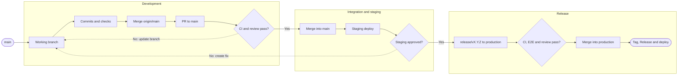

# GitHub Flow

This document defines how StarDust changes move through GitHub: branching,
commits, Pull Requests, review, CI, integration, staging, deployment and
releases.

The project uses a **trunk-based flow with a release branch** and two permanent
branches:

- `main` is the integration branch. Every change merges into it through a Pull
  Request and the Web App is deployed to staging from it.
- `production` represents the version currently released to production. It
  only receives release Pull Requests.

Every change starts from `main` and returns to `main` through a Pull Request. A
version reaches `production` only through a release Pull Request from
`release/vX.Y.Z`, created from a snapshot of `main`.

---

## Permanent branches

| Branch       | Responsibility                            | Deployment                                           |
| ------------ | ----------------------------------------- | ---------------------------------------------------- |
| `main`       | Integration of approved changes           | Web staging; Server, Backoffice and Crew CD          |
| `production` | Published production state of the Web App | Web production, through the published GitHub Release |

Rules:

- do not develop directly on `main` or `production`
- do not push directly to `main` or `production`
- integrate changes through Pull Requests
- every working branch starts from the latest `origin/main`
- every regular Pull Request has `main` as its base; never open a PR that
  targets a personal or intermediate branch
- do not create production tags or GitHub Releases manually; the
  `create-release.yaml` workflow does it after the release PR is merged

---

## Branch naming

Working branches follow this format:

```text
<category>/<short-kebab-case-description>
```

Categories in use:

| Category   | Purpose                                      | Example                                   |
| ---------- | -------------------------------------------- | ----------------------------------------- |
| `feat`     | New functionality                            | `feat/notes-drawer`                       |
| `fix`      | Defect correction                            | `fix/challenge-initial-code`              |
| `refactor` | Behavior-preserving restructuring            | `refactor/ai-assistant`                   |
| `chore`    | Maintenance, configuration or infrastructure | `chore/supabase-local-development`        |
| `docs`     | Documentation                                | `docs/translate-documentation-to-english` |
| `test`     | Test coverage or test infrastructure         | `test/<short-description>`                |
| `ci`       | GitHub Actions and automation                | `ci/dependabot-group-guards`              |

The release branch is the only other allowed shape:

```text
release/vX.Y.Z
```

Naming rules:

- use only lowercase letters, numbers, `/` and `-`
- use kebab-case for the description
- keep the name short and tied to one intent
- do not include a person's name
- do not use `main` or `production` as the category

`dependabot/*` branches are created by Dependabot. Do not create `hotfix/*`
branches: an urgent production fix is a regular `fix/*` branch from `main`,
validated in staging and shipped through a patch release.

---

## Development cycle

### 1. Update `main`

```bash
git switch main
git pull --ff-only origin main
```

### 2. Create a working branch

```bash
git switch -c feat/notes-drawer
```

### 3. Read the rules, implement and validate

- read the rules that match the layer before the first edit, as required by
  [`AGENTS.md`](../AGENTS.md) and the [Rule router](rules/rules.md)
- keep the change within the issue or Spec scope
- create or update the required tests
- run the detectors for the changed workspaces and their direct consumers; the
  selection rules are in [`tooling.md`](tooling.md#execução-local-escopada)
- do not include secrets, `.env` files or unrelated local changes

### 4. Create commits

Commits are atomic, grouped by semantic responsibility, and use an emoji prefix:

```text
<emoji> <prefix>(<optional scope>): <description in English>
```

Examples:

```text
🐛 fix(server): align Inngest local discovery port
📚 docs: document server commit rules
🧪 test(web): cover notes drawer manual close flow
```

Never use `--no-verify` or amend without an explicit request. See
[`rules/commit-rules.md`](rules/commit-rules.md) for the approved prefixes and
[`prompts/commit-code-prompt.md`](prompts/commit-code-prompt.md) for the
automated commit procedure.

### 5. Synchronize with `main`

Before publishing, incorporate the latest `origin/main` into the branch with a
merge, not a rebase:

```bash
git fetch origin main
git merge origin/main
git merge-base --is-ancestor origin/main HEAD
```

Resolve simple textual conflicts in files owned by the change while preserving
the intended logic, and validate the result with the affected tests. When a
conflict touches shared contracts, migrations or generated files, stop and align
with whoever owns the concurrent change. The full procedure is in
[`prompts/open-pr-prompt.md`](prompts/open-pr-prompt.md) and
[`prompts/resolve-merge-conflicts-prompt.md`](prompts/resolve-merge-conflicts-prompt.md).

### 6. Publish the branch and open the Pull Request

```bash
git push -u origin feat/notes-drawer
```

Create or update the PR with `gh` against `main`. The `open-pr` skill owns the
title and body contract:

- the title and the description are written in PT-BR
- the title is a short noun phrase, without a Conventional Commit prefix, an
  emoji, or a leading verb
- the body keeps the sections defined by
  [`prompts/open-pr-prompt.md`](prompts/open-pr-prompt.md) (Objetivo, PRD,
  Requisitos afetados, Issues relacionadas, Implementação técnica, Testes
  manuais, Validações automatizadas and Limitações conhecidas)
- the `## PRD` section classifies the PR with a milestone URL or
  `Não aplicável`, because the release workflow reads it for traceability

Dependabot PR titles are translated automatically by
`.github/workflows/dependabot-pr-title.yaml`.

### 7. Review and integrate

After publishing, wait for the CI and the review, and fix failures and review
conversations until the PR is mergeable
([`prompts/resolve-pr-feedback-prompt.md`](prompts/resolve-pr-feedback-prompt.md),
[`rules/pr-review-rules.md`](rules/pr-review-rules.md)). Merge the PR into
`main` only when:

- the scope is clear and reviewed
- all actionable comments are resolved
- all required CI workflows pass
- there are no conflicts with `main`
- skipped validation and known risks are documented

---

## Continuous integration

Pull Requests targeting `main` run the CI of every area their paths touch:

| Workflow                   | Checks                                                                                         |
| -------------------------- | ---------------------------------------------------------------------------------------------- |
| `core-package-ci.yaml`     | Architecture, code, complexity, types, tests and build for `@stardust/core`                    |
| `server-app-ci.yaml`       | Architecture, code, complexity, types, unit and integration tests, and build for `apps/server` |
| `web-app-ci.yaml`          | Architecture, code, complexity, types, unit and integration tests, and build for `apps/web`    |
| `backoffice-app-ci.yaml`   | Architecture, code, complexity, types, unit tests and build for `apps/backoffice`              |
| `crew-app-ci.yaml`         | Checks for `apps/crew`                                                                         |
| `crew-pr-review.yaml`      | Sends the PR to the Crew reviewers and posts the findings as a PR review                       |
| `dependabot-lockfile.yaml` | Regenerates the lockfile on dependency changes                                                 |
| `dependabot-pr-title.yaml` | Translates Dependabot PR titles                                                                |

Each CI workflow is filtered by paths, so a PR only runs the workflows of the
areas it changes. The CI runs the full suites; locally, run only the scope
defined in [`tooling.md`](tooling.md#execução-local-escopada).

---

## Staging

Merging a PR into `main` triggers `web-app-staging-cd.yaml` when the change
touches `apps/web`, `packages/core`, `packages/validation` or `packages/lsp`.
It triggers the Web App Coolify webhook for the staging environment.

The staging deployment shares the `stardust-web-staging` concurrency group with
the release E2E workflow, so staging does not change while a release candidate
is being exercised in the browser.

---

## Production deployment

| Component         | Production trigger                                                                                                                         |
| ----------------- | ------------------------------------------------------------------------------------------------------------------------------------------ |
| `apps/web`        | `web-app-production-cd.yaml`, when a GitHub Release is published                                                                           |
| `apps/server`     | `server-app-production-cd.yml`, on push to `main` that touches the Server or its packages; applies migrations before requesting the deploy |
| `apps/backoffice` | `backoffice-app-production-cd.yaml`, on push to `main` that touches it or its packages                                                     |
| `apps/crew`       | `crew-app-production-cd.yaml`, on push to `main` that touches it, or manually                                                              |

The production jobs use the `production` GitHub Environment. The repository
variable `PRODUCTION_RELEASES_PAUSED` must be `false` for the normal Web and
Server deployments to proceed; set it to `true` to pause production releases.

`packages/*` have no independent deployment. They are built, tested and shipped
through their consuming applications.

---

## Release Pull Request

When `main` is approved in staging, create a release PR:

```text
release/vX.Y.Z -> production
```

The release branch is created from the exact SHA of `origin/main` and receives
no additional commits before the PR is opened. Use
[`prompts/create-release-pr-prompt.md`](prompts/create-release-pr-prompt.md) to
analyze the included PRs and affected PRDs, calculate the SemVer version and
create the PR with `gh`. The prompt presents the draft first; the PR is only
created or updated after explicit approval.

### Title and metadata

The title is exactly:

```text
Release vX.Y.Z
```

The branch name must match the version in the title. The body is written in
PT-BR and is reused as the GitHub Release notes. Do not enable auto-merge; a
responsible person merges the release PR manually after CI, review and staging
validation.

### Release E2E

`hermes-e2e-testing.yaml` runs on release PRs. It verifies that the staging Web
App is available (it does not deploy), runs the E2E tests of the PRDs listed in
the PR on staging and publishes the requirements matrix on the PR. Release
branches must keep the exact SHA that was validated.

### Merge

Merging into `production` triggers `create-release.yaml`, which validates the
title and the branch, checks that the merged tree equals the validated head tree,
checks that the release E2E run succeeded, creates the annotated tag and the
GitHub Release, and publishes the links on the PR. Publishing the GitHub
Release triggers the Web App production deployment.

### Correcting an open release PR

Keep the existing release PR open when a problem is found before merge.

| Problem                                 | Correct action                                                                                                                         |
| --------------------------------------- | -------------------------------------------------------------------------------------------------------------------------------------- |
| Incorrect title, version or description | Edit the same release PR                                                                                                               |
| Transient GitHub Actions failure        | Rerun the failed workflow                                                                                                              |
| Code defect or additional functionality | Create a `fix/*` or `feat/*` branch from `main`, merge it into `main`, then create a new release branch from the new `origin/main` SHA |

Do not:

- commit directly to `release/vX.Y.Z` or to `production` to repair a release
- merge while CI or review is pending

If a problem is discovered after the merge into `production`, create a new fix
through `main` and publish a new patch release, for example `v1.8.2 -> v1.8.3`.

---

## Lifecycle

The diagram shows the successful path.


